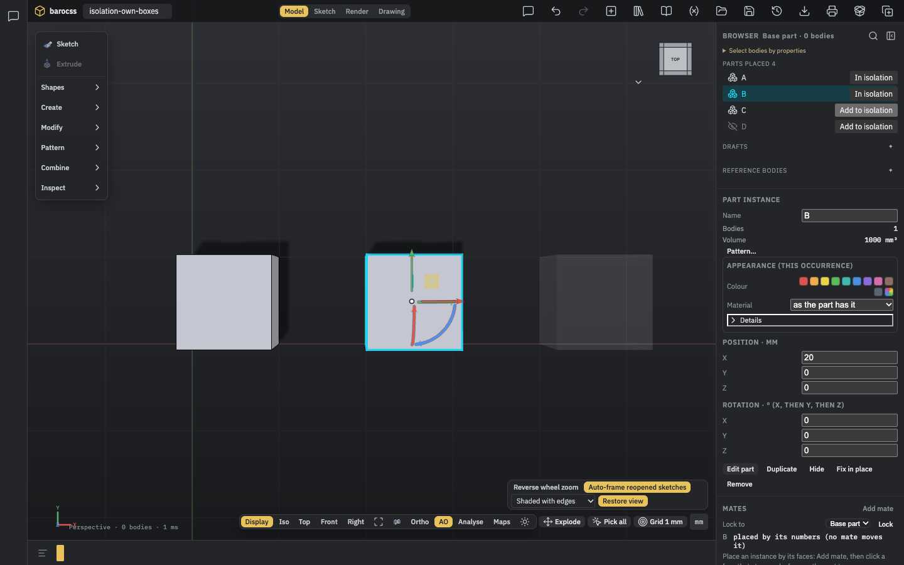

# #235 — Explicitly add a placed part to isolation

Bounded actual WebGPU acceptance on synthetic A/B/C boxes and hidden D. This is not whole-issue completion or general display-mode qualification.

## Implementation and focused checks

Parent `1bbb146ff77cc1d1f29325875249cec0d54bd87f`. A private admission helper validates exact top-level IDs, visible current native solid results and every existing isolated member. App retains the session-state write authority and rejects stale document/evaluation/worker/open scopes and active operations. Outliner receives a composition action slot rather than new display-state ownership. Existing isolation pruning, Restore, selection, authored state and shared GPU code are unchanged. Focused input clicks preserve the draft and explain how to retry.

Final focused tests 11/11 (four new admission/composition checks plus seven existing Browser checks), Studio type check and affected-file ESLint all exit 0. Driver syntax and whitespace checks pass.

## Actual result

**PASS, run02.** Isolate A, then select B's Browser row: B and C remain faded, so selection does not implicitly enlarge isolation. Clicking the separate **Add B to isolation** action preserves B selection and leaves A/B opaque while C remains faded and D hidden. Already-included A/B and hidden D actions are disabled.

Existing renderer diagnostics confirm A/B `surface: 2`; C has `surface: 0`, `transparent: 1`, `oit: 1`. Before the explicit action, selected B also has only those faded passes. Existing renderer raycast at fixture face centres hits A/B after Add, but not C/D. This uses existing diagnostics, not a new opacity or GPU API.

Escape clears selection without losing isolation. During Measure, Add C is disabled and programmatic button click has no effect; the measurement operation stays open. Leaving Measure retains A/B isolation. Restore view returns all visible A/B/C to ordinary passes and picking. Accepted public file Open resets isolation and removes the additive actions.

The document (including every instance's feature history and placement), camera, dirty indicator and Undo/Redo button states remain exact across isolation operations. The root has zero feature nodes: its history DOM is legitimately empty and is not independent proof of nonempty history preservation. Recursive document equality is the authored-history evidence here.



Implementer reviewed all three actual screenshots and root independently reviewed the A/B-isolated image; the copied image contains only the synthetic fixture and no personal/account data. No compositing or simulated UI.

## Reproduce

From `apps/cad-studio`, Node 22 with local PW_DIR/CHROME, whole-checkout source freeze and shared heavy gate:

```sh
ISOLATION_ADD_FROZEN=1 node test/instance-isolation-add-browser.mjs /tmp/cad-instance-isolation-add-02
```

- Run02: PASS, zero browser errors/downloads, context/browser/server cleanup complete; 514 frozen sources unchanged through cleanup.
- Run01: FAIL before feature acceptance. The root fixture omitted `nextId`; normal file admission added `nextId: 0`, causing the exact-document wait to time out. Explicit `nextId: 0` corrected only the driver fixture. Original failure retained, not counted as a product failure.
- Driver syntax check: PASS. Root reported final Studio build PASS (4.96 s, exit 0; `/tmp/cad-isolation-add-build.log`). Focused/type/lint evidence is coordinated separately, not claimed from this browser run.

## Limits

Actual renderer evidence is WebGPU only. WebGL fallback, nested occurrence addition, deletion/Undo, linked-source replacement, delayed replies, every blocked mode, Save/reopen persistence and full #235 acceptance are NOT_RUN here. Measure is the one actual blocked-operation case. No shared GPU code, geometry algorithm, file schema, WIP or HOLD scope changed by this driver. Root owns final issue status and integration.
