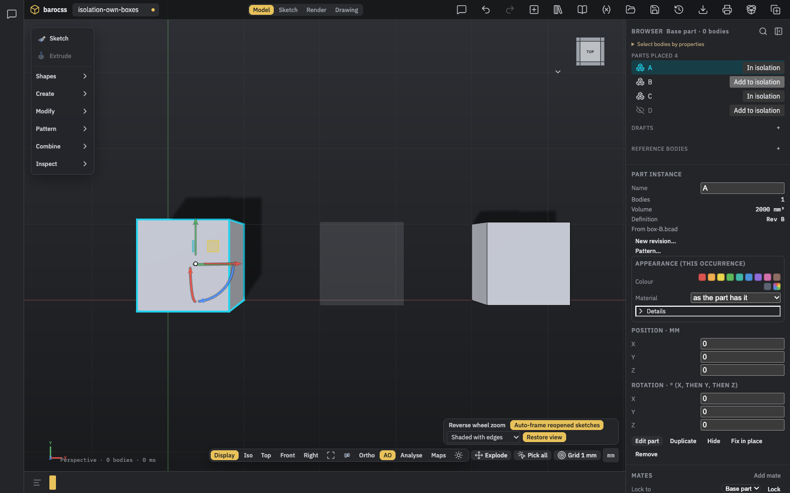

# #235 isolation lifecycle acceptance — 2026-11-17

Test/evidence only. This adds a separate `--lifecycle` branch to the existing driver, not a new product behavior or a whole-issue completion claim.

## Actual bounded results

Final run `/tmp/cad-instance-isolation-lifecycle-02`: **PASS**, desktop Chrome WebGPU. All 514 frozen source entries remained unchanged; no errors or downloads; context, browser and server closed.

- Isolate A and explicitly add B. Remove B through the public Instance UI. The saved isolation snapshot is deliberately not pruned: C cannot be added, including a forced click, and the document/camera/dirty/Undo state remains unchanged by that refusal.
- Undo restores the same B and original A/B isolation. C then supports explicit addition. This verifies the existing snapshot policy, not a new automatic recovery policy.
- Open a synthetic linked A revision, isolate A, choose a public **New revision file**, then **Accept Rev B**. Hold the original actual `placed` response and subsequent same-worker callbacks FIFO. Add C is disabled and a forced click has no effect until current geometry is available.
- Passive outgoing wire-table observation proves held request id/revision **11/11**, nativeSource epoch **1**, requestId **11**, revision **11**, slot **placed**, and the actual extrude height **20**. No product request or response payload is rewritten. Only delivery timing changes.
- Release original callbacks FIFO. Current A bounds are exactly `[0,0,0]` to `[10,10,20]`; B/C remain their literal 10 mm cubes at x20/x40. Explicit Add C now succeeds: A/C opaque, B faded, hidden D absent. Accepted revision document and selection are preserved; the display-only Add does not change document/camera/dirty/Undo state.

The Volume panel checks **1000 → 2000 mm³** are rounded UI readouts, not full-precision native-mass assertions. Independent literal geometry is checked through exact evaluated bounds. Root history is legitimately empty; recursive document equality and Undo/Redo controls are the meaningful authored-history invariants.



Actual final pixels reviewed by implementer and parent: A/C in isolation, B faded, D hidden, A shows Rev B and 2000 mm³. Synthetic fixture only; no personal information. Parent additionally reviewed the deleted-member refusal screenshot.

## First run retained

`/tmp/cad-instance-isolation-lifecycle-01` is preserved as **FAIL (harness)**. Deletion/Undo checks passed, but the diagnostic read `WireDoc.doc.nodes[1]` even though wire nodes use `ids`/`added`. The driver was corrected to observe the original outgoing per-worker table, then the bounded run passed. This is not evidence of a product defect.

## Reproduction and limits

From `apps/cad-studio`, with the established heavy gate, Node 22, `PW_DIR`, `CHROME`, and all checkout writers frozen:

```sh
ISOLATION_ADD_FROZEN=1 node test/instance-isolation-add-browser.mjs /tmp/cad-instance-isolation-lifecycle-new --lifecycle
```

See `qualification.json` for receipt, screenshot and driver hashes and actual observations. Driver syntax and `git diff --check` are checked for this test-only change; product type/build are not repeated.

**NOT_RUN here:** Save/fresh project Open persistence, representative downstream consumers, WebGL, nested occurrences, and the complete blocked-mode matrix. No claim that all #235 acceptance is complete. No native/renderer/shared GPU implementation changes, protected WIP changes, or HOLD activation.
