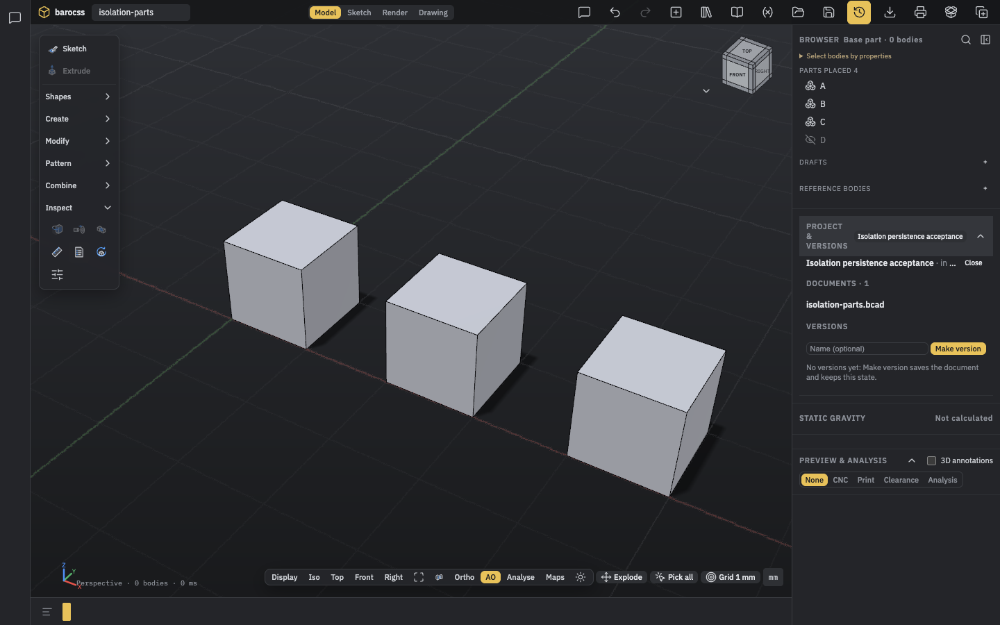

# #235 — Isolation persistence and consumer acceptance

Test/evidence only, 2026-11-17. Parent `fa89811a3`; no product changes.

## Actual result

`/tmp/cad-isolation-persistence-01`: **PASS**, session exit 0. Named OPFS file `isolation-parts.bcad` is read only after its actual `FileSystemFileHandle.createWritable` stream's original `close()` completes. The observation wrapper forwards all original calls unchanged.

- Baseline Save and Save while A/B are isolated are **3976 bytes exactly equal**, SHA-256 `e10be770af187df79624fd0d4243d775d6c1a8c4be10effa77363dbcb65e6c64`.
- Close project → page reload → reopen the browser project → public file Open preserves the entire authored document, including all four occurrence IDs, geometry, placements, each `part.id/rev/source`, and hidden D. No additive-isolation actions remain: the session isolation is reset.
- Actual BOM before isolation, while A/B are isolated, and after fresh Open has exactly the same rows and totals: **one grouped row, Qty 4; 4 parts, 0 bought elements, 10.8 g**. The four identical solids are grouped by shape/material. Existing top-level hidden D is included by BOM policy; viewport visibility is only A/B/C, and isolation opacity only A/B. This is a literal four-part expectation, not just equality of possibly empty results. The table does not expose each occurrence ID; those identities are verified separately by exact authored Doc/file comparison.
- `errors`, `consoleErrors`, frozen-source `changes`, and `downloads` are empty. Context, browser and server closed. No native CLI or physical download.



Both actual screenshots were reviewed: the first shows A/B opaque and C faded; fresh Open shows A/B/C ordinary and D hidden. Parent independently reviewed the final pixels and receipt. Synthetic fixture only, no personal/account information.

## #235 bounded acceptance map

Product and initial actual evidence: [450f6eee7](https://github.com/barocss/cad/commit/450f6eee7), [initial note](../instance-isolation-add-2026-11-17/README.md). Lifecycle evidence: [fa89811a3](https://github.com/barocss/cad/commit/fa89811a3), [lifecycle note](../instance-isolation-lifecycle-2026-11-17/README.md).

| Original proposed contract | Evidence / retained boundary |
|---|---|
| 1. Visible top-level solids; explicit A→A+B, no passive selection addition, duplicate no-op | Initial actual A/B/C/D flow, render passes and raycasts; helper exact ID/current solid validation. Already-included action disabled; pure test preserves array identity on duplicate. |
| 2. Temporary display only; no geometry/placement/hidden/material/selection/camera/history changes; Restore | Initial exact authored Doc/camera/dirty/Undo checks, selection-clear/Restore actual; this run full Save bytes equality. Root history is empty, so recursive Doc equality is the authored-history evidence. |
| 3. Hidden/deleted/unresolved/stale IDs refused without replacing membership | Pure hidden/duplicate/missing/stale tests; actual hidden D; lifecycle deletion refuses Add without pruning. Undo restores original occurrence and prior isolation under the existing session-ID policy. |
| 4. Nested selection not silently promoted | Action slot rendered only on top-level rows; focused nested-row regression. No nested-only isolation claim or change to existing `hostsOf` behavior. |
| 5. One display authority; blocked operations and stale callbacks | App exact Doc/evaluated/worker/open/generation owner plus live command guards; actual Measure refusal; held linked revision FIFO response test disables Add until current result, then allows explicit Add. No renderer ownership rewrite. |
| 6. Full source retained for output consumers | State exists only in App/renderer, not Doc. This run actual BOM Qty4 and full OPFS file/fresh Open prove a representative consumer and storage boundary are not reduced to isolated A/B. |

Pure/focused checks: **11/11 PASS** (4 new admission/Outliner cases plus 7 existing Browser cases), Studio type-check and scoped lint PASS in product validation. Initial/lifecycle notes retain the first harness failures and corrected results. This test adds driver syntax/lint PASS and one actual persistence/consumer run; no redundant product build/type execution.

**Recommendation:** the issue's narrow first scope is complete with the combined product, actual display/pick, lifecycle, persistence and representative-consumer evidence. This is not complete assembly/viewer qualification.

**NOT_RUN / excluded:** actual WebGL fallback, every blocked mode exhaustively, nested occurrence addition, and separate STEP/drawing export file runs. Existing shared GPU code is unchanged. The source-only session-state boundary, exact full Save bytes and actual full BOM provide impact-based consumer coverage; they do not claim those unexecuted exports passed. No manufacturing/schema/kernel/HOLD or protected WIP changes.

## Reproduce

From `apps/cad-studio`, using Node 22, the established heavy gate, `PW_DIR`, `CHROME`, and all checkout writers frozen:

```sh
ISOLATION_PERSISTENCE_FROZEN=1 node test/instance-isolation-persistence-browser.mjs /tmp/cad-isolation-persistence-new
```

`qualification.json` records compact original receipt observations and driver/screenshot/receipt hashes. No file is downloaded or published by the test.
