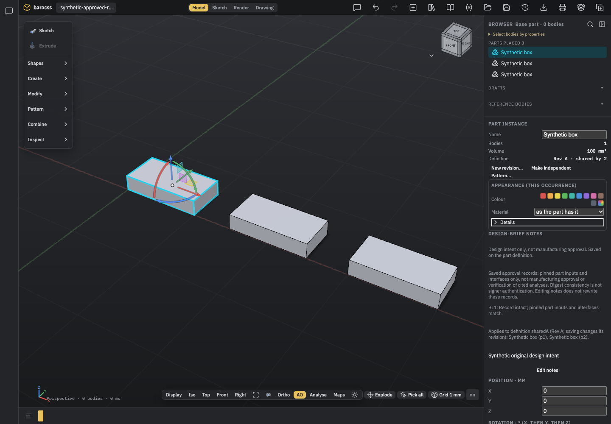
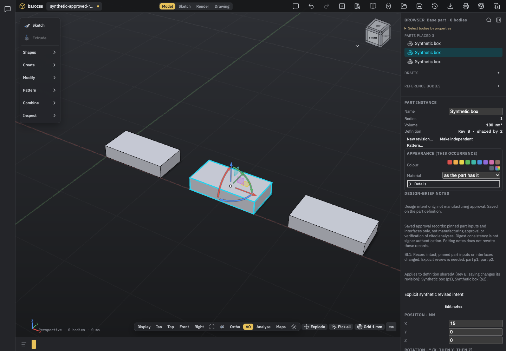
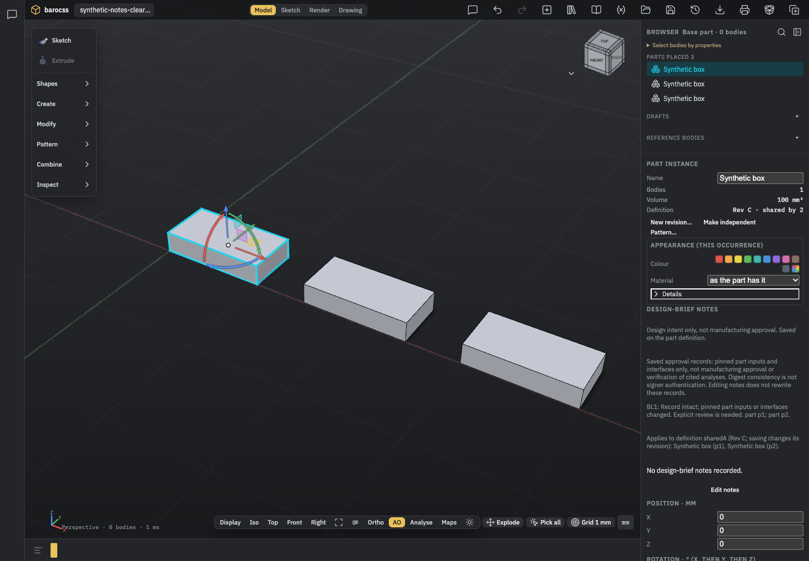

# Definition notes: saved approval-record status

Parent `d619440863d7d164fe8a5efcf0f058b57125a2da`. Issue #274 remains **OPEN** beyond this bounded read-only status feature.

## What changed

The existing definition-note editor now shows the consistency of saved approved records against their pinned part inputs and interfaces. It distinguishes matching pins, changed pins requiring explicit review, and unverifiable records. Save/Clear do not rewrite the records. There is no new approval action, schema or signed identity claim.

Digest consistency is **not signer authentication**. This display does not establish manufacturing approval, cited-analysis freshness or a complete current approval of the assembly. It uses the existing baseline verifier only after bounded read admission; malformed/ambiguous records fail closed rather than appearing current.

Product files: `src/state/noteBaselineStatus.ts`, `src/ui/NoteBaselineStatus.tsx`, and the composition in `src/ui/InstanceBriefNotes.tsx`. Focused tests: `test/note-baseline-status.test.ts`. Actual driver: `test/instance-note-baseline-browser.mjs`.

## Actual first run: PASS

`/tmp/cad-note-baseline-after-01`, Chrome WebGPU 1440×1000. No prior actual failure or retry in this task.

The fixture contains three fixed, joint-free synthetic boxes: p1/p2 share definition sharedA; p3 is independentB. The seed is first opened through the public file UI and compared exactly with the accepted document. The test then creates BL1 through the actual `bomView → deriveBom → draftBaseline → moveBaseline(review) → moveBaseline(approved)` APIs, using test-only synthetic user tokens and fixed synthetic timestamps. This is **not an actual user's approval**. The generated fixture is opened publicly and must initially verify intact/current with exact accepted document equality; no solve/currentness mismatch is hidden.

1. Initial UI: record intact, pinned part inputs and interfaces match.
2. Public Save notes on p1 updates the shared p1/p2 definition; BL1 remains byte-equivalent JSON but reports changed p1/p2. p3 remains exact.
3. One Undo returns the complete original document and matching status. Redo returns changed status.
4. Public Clear note removes the saved field for both shared members. The record remains intact/changed. Undo/Redo reproduce exact documents and status.
5. Actual native Save downloads a **5421-byte** `.bcad`. A fresh browser context opens it exactly and still shows changed p1/p2 and no saved note. No approval record is silently updated.

The independent Python JSON oracle checks full baseline JSON preservation through Save/Clear/reopen, exact p3 preservation, p1/p2 equality, and all other definition data and placements unchanged. The product verifier is separately called against each observed accepted document; it is not presented as an independent cryptographic oracle.

- Saved file SHA256: `c3111534eca0e1cf610a3cf9e8e03a48d527fea40ac1369a71e3de4908d34820`.
- Independent canonical baseline-JSON SHA256: `faa3e400dd5686d349501ee55bf3d951400badef486ba5cd4cfbf795208f746a`.
- Source capsule **1265 files** unchanged before/after/after cleanup. The initial subset is not the complete capsule.
- Page/console errors and watched changes: zero. Two contexts, browser and server closed normally; source freeze then released.

[Curated receipt](receipt.json), [synthetic approved fixture](synthetic-approved-fixture.bcad), [actual saved file](saved.bcad), [independent parser](independent-oracle.py), [oracle input](oracle-input.json), [oracle result](oracle-result.json).





All three screenshots were directly inspected for readability/privacy. The shared-Save and fresh-Clear screenshots were also independently reviewed, as were the downloaded file and baseline/p3 preservation. All names/text are synthetic; no personal information.

## Verification and first compile failure

- Final focused **20/20 PASS**, comprising new10 baseline-status cases and adjacent10 existing instance-note cases.
- Studio TypeScript and targeted lint PASS.
- Driver syntax/lint PASS.
- Post-actual Studio production build **5.53s PASS**.
- Initial TypeScript check failed on the intentionally malformed `baselines:null` test fixture's direct `StudioDoc` cast (TS2352). The test cast was corrected through `unknown`, then final checks passed. This was a fixture typing failure, not an actual runtime failure; the original diagnostic is retained in [logs](logs.txt).

Focused tests cover malformed/duplicate/parent/unsafe-key admission, shared/independent changes, nonmutation and static rendered wording. Those negative cases were **not** all run in the browser. Actual evidence above covers the valid synthetic approved record, shared Save/Clear, Undo/Redo and real file round trip. No broad native geometry/mass suite was repeated; fixture BOM evaluation is setup, not a new mass-accuracy certification.

## Reproduction and custody

Use Node22 and existing dependencies; acquire the shared heavy gate before expensive checks. Final test/type/lint logs are the `final2` files listed in logs.txt. Public log copies remove ANSI and trailing whitespace and replace the home prefix with `<HOME>`, retaining each original raw file SHA256.

```sh
cd apps/cad-studio
node scripts/test.mjs note-baseline-status instance-brief-notes
pnpm exec tsc --noEmit -p .
pnpm exec eslint src/state/noteBaselineStatus.ts src/ui/NoteBaselineStatus.tsx src/ui/InstanceBriefNotes.tsx test/note-baseline-status.test.ts
node --check test/instance-note-baseline-browser.mjs
pnpm exec eslint test/instance-note-baseline-browser.mjs
PW_DIR="$HOME/.cache/barocss-playwright" \
CHROME='/Applications/Google Chrome.app/Contents/MacOS/Google Chrome' \
NOTE_BASELINE_FROZEN=1 node test/instance-note-baseline-browser.mjs /tmp/cad-note-baseline-after-01
pnpm build
```

The actual output folder is preserved evidence; a future rerun should use a new path. `flow-helper.mjs` bundles the existing API inspector and hashes its source inputs together with the Studio capsule before/after/cleanup. No product payload or worker result was altered. Existing WIP/HOLD, baseline decision APIs and note eligibility limits remain unchanged.
