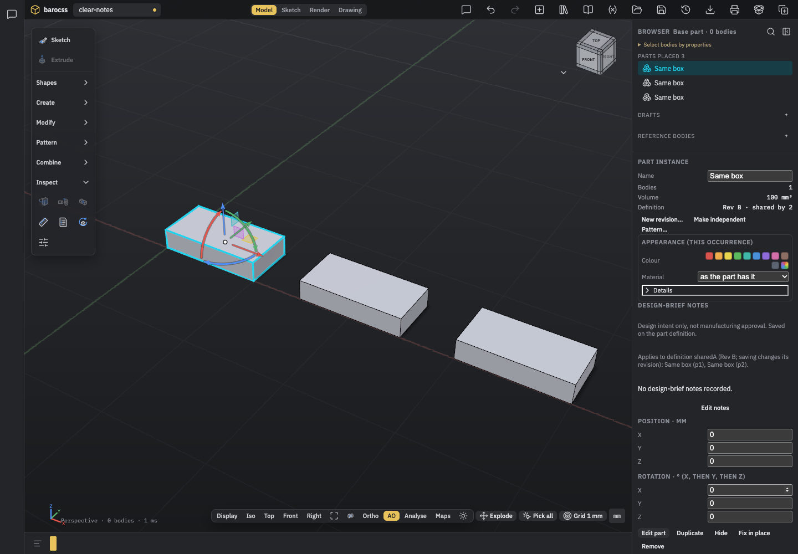
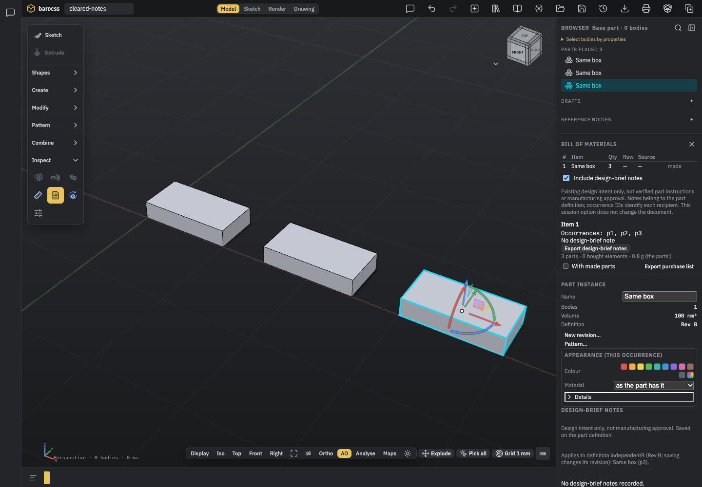

# #274 Explicit Clear note acceptance — 2026-11-17

Base: `1227d514cd951723a789a604be205701f481d164`. Narrow addition to the existing ordinary definition note editor; not a claim that all of #274 is complete.

## Contract

- Clear note is explicit, inside Edit notes. Empty Save remains rejected.
- Clear deletes the entire saved `Brief.notes` Field, including its provenance. Other brief fields, geometry and placements remain unchanged. A version-1 brief container remains even if notes was its only optional field.
- Existing eligibility, exact shared definition/revision ownership and central commit are reused. Linked, pending, nested, patterned, library, fastener and bought definitions are not newly supported.
- Save/Clear share the existing live owner/session admission. Successful Clear ends the session and discards its unsaved draft; failed commit keeps the editor. No saved note is a no-op and the UI disables Clear.
- No approval record is rewritten or reused as fresh confirmation. Record preservation is not certification of approval currentness.

## Evidence

| Boundary | Result |
| --- | --- |
| Pure helper + existing session tests | 10/10 PASS: shared/independent deletion, unrelated fields, original immutability, exact no-op, exclusions, session admission |
| Actual shared p1/p2 | Both notes removed together, shared revision A→B; p3 unchanged; exactly one Undo/Redo restores/reapplies |
| Actual independent p3 | Only p3 notes removed; exactly one Undo/Redo; all authored node/brief-purpose/placement values retained |
| Pending text | Explicit Clear discards the uncommitted text; afterward no-note Clear and empty Save disabled; Cancel unchanged |
| BOM | Quantity 3 and totals unchanged; default purchase CSV exact bytes unchanged; opt-in notes CSV maps p1/p2/p3 to `absent` without a Field |
| Actual Save/fresh Open | Browser download `saveAs` completed, saved JSON equals accepted document, new browser context Open retains absence and original geometry definitions; note opt-in resets |
| Independent CSV oracle | Python standard csv + JSON parsing, no product imports; both before and after fresh Open PASS |

Actual run: `/tmp/cad-instance-note-clear01`, receipt PASS, browser session exit 0, errors/console errors/changed frozen files all zero; contexts/browser/server cleaned up. `qualification.json` retains compact results and file hash. The native file was actually downloaded and read; CSVs were captured from the application Blob boundary, not claimed as downloaded files. No native CLI inspector was executed.

Saved native SHA-256: `6bfac42fa581c0a6f60974c0f965278bfe38510216f869227c5452694286095a`.




Root inspected the original 01/03/05 images. These show the deletion results, not the Clear button itself. Synthetic fixture only; no private user data.

## Commands and logs

From `apps/cad-studio`, Node 22.19.0 and the shared heavy gate:

```sh
node scripts/test.mjs instance-brief-notes
../../node_modules/.bin/tsc --noEmit
../../node_modules/.bin/eslint src/state/instanceBriefNotes.ts src/ui/InstanceBriefNotes.tsx test/instance-brief-notes.test.ts
node --check test/instance-note-clear-browser.mjs
../../node_modules/.bin/eslint test/instance-note-clear-browser.mjs
NOTE_CLEAR_FROZEN=1 node test/instance-note-clear-browser.mjs /tmp/cad-instance-note-clear01
../../node_modules/.bin/vite build
```

Focused `/tmp/cad-clear-note-tests.log` (10/10), type `/tmp/cad-clear-note-tsc.log`, lint `/tmp/cad-clear-note-lint.log`, driver lint `/tmp/cad-clear-note-driver-lint.log`, actual `/tmp/cad-instance-note-clear01.log`, final production build `/tmp/cad-instance-note-clear-build.log` (`built in 5.26s`). No failed product/browser attempt preceded this passing run. A later read-only housekeeping command encountered sandbox restrictions on `ps`/heredoc; an authorized read confirmed the build had finished. No validation was rerun for that inspection issue.

## Limits

Approval currentness, external linked-revision reconciliation and expanded unsupported instance families are NOT_RUN/outside this change. Session unit simulation is not an actual captured React callback replay. Authored geometry equality and existing BOM totals are demonstrated; new native geometry accuracy or approval validity claims are not made. No schema, solver, manufacturing, shared GPU or protected WIP changes.

Files: `src/state/instanceBriefNotes.ts`, `src/ui/InstanceBriefNotes.tsx`, `test/instance-brief-notes.test.ts`, `test/instance-note-clear-browser.mjs`, this evidence directory. No model changes.

`checks.txt` contains portable checks and hashes. `saved.bcad` is the synthetic actual downloaded file; paired CSV input/output JSON files preserve independent parser evidence. Existing baseline/approval currentness limitations remain unresolved.
