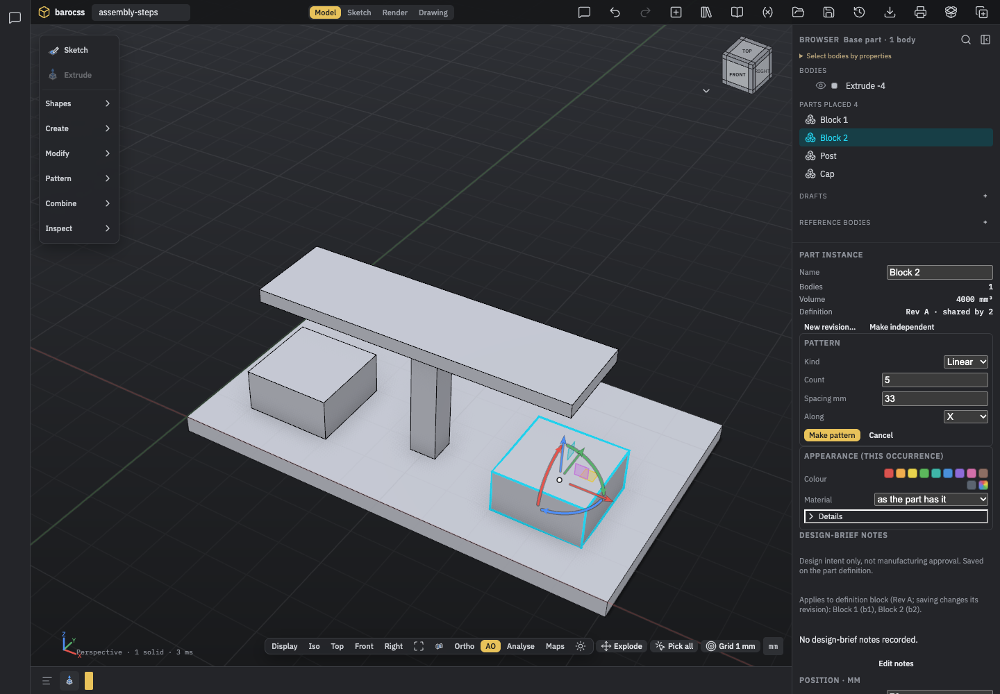
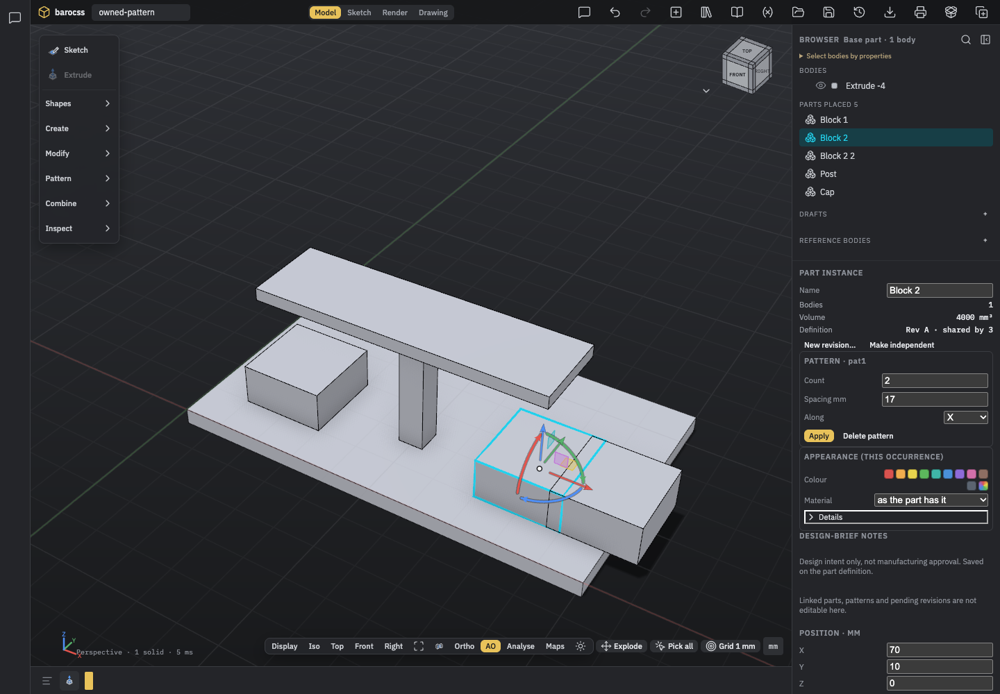

# Pattern drafts belong to the selected instance

Base `d2dd7cdb18be878288e401150b0326ccdca96f6a`. Bounded assembly #178 fix.

## Defect

Open Pattern on unpatterned Block1, type count5/spacing33, then select unpatterned Block2. Both `pattern` props are undefined, so the existing effect did not reset state: Block2 showed Block1's pending controls and values. The creation callback now names Block2, allowing an unrelated draft to be committed to the wrong seed. Actual Chrome baseline failed the expected absence assertion (one form, expected zero). The before screenshot shows Block2 selected with count5/spacing33 left from Block1.

`InstanceInspector` now keys `InstancePatternControls` by the exact instance ID. Selection change remounts only this editor and discards its local open/draft/error state. Same-seed Cancel/reopen retains existing behavior. No Model placement algorithm, schema or API change.

## Evidence

- Baseline actual Chrome: FAIL as above. Fixed first run: PASS.
- Two unpatterned selections: Block2 starts closed and opens with defaults3/20, not Block1's5/33.
- Explicitly author Block2 count2/spacing17. Exact Model readback names seed `b2`, one copy at `[87,10,0]`; all four original instance objects and source documents are preserved.
- Pending edit spacing29 on Block2 is discarded on switching to Block1; returning to Block2 reads accepted17. Block1 starts from default20, not stale33.
- Same-seed Cancel/reopen retains its17 draft, preserving the previous behavior.
- Undo/Redo and actual native Save download/fresh Open PASS. Screenshot reviewed at1440×1000.
- Adjacent draft/mate-pattern tests12/12 PASS. First runner invocation from repository root passed7 but the mate test's nested bundler could not resolve `src/assembly/useAssembly.ts`; rerunning from its required app cwd passed all12. Not a product failure.
- Studio type check, changed-file lint and whitespace checks PASS.

```sh
# from apps/cad-studio (the mate test has a cwd-relative nested bundle)
node scripts/test.mjs instance-pattern-draft mate-pattern-commit
# from repo root, with existing Node22.19/Playwright/Chrome
PATTERN_OWNER_FROZEN=1 PW_DIR=<existing-playwright> CHROME=<Chrome> node apps/cad-studio/test/instance-pattern-owner-browser.mjs <output>
node node_modules/typescript/bin/tsc --noEmit -p apps/cad-studio/tsconfig.json
node node_modules/eslint/bin/eslint.js apps/cad-studio/src/ui/InstanceInspector.tsx
```

Limits: top-level instance selection only. Nested assembly, mate changes, same-ID external document replacement and neutral exchange not qualified by this run. No whole-assembly acceptance or HOLD expansion.



