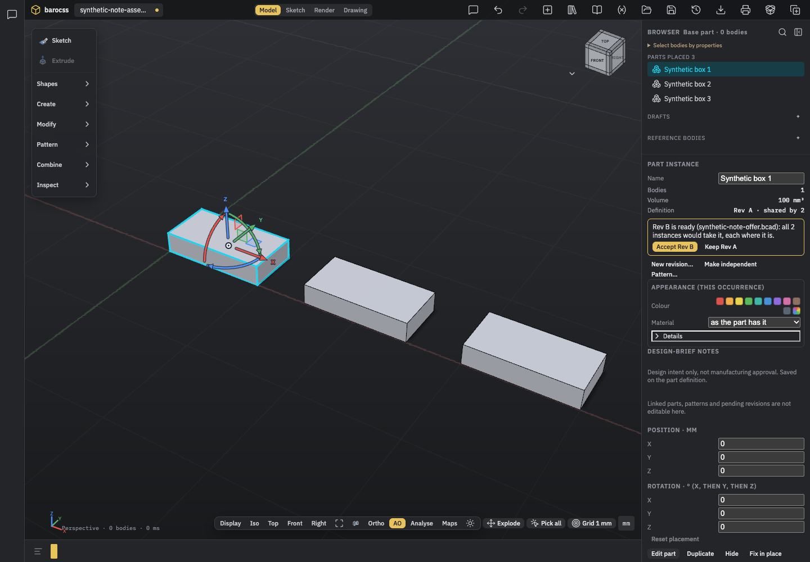
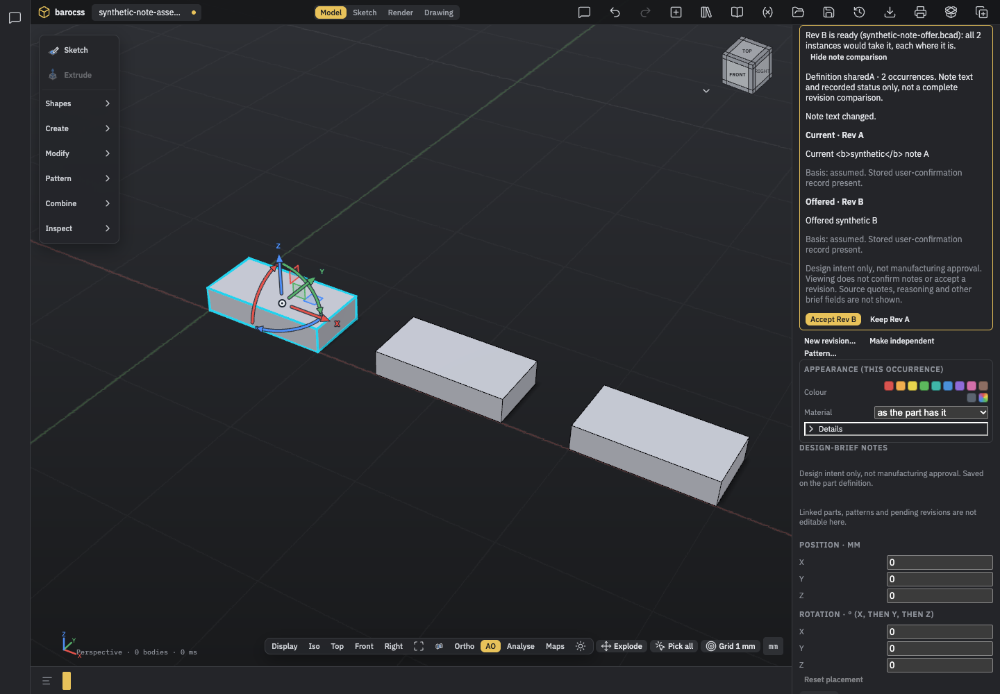

# #274: opt-in revision note comparison

Status: implemented; baseline and final actual03 PASS. Final screenshot visually reviewed by the coordinating reviewer. Commit, push and exact-commit CI are pending. **#274 remains OPEN.**

## Bounded behavior

The selected top-level occurrence's shared definition can show its current and offered design-brief note text before Accept or Keep. Comparison is collapsed by default and opened explicitly. It displays revision IDs, shared count, text, basis, and whether a stored user-confirmation record exists. A confirmation record is not authenticated approval or permission to manufacture.

Source quotes, reasoning, quote-verification values, confirmation timestamps, other brief fields and other owners' notes are not returned by the helper or included in the comparison. Text is rendered as React plain text, not HTML or auto-links. A text-equal metadata change is labeled separately rather than claiming the whole Field is unchanged. Invalid fields or inconsistent shared definitions fail closed without rewriting stored data. Viewing never edits, merges, confirms or accepts notes. Existing Accept/Keep behavior is unchanged.

Disclosure is invalidated by accepted document, selection or offered revision identity changes. Undo does not resurrect prior disclosure consent.

## Evidence

- Baseline01: public New revision file input offered a note-only revision to two shared occurrences; UI exposed revision/name but no current/offered note comparison. Keep and Accept preserved their existing behavior. Receipt PASS, no browser/console errors or tracked source changes, context/browser/server cleanup recorded.
- Actual01: all assertions PASS. Explicit disclosure, literal markup text, comparison-only metadata redaction, shared and unrelated selection handling, same-revision offer replacement, same-content document Open reset, metadata-only change labeling, offered removal, Keep/Accept, Undo/Redo, and a real native download/fresh Open were checked. Two contexts were closed; browser/server cleanup recorded. No browser/console errors or tracked source changes.
- Actual01 screenshots clipped the lower comparison because the synthetic root brief occupied panel space. This is a visual-evidence limitation, not a failed assertion. A fixture-only scroll correction was applied. Actual03 supplies the final complete comparison screenshot.
- Actual02: FAILED final frozen-source qualification. UI assertions finished, but README/verification files were created while the run was active. This was a coordination error: the coordinating owner started the run prematurely while the evidence writer remained active. It is not counted as a qualified pass. Two contexts, browser and server were cleaned up.
- Actual03: final frozen rerun PASS with all flow assertions, zero browser/console errors and zero tracked source changes. Two contexts, browser and server were cleaned up. The coordinating reviewer visually inspected the complete comparison screenshot: both note texts, disclaimer and Accept/Keep are visible.
- Existing Model definition regression: 8/8 PASS; no Model product changes.
- Studio focused regression: 29/29 PASS, zero failures/skips. Studio TypeScript and targeted lint completed with exit 0 (logs empty; exit status reported by execution owner).
- No Model product source changed in this increment. The existing definition tests were run; no additional Model type result is claimed.

Full stored JSON comparisons use the reader-normalized accepted document. Pending/Keep retain it; Accept changes the two shared note Fields and the expected revision/source metadata, preserving root data, placements, geometry inputs, unrelated occurrence and other brief fields. These are data-preservation assertions, not independent geometry or mass certification.

## Privacy and limits

All fixtures and sentinel strings are synthetic. Strings prefixed `PRIVATE` are test markers, not real private information. Redaction claims concern the comparison DOM only: the existing root Brief UI may display its synthetic root note. Raw receipts, complete documents, local paths and machine-specific logs are not published here.

This does not claim linked-source, nested, pattern or asynchronous completion-race coverage; it is not a full revision/geometry diff. No new schema or manufacturing workflow is introduced. Existing HOLDs remain unchanged.

## Reproduction entry points

From repository root, use the matching frozen source capsule for the baseline (it intentionally fails after the comparison exists):

```sh
INSTANCE_REVISION_NOTE_COMPARISON_BASELINE_FROZEN=1 node apps/cad-studio/test/instance-revision-note-comparison-baseline-browser.mjs "$OUTPUT/baseline"
INSTANCE_REVISION_NOTE_COMPARISON_FROZEN=1 node apps/cad-studio/test/instance-revision-note-comparison-browser.mjs "$OUTPUT/actual"
```

Source hashes and run-specific status are in `verification.json`. These commands describe reproduction, not additional runs.

## Selected screenshots





Images contain only synthetic test data. Final visual inspection was performed by the coordinating reviewer.
