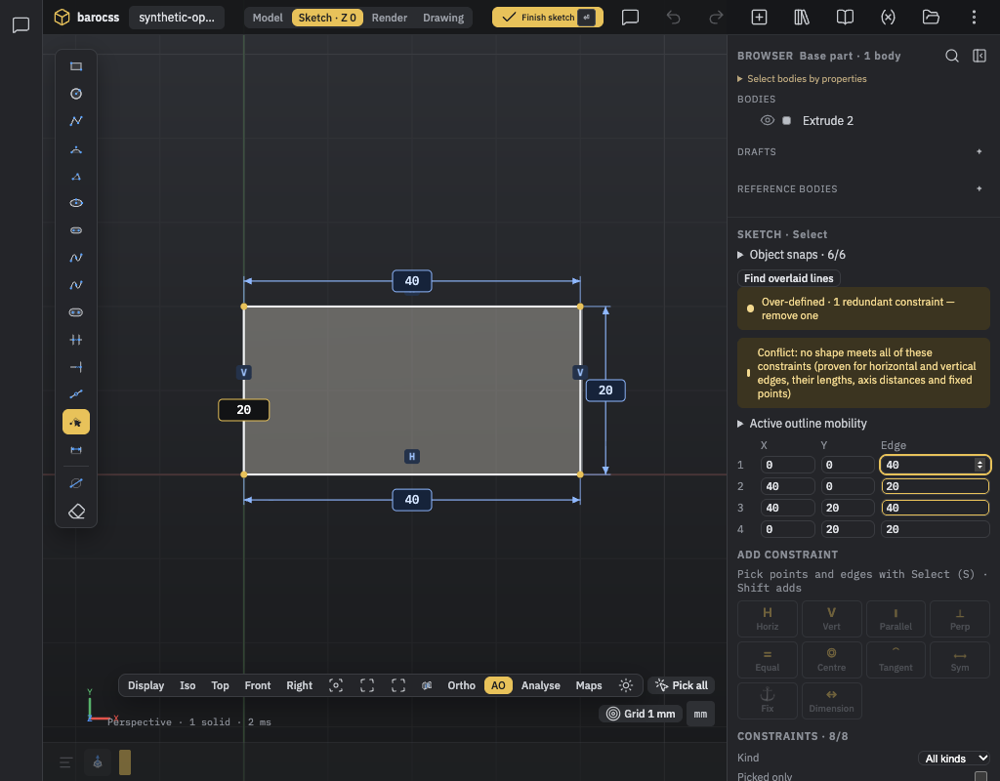
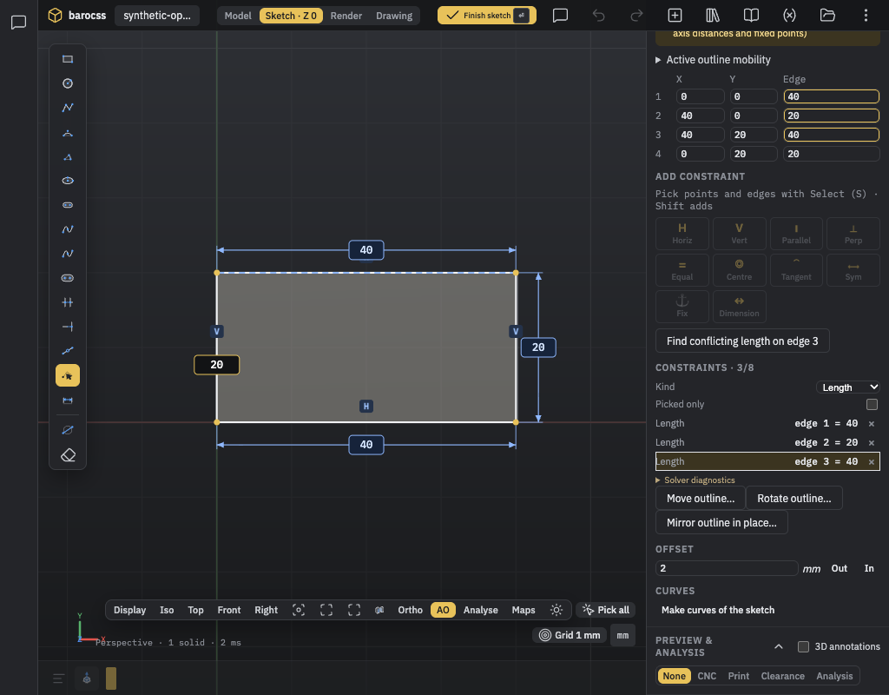
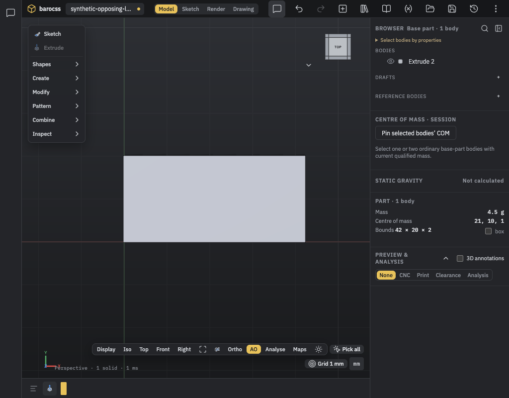

# #21: panel opposing-length conflict recovery

Partial completion of https://github.com/barocss/cad/issues/21. The broad issue remains OPEN.

Base: `2c9897b87ab1dfa3519dff386dd7d18176b72587`.

## Reproduced gap

A synthetic 40 × 20 mm H/V rectangle, extruded 2 mm, has length locks on edges 1/2/3 of 40/20/40 mm. Typing 42 in the Sketch panel's Edge 1 field refused the conflicting edit but did not identify the opposite lock. The same canvas dimension edit already offered “Find conflicting length on edge 3”. Baseline passed with this discrepancy, not a solver failure.

## Narrow change

The panel reuses the existing `opposingLengthConflict` proof and a confirmed `commitDimension` refusal to identify the existing opposite row. Successful and unproven edits retain their prior route. Document/draft/generation and exact active-shape ownership prevent stale callbacks from offering or committing edits. Existing fixed-triangle recovery and canvas handling remain unchanged. No kernel, general solver admission, At-t, material or Rendering changes.

## Verification

- New four-test unit suite plus existing constraint-list, fixed-triangle-inline-ownership and ellipse-axes-recovery: **19/19 PASS**.
- Studio `tsc --noEmit`: PASS.
- Scoped ESLint on App, viewport actions and new unit test: PASS.
- Vite build: PASS.
- Actual Chrome driver `test/panel-opposing-length-browser.mjs`: baseline and actual PASS.
- Panel and canvas: exact `len:2` focus / `edge:2` emphasis, explicit removal, 42 retry, Finish, Undo and Redo PASS.
- Refused panel edit preserves exact document/selection and displayed draft coordinate/length values.
- Result native validity PASS; volume `1680.0000000000005 mm³`, compared with independent rectangle arithmetic `42 × 20 × 2 = 1680 mm³` (not a second geometry kernel).
- No console/page errors or source changes during actual run; frozen product/test hashes unchanged. Contexts, browser and server closed.

Run commands from apps/cad-studio with the established installed dependencies and serialized heavy gate:

```
node scripts/test.mjs panel-opposing-length constraint-list fixed-triangle-inline-ownership ellipse-axes-recovery
../../node_modules/.bin/tsc --noEmit
../../node_modules/.bin/eslint src/App.tsx src/viewport/studioSketchViewportActions.ts test/panel-opposing-length.test.ts
../../node_modules/.bin/vite build
PANEL_OPPOSING_LENGTH_FROZEN=1 node test/panel-opposing-length-browser.mjs <output> --baseline
PANEL_OPPOSING_LENGTH_FROZEN=1 node test/panel-opposing-length-browser.mjs <output>
```

Browser runs additionally require the existing `PW_DIR` and `CHROME` configuration. Baseline runs against the base code, actual against the narrow change.

## Limits

This is one proven straight rectangle opposite-lock path, not general conflict localization. Unit negatives cover missing locks, non-alternating axes, arcs, tolerance/out-of-range values, ordinary successful height edits and stale ownership. Delayed owner races are unit-tested, not induced in Chrome. Save/Open, arbitrary curves/ellipse mobility and broader #21 completion are not claimed. Draft preservation in the browser uses displayed precision; committed documents are compared structurally.

## Actual Studio screenshots

Only synthetic model data; these are actual Studio screenshots, not concept images.

### Before: refusal without recovery target


### After: explicit opposite constraint target and emphasis


### Recovered: accepted 42 × 20 × 2 mm result

