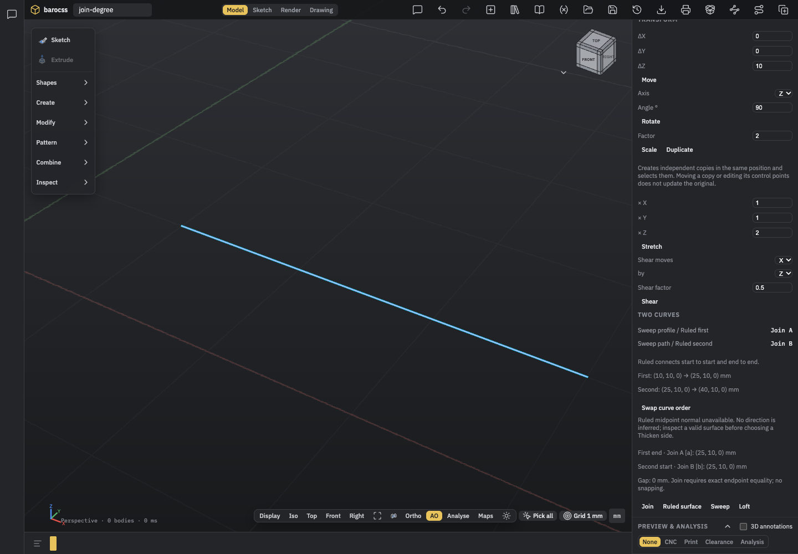
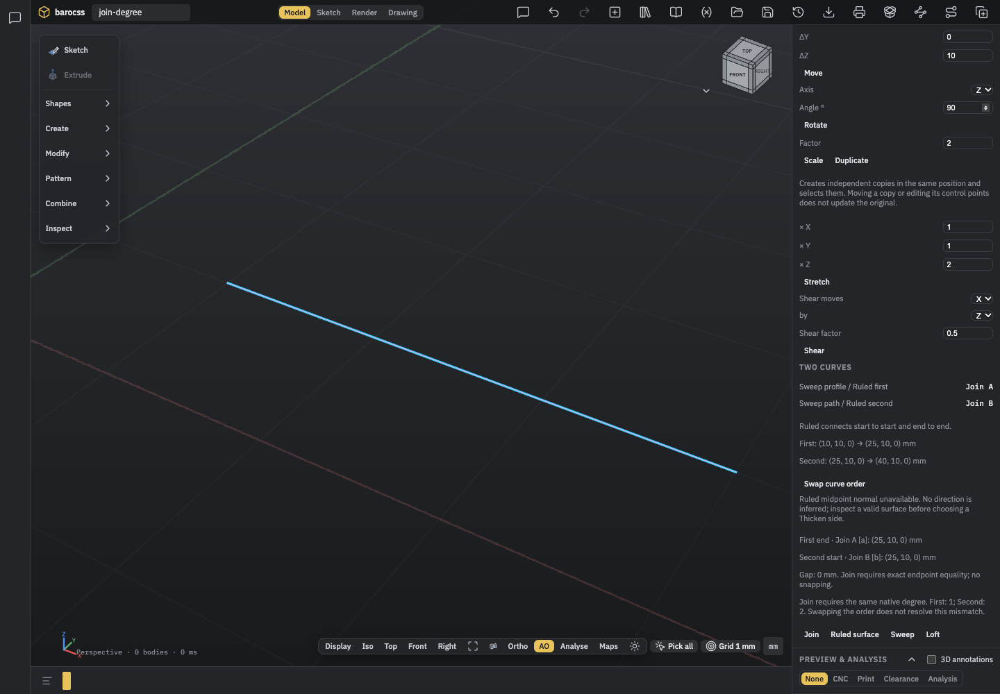
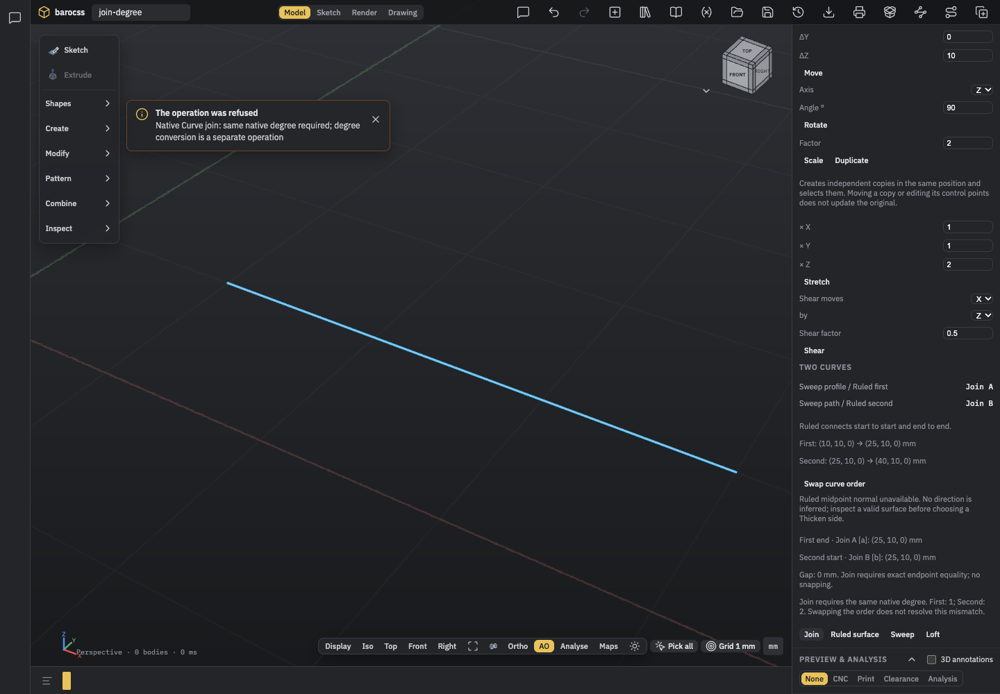

# #29 — exact native Join degree mismatch before Apply

Limited continuation of the existing open #29. Baseline main: `8250151272bcdd0b9db6a23b7bc919c3aa286dcb`.

Synthetic native degree 1 and degree 2 curves share the exact [25,10,0] endpoint. The original UI showed gap 0 without the degree restriction; Join then refused. Reversing that incompatible pair also offered “Swap curve order, then try Join,” although swapping cannot change degrees.

The read-only guidance now uses the already validated native curve degrees and states their ordered values before Join. Only an exact known degree mismatch suppresses the misleading reverse-order retry suggestion. The Swap control, Join button, native admission, geometry, data, save and other operations are unchanged. Same degree is not a guarantee of other native admission constraints, and no degree-conversion remedy is promised.

## Verification

- Baseline01 actual Chrome PASS on clean current main: missing preflight message, native refusal, document and selection unchanged; same-degree explicit Swap → Join → Undo/Redo PASS.
- Focused Join/TwoCurveRoles/Ruled endpoint tests: **9/9 PASS**. Studio TypeScript, scoped ESLint and production Vite build PASS.
- Actual01 same driver, corrected product: ordered 1/2 preflight message; reversed 2/1 message with no erroneous retry; actual native Join refusal and exact document/selection preservation; compatible degree1 Swap → Join → Undo/Redo PASS.
- Both runs: no page errors, no console errors, frozen source unchanged; context/browser/server cleanup confirmed. >= 2 GiB reserve and serialized heavy gate maintained (about 29 → 28 GiB).
- Screenshots below are real Studio pixels of synthetic data, not concepts; inspected at 1440×1000. No personal source, credentials or private metadata.
- Independent source and fixture review passed. Open waits for the exact seed, not a potentially stale general-ready flag. No failed browser run in this unit.

## Evidence

## Limits

Not an all-Join admission preflight, native shape accuracy claim or new Save/Open qualification. Existing #497 endpoint/order/lifecycle evidence remains intact. At-t/Split protected WIP and Rendering HOLD are untouched. #29 remains OPEN for its other original requirements; this is only its exact unequal-native-degree explanation gap.

Dedicated equivalent fixture: `test/direct-join-degree-browser.mjs` (`JOIN_DEGREE_MODE=baseline|actual`, `JOIN_DEGREE_FROZEN=1`, established `PW_DIR`/`CHROME`). The existing full endpoint driver is unchanged and was not redundantly rerun. Raw receipts retained privately; SHA256:

- baseline01: `7ede45b29950aa727f287e185a65dd3665b514ffe9d6670b1150920000228069`
- actual01: `b04b0cb7b2bc1c7b13bbe1dcd614b4b011bf036482e1d2f630a7321a6746afd9`
