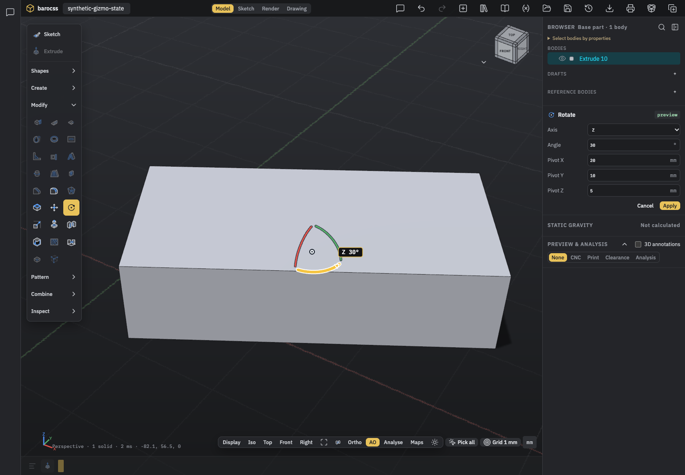
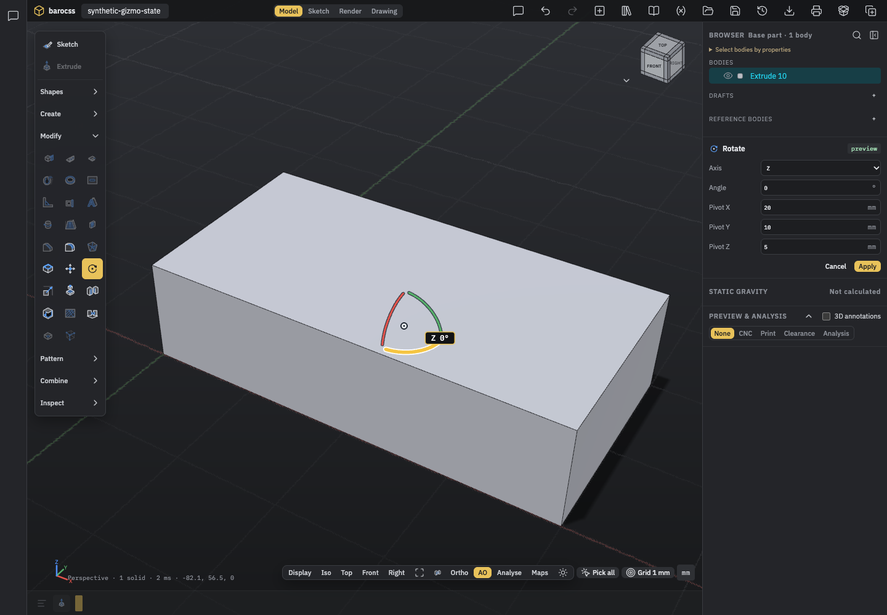
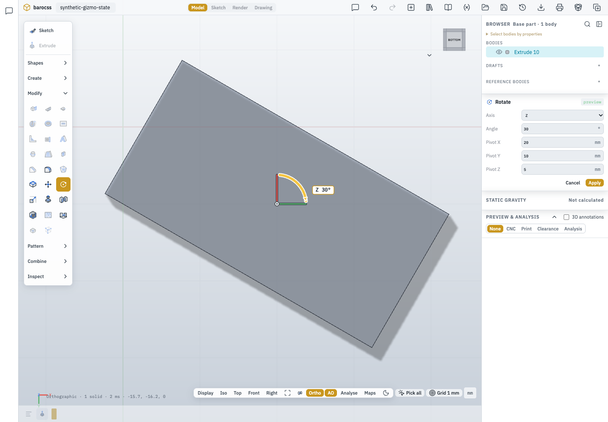
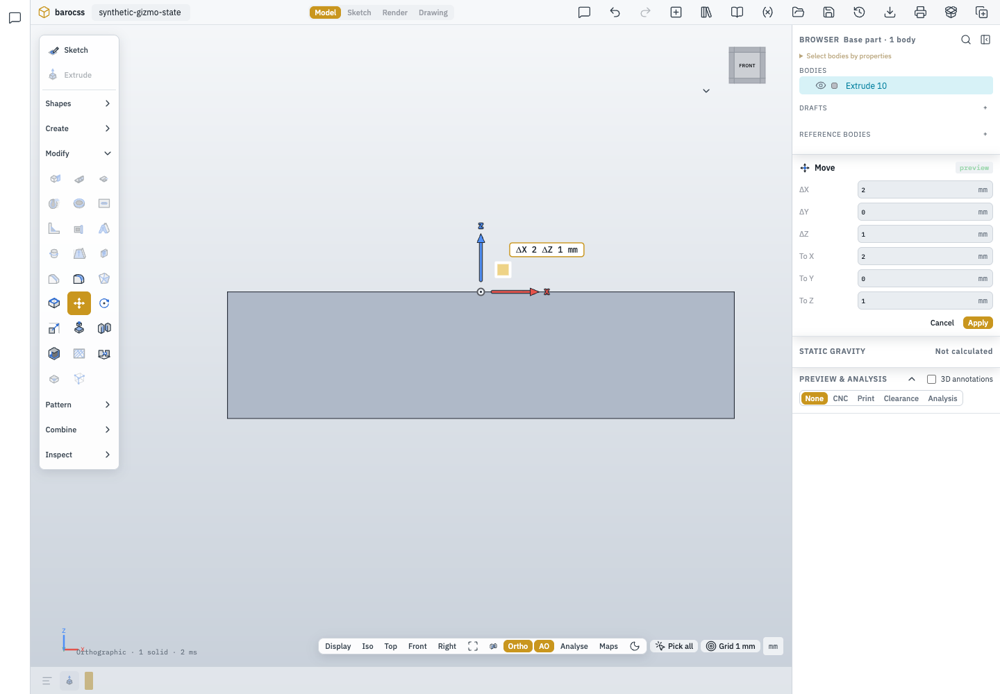
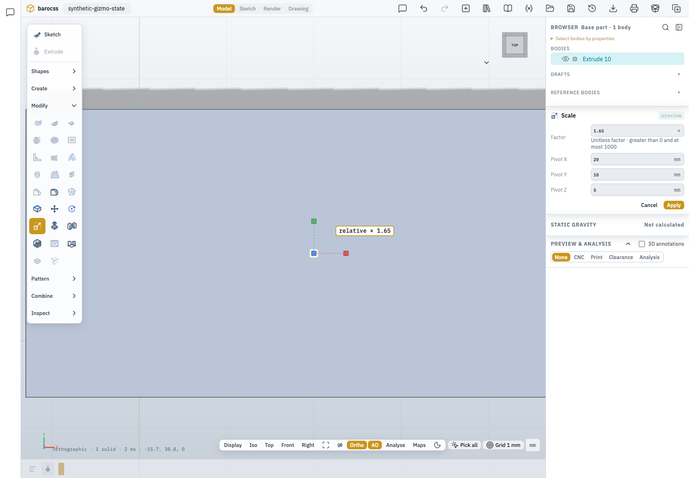

# #735 transform drag feedback: limited verified implementation

Existing issue: https://github.com/barocss/cad/issues/735 (OPEN; partial acceptance only).

## Product boundary

Only GizmoMarks.tsx presentation and the Viewport.tsx call adapter change. The existing pointer drag hit and signed degrees are authoritative. Hover retains its previous treatment; active Move axis/plane, Rotate and Scale get heavier outlines/strokes. Rotation heads are absent at idle/hover/zero and appear only for a matching finite nonzero turn with nondegenerate projected geometry. Cyclic world-axis order and the existing projected quarter arc determine the signed endpoint, including reversed views.

Feature-handle/readout implementation suffix is byte-identical to the baseline. No layout/hit-test, pointer input, drag/snap math, model, Save or geometry code changes. Other handles retain their existing contrast; this is not a comprehensive contrast/accessibility certification.

## Evidence and gates

Baseline main: `4883100a68594f1e294510c4531e5c31083a8e34`.
Product SHA256: GizmoMarks `fc2d8d3cc67364ec177696bab1d9814e75f30b5456ae19cdc6cbdfbd570efce8`; Viewport `da8746a63dce9d8ae8a257eb3d491b093080fdc2a1028a058e245f58540691c9`.

- Baseline02 PASS: Move hover and drag had identical style. Rotate -30/0/+30 kept the same idle arrowhead. Release, Cancel and real keyboard Escape preserved the synthetic document.
- check01 PASS: 14/14 focused/existing gizmo tests, Studio TypeScript, scoped lint on the two product/two unit-test files, production Vite build to isolated output.
- actual01 PASS: 12 stages. Dark/light x Iso perspective/Top orthographic/Bottom orthographic Z rotation at negative/zero/positive values; Move X, XZ plane and uniform Scale; release/Cancel, Escape, public DOM capture loss, explicit Move Apply then Undo. Each rotation endpoint matched the observed camera-basis/sign oracle. Zero has no head. The 48 XYZ/camera-octant unit cases are render-contract checks, not an independent solid-geometry oracle.
- Actual source freeze: all 591 files unchanged before/after; external driver hash unchanged. Page/console errors 0. Browser/context/server closed, serialized gate released. More than 22 GiB remained at completion.
- Independent product, fixture and unit review performed before execution. Screenshots are actual 1440x1000 Studio output from a synthetic box, not concept art or user documents.

### Failure history and limitations

Baseline01 failed in the fixture: innerText was used on an SVG g. Prior partial observations were preserved; only that read was changed to textContent after independent review, and baseline02 passed. Before actual execution, review found and corrected a sample timing race (read after two animation frames) and strengthened signed endpoint checking against observed camera pose. No failed product actual run is being hidden.

DOM capture-loss uses releasePointerCapture on the observed active pointer. It is NOT OS-induced cancellation. NOT_RUN: OS cancellation, Save/Open, snap-step accuracy, exact geometry, all arbitrary cameras/devices and full-suite. Actual Rotate covers Z; other axes have unit coverage only. Move/plane/Scale actual shots are light-theme orthographic, not the complete theme x camera cross product. Prior #709 browser fixture is retained unchanged; the new dedicated driver covers this state follow-up. No claim that the entire issue acceptance checklist is complete.

## Real before/after images

Baseline and after positive/zero comparisons use the same synthetic part, isometric camera and rotation value. These are product screenshots, distinct from the issue body’s pre-implementation concept.

| Baseline +30 degrees (fixed opposite head) | After +30 degrees (signed head) |
| --- | --- |
|  |  |

| Baseline zero (head present) | After zero (head absent) |
| --- | --- |
|  |  |

## Reproduction

`node apps/cad-studio/scripts/test.mjs gizmo`

`node node_modules/typescript/bin/tsc -p apps/cad-studio/tsconfig.json --noEmit`

Actual: set CAD_ROOT to the explicit checkout, GIZMO_SOURCE_FROZEN=1 and approved PW_DIR/CHROME, then run `node apps/cad-studio/test/gizmo-state-actual-browser.mjs <new-output-directory>`. Use the exclusive heavy gate and at least 2 GiB reserve. The baseline driver asserts old behavior and is historical, not a current regression expectation.

CI and integration confirmation are recorded separately on the existing issue for the exact published commit, not inferred from local PASS.
