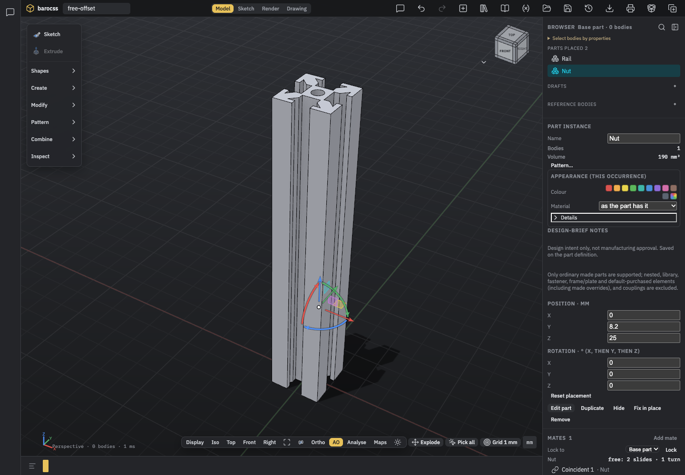
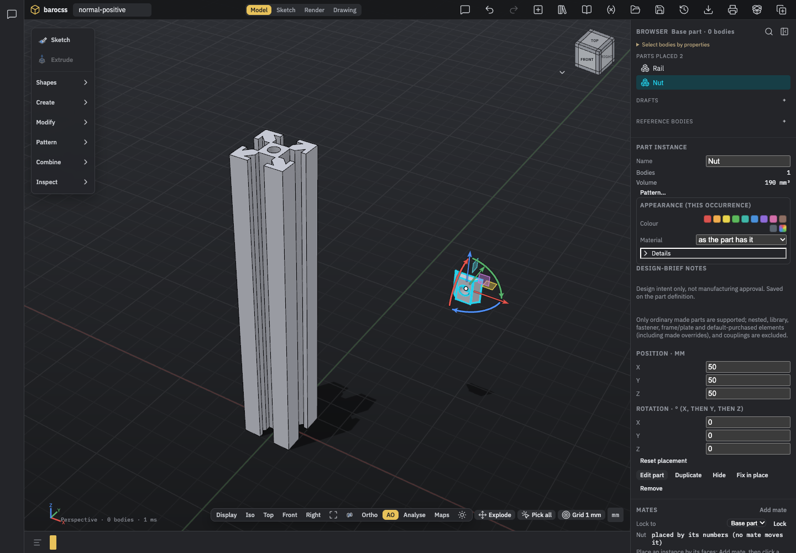
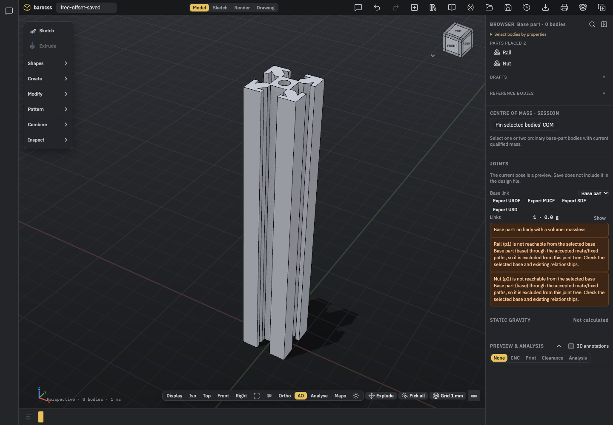

# Snap offset and real mate constraints (#661)

Baseline at 81dc2ec21: T-slot rail / slot nut with interface offset `[30,0,5]` is initially placed at `[0,3.2,25]`, but solveDoc and the actual grouped dispatcher return `[0,8.2,25]` with success and no problems. The requested 5 mm normal displacement is silently removed. `[30,0,0]` stays `[0,8.2,25]`.

The existing LIB2 contract keeps flat faces flush and cylindrical faces on-axis. This fix does not introduce distance mates. It refuses offsets across those constraints before returning any changed document. It uses the actual named face geometry and A-local displacement, not an assumed interface z. The bound is the solver's existing 1e-6 mm positional tolerance.

## Validation
- Focused regressions cover signed normal rejection and document atomicity, zero/free direction, within/beyond tolerance, rotated parent, a custom frame not aligned to its named plane, cylinder axial/transverse movement, actual dispatcher and native roundtrip.
- Library + frame-tslot-interfaces regression: **20/20 PASS**.
- Model TypeScript and scoped ESLint PASS. Read-only review: no blocker within the declared scope.
- Actual Chrome: free offset result opens with Nut position `[0,8.2,25]` and one Coincident mate. Positive/negative normal refusal documents retain `[50,50,50]` and no mates. All three are evaluated, saved and freshly reopened with semantic equality. Frozen source unchanged and no console errors.

## Limits
This guard covers actual plane-plane and cylinder-cylinder pairs only. Missing faces, cone/line/sphere semantics and incorrectly aligned zero-offset custom interfaces are unchanged. Existing unrelated mates are not newly adjudicated. This is the dispatcher/document-consumer path, not a numeric UI-input bug or full snap correctness qualification. Existing HOLD and doc-sync remain unchanged.

