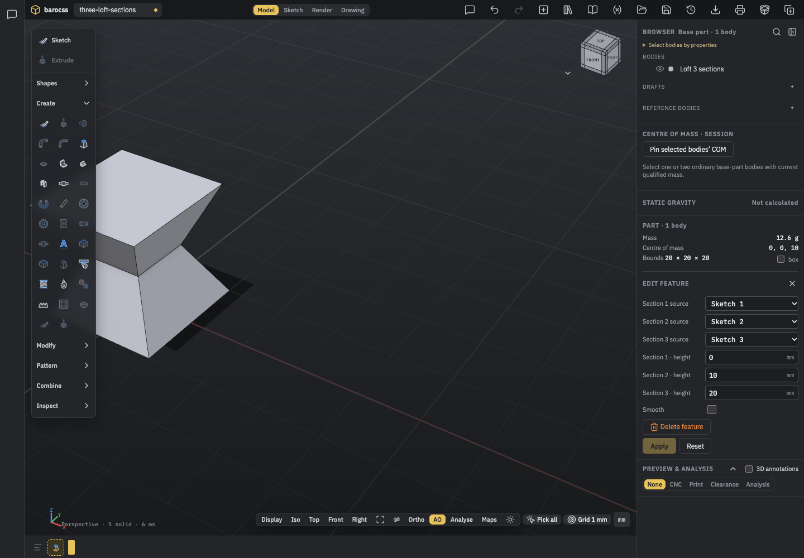
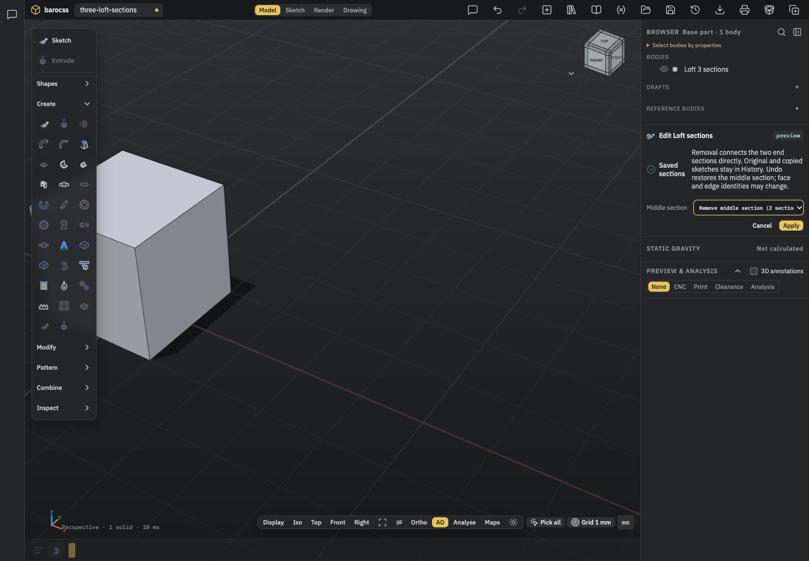
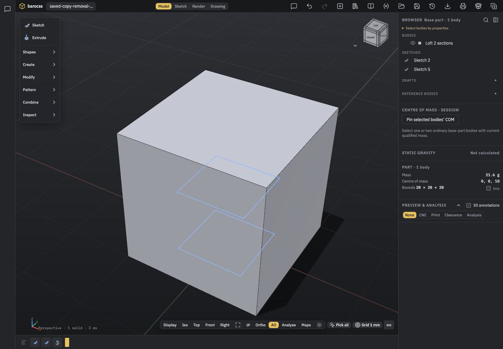

# Loft: explicit middle-station removal (#720)

History → Edit Loft sections → Middle section → Remove middle section connects the two end sections. This is an explicit 3→2 edit, not automatic simplification. Undo restores the middle station. All six original/copy sketch nodes, their IDs, node indexes, nextId and output ownership remain unchanged. Spare sketches remain visible in the Browser.

## Qualified scope
Exactly three independent numeric rectangle originals and three plain rectangular loop snapshots, followed by one terminal unguided ruled Loft. Strict rising numeric heights, XY-parallel original frames, no downstream/reference metadata, Smooth or guides. Only sections and from change. Original and candidate must independently evaluate to one valid native solid. Owner identity and canonical revision guard stale edits. Face/edge identities can change; no downstream rematch support is claimed. Live direct:undefined is absent geometry and admitted; any defined Direct value remains excluded.

## Evidence
Actual UI creates the three-station ruled part. Baseline History has source replacement/heights/Smooth but no station removal. Final actual checks preview Cancel, Apply, full native volume/centroid/one-to-one vertices, Undo/Redo, Save/fresh Open and two-section History. A second control changes only an original rectangle, proves stored copied sections are independent, and verifies removal uses those copies without regenerating them. Both source and copy nodes remain byte-equivalent.

Native oracle: 20×20 ends at z=0/20, 10×10 middle at z=10 gives volume 14000/3; direct end connection gives 20×20×20 box volume 8000. Native cyclic corner alignment is existing kernel behavior, tested with independently shifted starts; no forced twist assumption.

Focused 8/8, existing Loft source/guide replacement Chrome regression, Model type check, Studio type check and Vite build, scoped ESLint and diff check PASS. See verification.json for failed initial runs and limits, native.json and .bcad samples for numeric evidence. Exact publication CI and public image rendering are recorded on #720 after push. No HOLD lifted; doc-sync remains paused.

