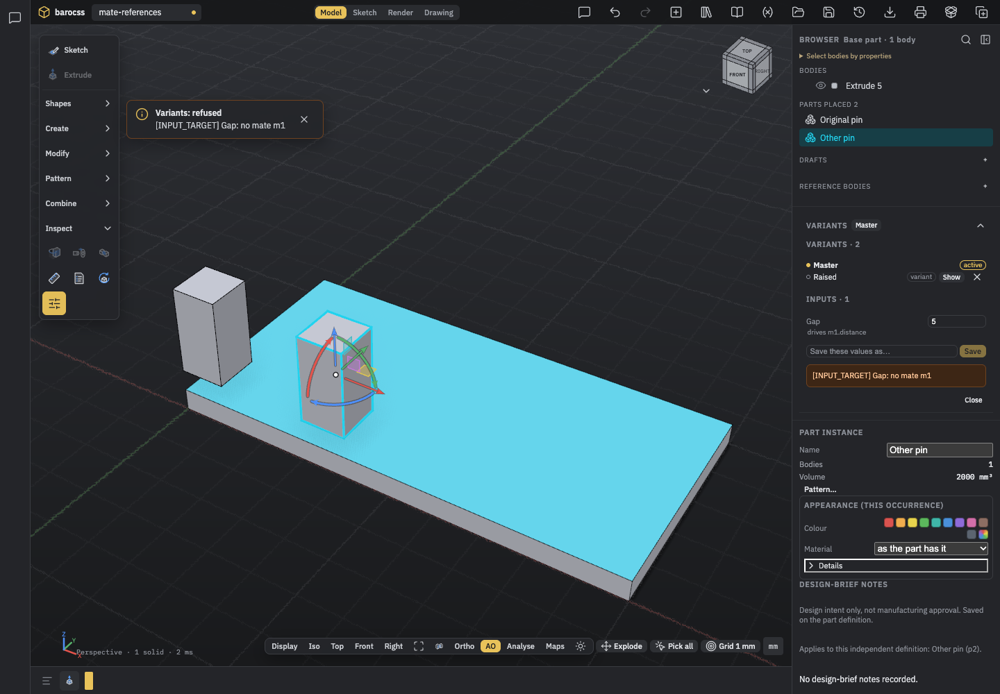

# Retained mate identity — #706

A deleted mate's reference remains unresolved until the user deliberately repairs or restores it. New mates must not adopt the old identity merely because its numbered id is free among current mates.

## Actual baseline
At `2bdf45d78`, the original pin p1 had distance mate m1 and a Gap input bound to m1.distance. Actual Studio Delete mate retained the binding. Creating a new Distance5 mate for p2 reused m1. Show Raised (Gap15) succeeded and moved the wrong part p2 from Z10 to Z20; p1 stayed Z10. The missing-target diagnostic disappeared. The public delete/add path reproduced the same numerical result.

## Bounded fix
Reserve live mate ids and current-document `variability.inputs[].bindings` mate references. Six allocation paths share this rule: core add/lock, facade lock, Library snap, Studio face mate/lock. Preserve each allocator's prior first-number policy. Child assembly documents have separate namespaces. Existing valid arbitrary ids and stored binding values are never changed. Deletion remains explicit and Undo can restore the original mate.

## Verification plan and limits
- Focused Model tests: public delete/add, core/facade locks, snap multiple allocations, native retained input and restored target, namespace and normal numbering.
- Real useAssembly hook: both face and lock allocation plus existing pattern-cycle regressions.
- Actual Studio: Delete/new mate/failed old Variant, Undo/Redo restoration, Save/Open.
- Final Model/Studio types, owned-file lint and exact CI required before closure.
- Initial hook invocation used the wrong cwd and never loaded the product hook; corrected app-directory invocation passed. This was a harness invocation problem, not a product failure.
- No automatic removal, migration, redirection or new mate type. Existing HOLD/doc-sync pause remain.

## Fixed results
- Actual Chrome: PASS. New p2 mate is m2; old m1 binding unchanged. Show Raised refuses with `INPUT_TARGET: no mate m1`, retaining the master and p2 at Z10. Undo restores original m1 and its variant moves p1 instead; Redo and actual Save/fresh Open retain the unresolved reference without retargeting.
- Model focused + existing O11/pattern/snap/facade/lock regressions: **53/53 PASS**.
- Real useAssembly hook + existing pattern-cycle regressions: **6/6 PASS**.
- Both source-frozen receipts have changes=[] and complete browser/context/server cleanup.
- Independent code review found no blockers.
- Disk before fixed run 11 GiB; after browser 9.5 GiB. No cache, evidence or source deletion.

Final Model and Studio TypeScript checks: PASS (exit 0); owned-file ESLint: PASS. Disk after both types: 11 GiB.
