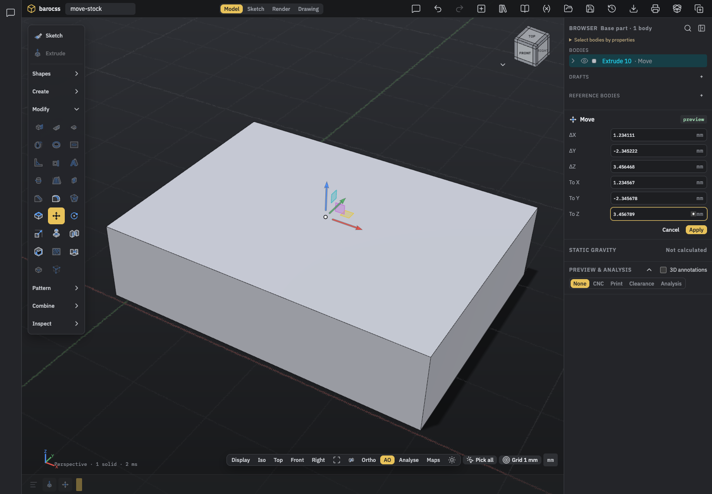
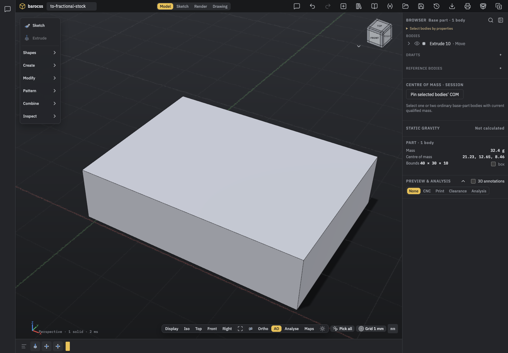

# Move authored coordinate precision (#700)

Baseline/fixed qualification base: `85d09f528f37299b63796d8ca11074a76377c427`. Before publication, unrelated #699 and #701 were fast-forward integrated through `3835ff053e8d74721f8719279716a05ea29aa73a`; the 17 Model focused tests passed again. Final local type/build qualification preceded that nonoverlapping integration; exact published CI is recorded on the issue.

## Contract and scope

Move places the current display-bounds minimum corner at the authored To X/Y/Z coordinates, or translates it by an explicit delta. It previously rounded both the source corner and derived offset to 0.001 mm. This was a stored-model error, not merely display formatting. Only Move's corner arithmetic changes. Rotation centre, numeric widget formatting, snapping, gizmo steps, geometry implementation and document schema are unchanged.

The native B-rep display path currently computes bounds from Float64 tessellation positions. This is not an exact-extrema promise for arbitrary curved bodies, imported meshes or other display approximations. The independent geometry proof below is for rectangular solids only. Binary64 arithmetic remains in use.

## Baseline

Actual Chrome, unchanged product source:

- Origin Box 40×30×10: requested To `[1.234567,-2.345678,3.456789]`, saved offset `[1.235,-2.346,3.457]`.
- Opposite signs reproduce the loss.
- Source already translated by `[0.000456,-0.000456,0.000321]`: actual minimum X=1.235456, not requested 1.234567. Residual 0.000889 mm.
- Explicit delta preserves every authored input digit and native box position.
- Native strict B-rep, eight vertices, volume and centroid confirm the geometry. Cancel preserves the source, and Undo/Redo plus Save/fresh Open preserve the baseline result, including its wrong landing position.

Baseline PASS means the observation and lifecycle assertions passed; the requested To precision **failed**. Initial Model test baseline: 1 PASS / 6 RED.

## Fixed actual checks

The same four actual flows pass with authored targets preserved. Fractional source stock computes offset `[1.234111,-2.345222,3.456468]`. To↔delta pairing and zero-delta defaults retain current source coordinates. Stored offset is checked directly; independent native eight-corner/centroid checks use 1e-8 mm, target residual is below 1e-10 mm, and volume 12000 mm³ uses 1e-7 mm³. No tolerances were enlarged after failure.

Each flow covers Cancel, Apply, Undo/Redo, Save/fresh Open. Native geometry is rechecked after lifecycle steps. The source document/prefix is preserved. Existing Shift precision drag (0.4 mm and Escape) and Split-half Move appearance flows also pass. All three fixed/regression runs reported zero runtime/console errors and closed their contexts, browser and server.

## Checks and interruption record

- Model focused: **17/17 PASS** (8 Move cases plus existing Rotate/Scale binding cases). Includes bounds-array copy/null fallback and nonfinite native refusal.
- Studio gizmo focused: **6/6 PASS**.
- Changed-file ESLint, browser syntax and diff checks: **PASS**.
- Actual fixed browser, existing precision drag and appearance: **PASS**.
- Final Model typecheck / Studio typecheck + build: **PASS**, Vite 5.20 seconds.
- Exact commit CI/public image delivery: **NOT_RUN pending publication**.
- Full repository suite: **NOT_RUN**.

A first gizmo test command used the wrong package filter and ran no tests; it was corrected to run in the actual Studio package (6/6 PASS).

Disk free space was monitored against a 2 GiB floor. Baseline started 5.98 GiB and ended 5.65 GiB. The fixed batch began at 3.82 GiB and fell to about 3.38 GiB. At coordinator request the owning shell was stopped so no later type/build stage could begin. A regression had already advanced from drag to appearance; appearance completed normally with cleanup. The stopped shell was then terminated (exit143) and the heavy gate released. This is an intentional orchestration stop, not a product/test failure. Type/build logs did not exist at interruption. A later allocated run completed both typechecks and the Studio build; free space remained about 13.0 GiB throughout. No unrelated process or file was changed or removed.

Synthetic retained source/native result and sanitized observations are alongside this note. No broad CAD accuracy or whole-product completion claim is made; existing HOLDs and paused doc-sync remain unchanged.
