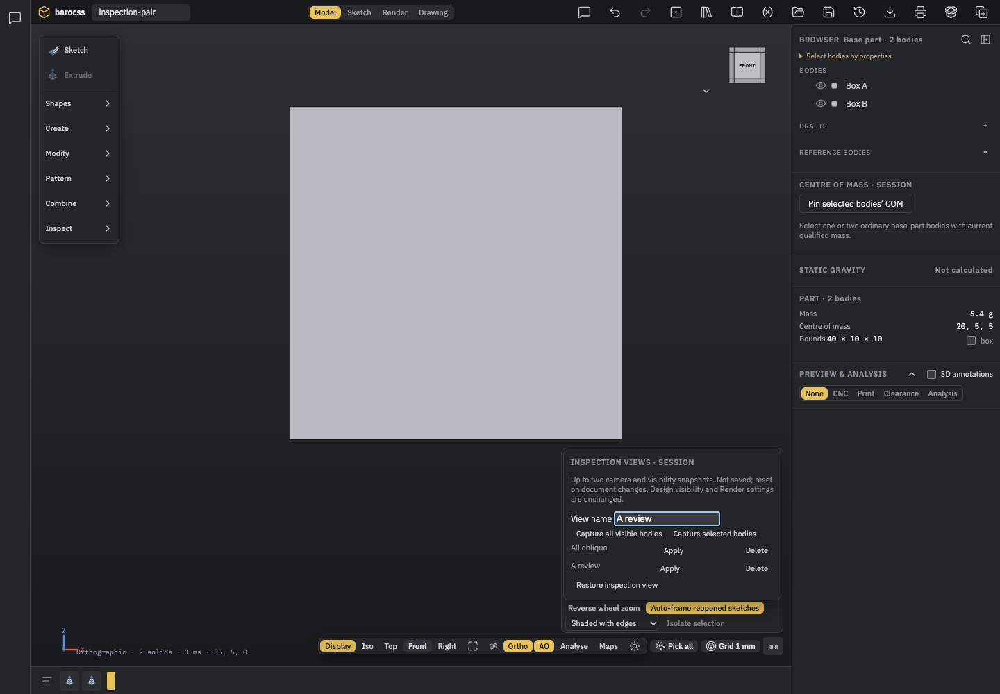
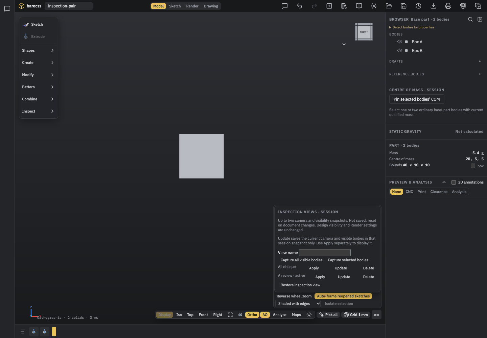

# #220: Update an existing session inspection snapshot

Partial follow-up on parent `0c8f96c7908c7c7745e821e3997a45d8fd3cd6a4`. **#220 remains OPEN. Commit, push and exact-SHA CI are PENDING.**

## Bounded change

An explicit **Update** replaces an existing snapshot's camera and currently visible design-body subset without deleting it. ID, name, order and serial remain unchanged. Update never navigates the viewport or issues a new display transaction; its transaction/token/visibility and first-Apply Restore camera are preserved. Updating the applied row clears its active/applied association; explicit Apply is required. Updating another row retains the currently applied row. Invalid, stale or mode-blocked requests publish nothing.

This remains the existing session-only ordinary-base-solid feature with at most two snapshots. No native schema, codec, sidecar, persistent named views or export behavior is introduced. Document/source ownership and incompatible-mode policies remain unchanged.

## Observed verification

- **baseline01 PASS:** with two snapshots, correcting the live camera had no Update control; capture was capped. Delete/re-capture was the available workaround. Re-applying the original row proved navigation did not silently overwrite it. Delete did not move the camera; the first Restore remained usable. This is a missing affordance, not a demonstrated data-loss defect.
- **actual01 PASS:** real public Update without Delete, two names/order retained, current camera unchanged, no active indication until Apply. Applying the other row then the updated row restored their respective cameras and masks. Positive A/negative B actual canvas picks verified the subset. Restore recovered the first pre-Apply camera and both bodies. Document, visible history, toolbar availability and dirty indicator were unchanged before Save.
- One actual native Save and fresh Open preserved the source document and cleared session snapshots. This checks session reset, **not** named-view persistence.
- Both runs recorded zero page errors, console errors and source changes. Baseline closed one context; actual closed two. Both browser/server cleanups completed. Coordinator inspected the actual screenshots.
- Studio focused/regression selection: **69/69 PASS**. Studio TypeScript and changed-file ESLint: **PASS, exit 0**, with empty logs reported by the coordinator.
- Dedicated mock-hook coverage checks ID/name/order/serial, the two-row cap, copied camera/target arrays, exact transaction and Restore identity, other-row active preservation, explicit Apply after Update/Restore, and atomic rejection for invalid/stale/missing/blocked ownership. These are unit checks, not browser internal-state observations.

## Execution history and reproduction

The first baseline and actual executions both passed. Before actual execution, static review found a fixture risk: Front auto-fits the visible subset, potentially putting the hidden-body probe outside the canvas. The fixture now publicly wheel-zooms out until both probe pixels reach uncovered canvas. This was corrected before execution, not a runtime failure.

Run browser fixtures from the repository root with an absolute external output directory:

```sh
NAMED_INSPECTION_UPDATE_BASELINE_FROZEN=1 node apps/cad-studio/test/named-inspection-update-baseline-browser.mjs "$OUTPUT/baseline"
NAMED_INSPECTION_UPDATE_FROZEN=1 node apps/cad-studio/test/named-inspection-update-browser.mjs "$OUTPUT/actual"
```

Baseline requires the pre-change parent above plus its fixture; it intentionally fails after Update exists. Source and fixture hashes are recorded in `verification.json`.

## Limits

No forced CPU/device failure/recovery, worker/project restart, asynchronous race or assembly/direct/section/animation snapshot qualification. Stable row IDs are unit-tested; actual UI verifies names/order and count, not hidden hook IDs. History observations do not prove internal stack identity. Pointer picking and camera checks are not independent geometry certification. Existing schema5, redesign, physics/motion and other HOLDs remain unchanged. Doc-sync remains paused; these are implementation verification records only.

Only synthetic screenshots and selected results are published. No full receipts, raw source documents, local absolute paths or account/authentication data are included.



