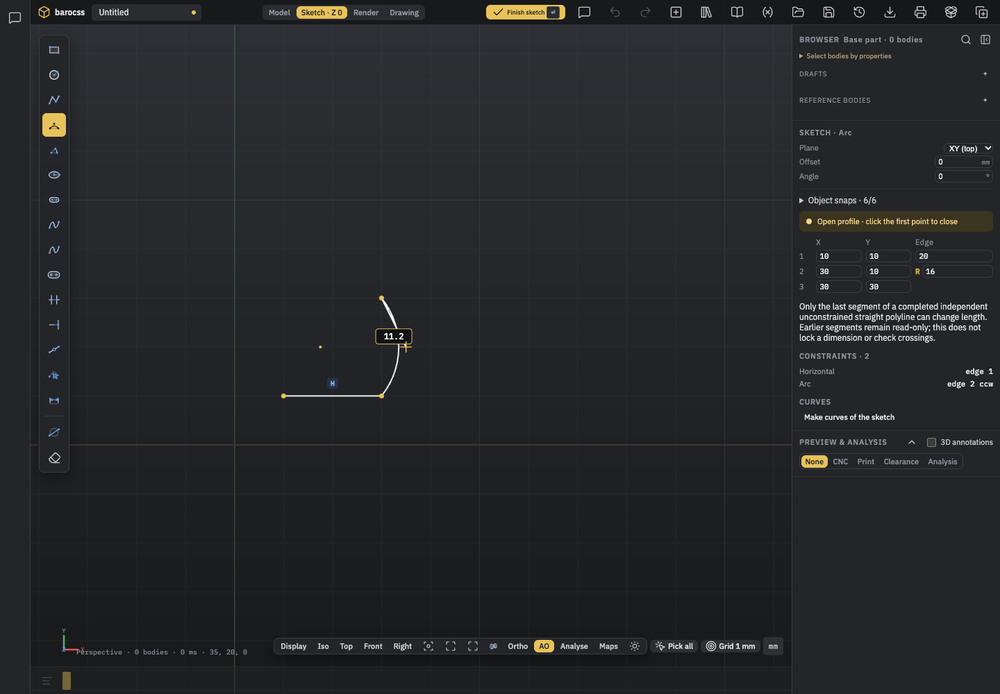
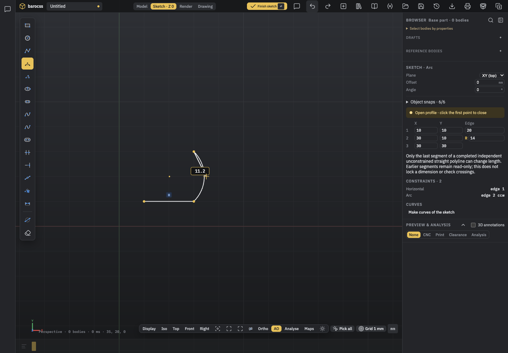
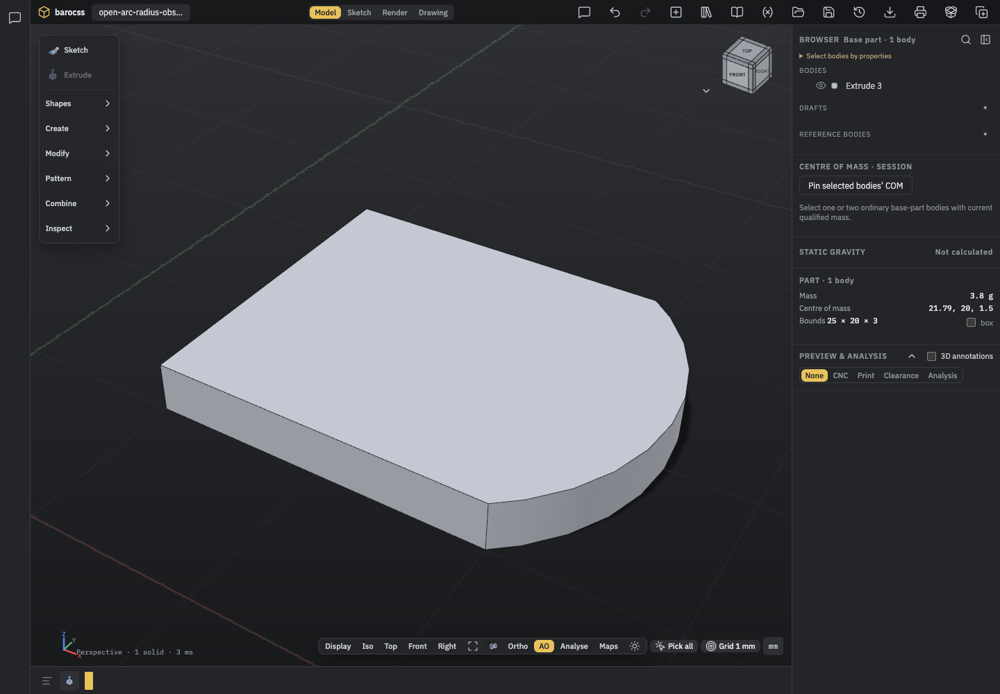

# Open Line + Arc numeric Radius draft history (#21)

## Bounded change
A newly drawn, completed, independent three-point Line + terminal Arc now records numeric Radius changes in draft Undo/Redo. The original endpoints, metadata, arc direction and major/minor branch are preserved. This is a bulge edit, not a driving-radius constraint. Existing radius calculation, snapping, solver and saved schema are unchanged.

Admission excludes pending/closed, constrained, reopened, linked, multi-outline and band drafts. Exact source/document/generation ownership is checked. General history matching is unchanged. Outside this admission the existing untagged edit behavior remains; this change does not claim Undo support for arbitrary arc chains or constrained edits. Major/negative branch boundaries are unit-tested, not browser-certified.

## Baseline and corrections
- Product baseline: `78f1c4f6b9f389fd3853cae01d67cc9ca6456175`.
- Baseline 01 observed successful Radius 12→14 edits with Undo disabled. Its semicircle oracle incorrectly assumed a minor arc, although the existing floating-point bulge/major-branch contract retained the major arc. Finish geometry assertion failed; subsequent extrusion/native/Save steps were NOT_RUN. This was an oracle error, not another product defect.
- Baseline 02 used an unambiguous minor arc: Line (10,10)→(30,10), Arc end (30,30), bend (35,20), R12.5. Edits to R14 and R16 preserved endpoints/document, but Undo was disabled. The observation/lifecycle fixture passed while its intended Radius-Undo classification was FAIL. Explicit R12.5 closure, native geometry, document Undo/Redo and Save/fresh Open passed.
- Initial focused run: 29/30. One test reused a history instance after foreign-owner undo, which intentionally clears that stack. Isolated histories corrected the fixture; final 30/30 passed. No product weakening.

## Fixed verification
- Actual R12.5→14→16; draft Undo→14 and Redo→16 PASS.
- Undo back through both radius edits to prior two-point Line placement, then Redo through all steps PASS.
- Impossible R9 (chord 20) leaves fields/document/history unchanged; subsequent Undo/Redo PASS.
- Finish, extrude height 3, document Undo/Redo, Save/fresh Open PASS.
- Independent native check: one strictly valid solid, one cylinder R12.5 centered (22.5,20), Z axis, expected endpoint vertices, volume `3 * (400 + 156.25 * asin(0.8) - 75) = 1409.669633438256` (absolute tolerance 1e-7). Panel fields before Finish and stored loop segments afterward are authored oracles; transient SVG cursor overlays are not.
- Existing three-point Arc placement, two-point Line length and terminal polyline length browser regressions: 3/3 PASS.
- Focused history/line tests: 30/30 PASS. Scoped lint, Model type-check, Studio TypeScript and Vite build PASS.
- Latest main `6479c86e2` (#268) integrated by non-conflicting fast-forward. Repeated focused 30/30, actual native/Save flow, Studio TypeScript/Vite PASS on integration. All browser receipts had no errors/source mutations and closed contexts/browser/server.

## Images
Synthetic local part only. Individually inspected before publication. Public rendering and exact commit CI are recorded in #21 after push.

#21 remains OPEN. No broader solver, constraint, schema or HOLD scope is completed by this unit.
