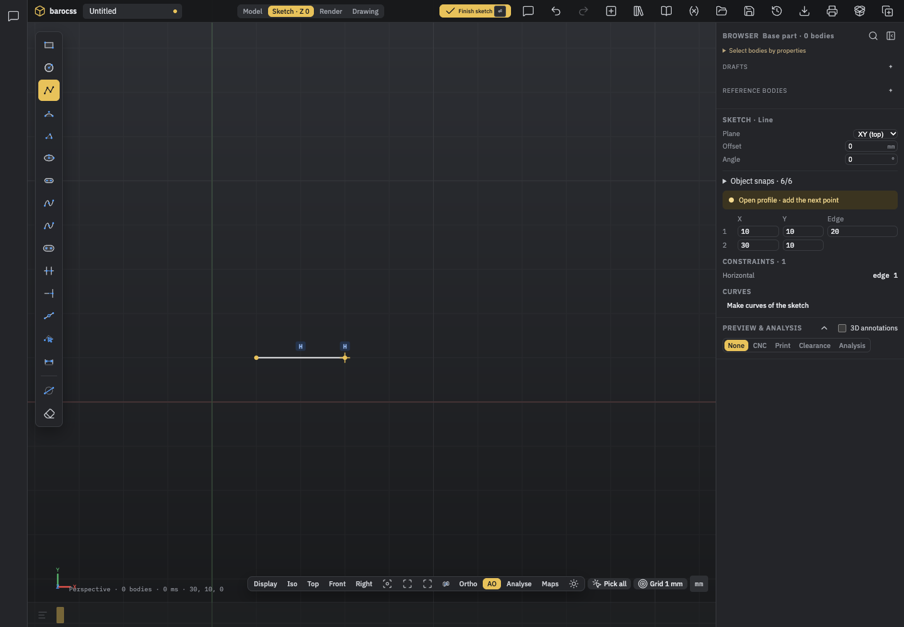
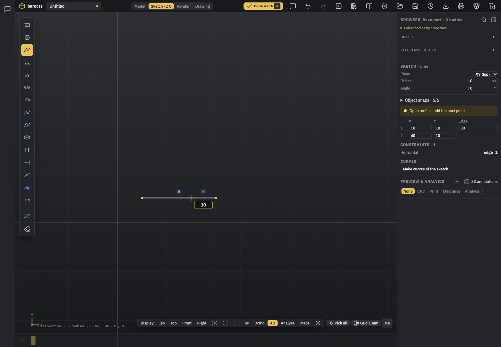
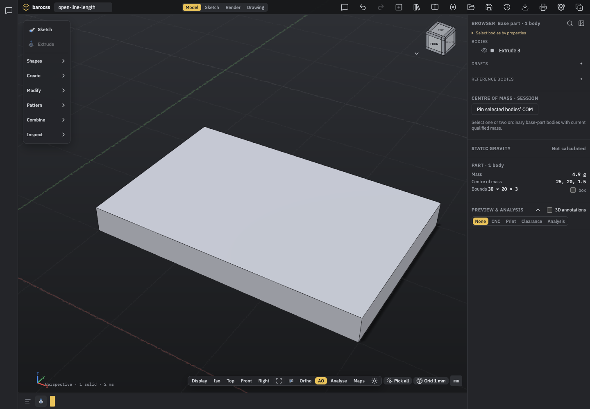

# Open two-point Line length editing (#21)

## Actual baseline

At `e3ec960f4435326ac9b18888e45d715e70aee5cf`, drawing a Line from [10,10] to [30,10] exposes **Edge 1 length**. Typing 30 and blurring restores 20; neither endpoint changes. The existing tooltip promises a locked length although the open-straight onChange path does nothing. Undo removes the second placement point, not a length edit. Redo, closing a 20×20 rectangle, Extrude3, native 1200 mm³ / eight vertices / centroid and physical Save/fresh Open all pass. This is an ineffective input, not document corruption.

## Change and safety

A completed independent, unconstrained, two-point straight line can now change length by moving only its second point along the original direction. The first point and metadata remain unchanged. This is a **coordinate edit, not a locked dimension**. Other open-straight states have a read-only field and explicit scope guidance; closed dimension locks and open-arc handling are unchanged.

The helper rejects malformed, degenerate, nonfinite, overflow, curved, multi-point, constrained and definition-owned inputs. It uses the existing numeric coordinate/tolerance policy without rounding geometry. Same length preserves the original object. A dedicated event carries the source shape and document identity. App checks these against live ownership, then checks rendered shape/generation, no linked/band state and the narrow before/after proof before pushing the existing whole-draft history. No broad identity matcher, solver, snap policy or file schema changed.

## Verification

- New unit tests 5/5 plus Slot width 2/2 PASS; existing draft/selection/three-point Arc history tests 17/17 PASS. The initial `draft-history` filter matched none of the intended existing draft files; the exact `draft-sketch-history`, `draft-selection-history`, `three-point-arc-history` filters were then run (17/17), not treated as covered by the first 7 tests.
- Units cover horizontal, vertical and oblique high-precision coordinates, metadata/first-point identity, no-op, zero/nonfinite/overflow/degenerate/unsupported geometry, invalid direction/origin/metadata changes and owned Undo/Redo snapshots. Foreign or cloned owners cannot replay history.
- Actual Chrome fixed flow PASS: requested30 produces [40,10], then35 produces [45,10]; two Undo and two Redo steps return through exactly the expected endpoints. Undo once returns to length30. Zero/negative/empty inputs and pointer motion retain that endpoint. Continuing the same Line, closing, Extrude3 and native **1800 mm³**, centroid **[25,20,1.5]**, eight independently expected vertices, document Undo/Redo and physical Save/fresh Open PASS. The saved file matches the accepted document.
- Existing actual three-point Arc and closed width-locked coordinate-feedback flows PASS.
- Model type check, Studio type check, production Vite build and scoped lint/diff checks PASS. Existing non-fatal bundler warnings are unchanged.
- Every browser receipt reports empty errors/source changes and closed contexts/browser/server. Final disk reserve approximately 46.2 GiB.

The small canvas value visible near the pointer in the edited screenshot is the existing next-segment cursor preview, not the authored edge length. The panel coordinates/length and independent native result establish the edited geometry.

## Reproduce

With Node22 and installed dependencies, configure `PW_DIR` to Playwright and `CHROME` to Chrome, then from repository root:

```sh
OPEN_LINE_LENGTH_SOURCE_FROZEN=1 node apps/cad-studio/test/open-line-length-browser.mjs /tmp/open-line-proof
pnpm --filter @barocss/cad-studio-app test open-line-length slot-width
pnpm --filter @barocss/cad-studio-app test draft-sketch-history draft-selection-history three-point-arc-history
pnpm --filter @barocss/cad-model type-check
(cd apps/cad-studio && pnpm build)
```

Use `--baseline` only on the original commit. Its observation/lifecycle PASS does not mean length30 was honored.

## Limits

Actual browser coverage is one horizontal new Line on XY. Vertical/oblique precision, unsupported states and foreign-owner cases are unit-level claims. Original point-placement replay after the new edits is proven by unit snapshots, not the fixed browser flow. No general open-chain length solver, persistent dimension lock, linked profile editing, arbitrary arc support, other DPI/browser or manufacturing claim. Closed-outline inference on later closure is preserved. #21 remains OPEN for broader work; existing HOLDs are unchanged.

All images and geometry are synthetic and contain no private data.




