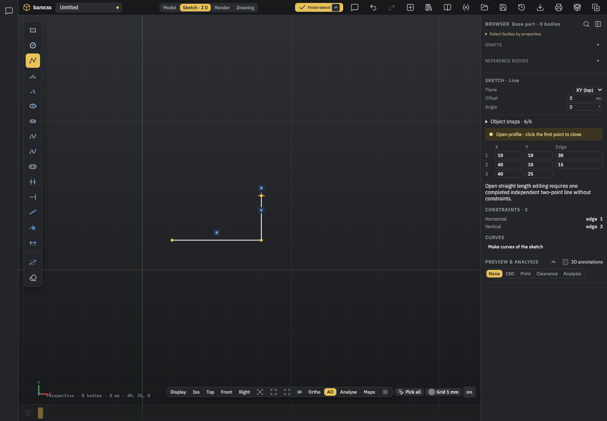
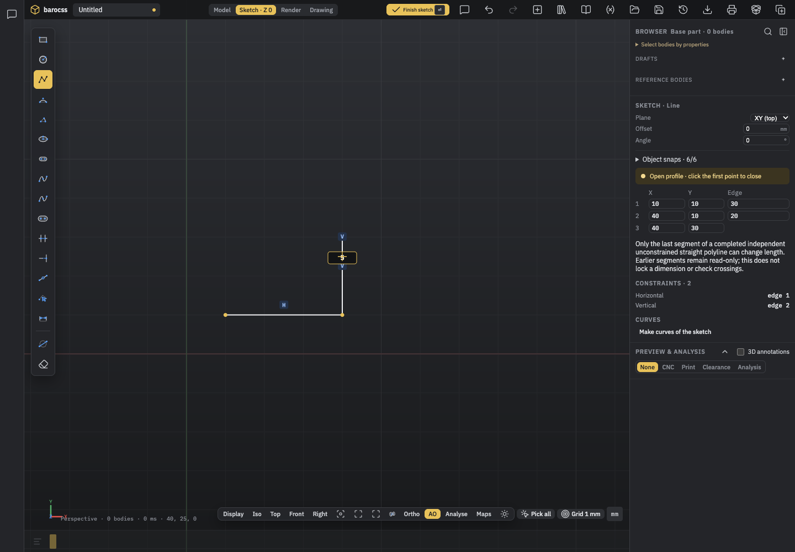
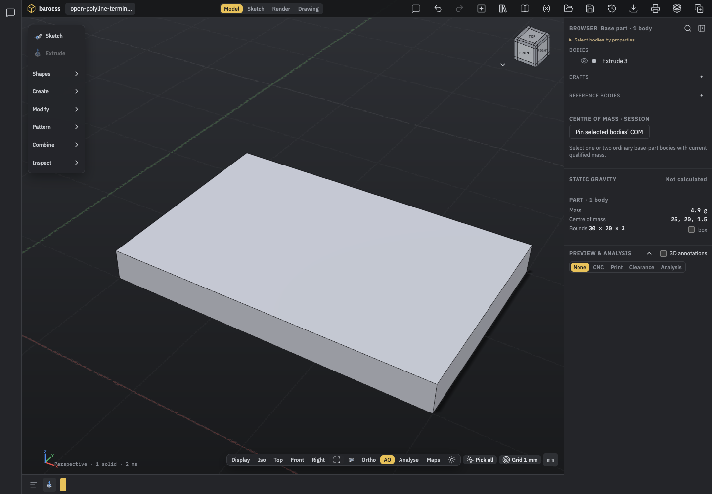

# Open polyline terminal length (#21)

## Baseline and scope

On `842e9fc9f2e2124ec7001599908d8ae240d8f866`, actual Line clicks at [10,10], [40,10], [40,25] made an open three-point chain. Edge 2 length was 15 mm and read-only. The fixture did not forcibly enable it or claim a failed text edit. Existing placement Undo removed the third point and Redo restored it. Explicit Line closure, Extrude 3 mm, native volume 1350 mm³, centroid [25,17.5,1.5], eight vertices, document Undo/Redo and physical Save/fresh Open passed. This was a limited editing gap, not data loss.

The last segment of a newly drawn independent unconstrained straight polyline can now change length by moving **only the final point along its existing direction**. Earlier point objects, metadata and point count stay intact. Earlier Edge rows remain read-only. This is a coordinate edit, not a driving length constraint or a general solver. Existing two-point helper/API, closed locks and open Arc behavior remain unchanged.

The new UI and action-time path share context admission: no other draft outline, reopened sketch, association, band or linked face source. Shape admission excludes pending, curved, constrained, definition-owned, degenerate and out-of-range input. Endpoint proximity within 1e-4 mm of the first point is refused to avoid triggering the existing joinOpen auto-close on later tool change/Finish. This does **not** check general crossings. Existing source/document identity, rendered generation and whole-draft Undo guards remain in place.

## Verification

- New focused tests 7/7 and existing two-point tests 5/5 PASS. Coverage includes vertical/oblique/negative terminal direction, exact earlier point identity/metadata, invalid values, malformed/unsupported shapes, join tolerance, forged earlier points/direction/count, optional done context, other-outline/reopen/linked/band refusal, original placement replay and foreign document/cloned state rejection.
- Actual Chrome: last length 15→20→25; preceding Edge 1 read-only; first two points unchanged. Undo twice reaches length15, a third Undo reaches original two-point placement, three Redos restore the edits. Return to length20, invalid0/negative/empty entries and pointer motion preserve points/document. Continue the same Line with explicit closure. Native Extrude3 has volume1800 mm³, centroid[25,20,1.5] and eight expected vertices. Document Undo/Redo and physical Save/fresh Open PASS.
- Existing actual two-point Line and three-point Arc regressions PASS. All three receipts show empty console/page errors and frozen-source changes, with contexts/browser/server closed.
- Independent review found optional done access before actual execution; a shared admission helper corrected it and added optional/empty/nonempty context tests.
- Initial Studio type check rejected the inline foreignOwner negative-test object. Moving the same object to a local variable preserved the runtime rejection assertion; focused12/12 retested. Product and actual fixture were unchanged. Vite was NOT_RUN during that failure, not a pass.
- Final Model and Studio type checks, Vite production build (4.92s), scoped lint and diff checks PASS. Existing bundler warnings remain non-fatal. Heavy slots released, final free disk about45.1 GiB.

## Reproduction

With Node22, workspace dependencies, PW_DIR and CHROME configured:

```sh
(cd apps/cad-studio && OPEN_POLYLINE_TERMINAL_LENGTH_SOURCE_FROZEN=1 node test/open-polyline-terminal-length-browser.mjs /tmp/polyline-proof)
(cd apps/cad-studio && OPEN_LINE_LENGTH_SOURCE_FROZEN=1 node test/open-line-length-browser.mjs /tmp/line-proof)
(cd apps/cad-studio && THREE_POINT_ARC_HISTORY_SOURCE_FROZEN=1 node test/three-point-arc-history-browser.mjs /tmp/arc-proof)
pnpm --filter @barocss/cad-studio-app test open-polyline-terminal-length open-line-length
pnpm --filter @barocss/cad-model type-check
(cd apps/cad-studio && pnpm build)
```

Use --baseline on the original commit for the observational mode.

## Limits

Actual browser coverage is the specified axis-aligned three-point chain. Oblique/longer-chain precision, malformed contexts and join-tolerance refusal are unit tests. No new browser stale-navigation claim. No general intersection validator, auto-close policy change, earlier-segment editing, linked/reopened/multiple-outline editing, constraint solving or format change. All existing HOLDs remain and #21 stays OPEN.

Canvas cursor numbers are the next-segment preview, not the authored edge length. Panel coordinates and independent native geometry are the oracle. Images and values are synthetic; no private information or credentials.




