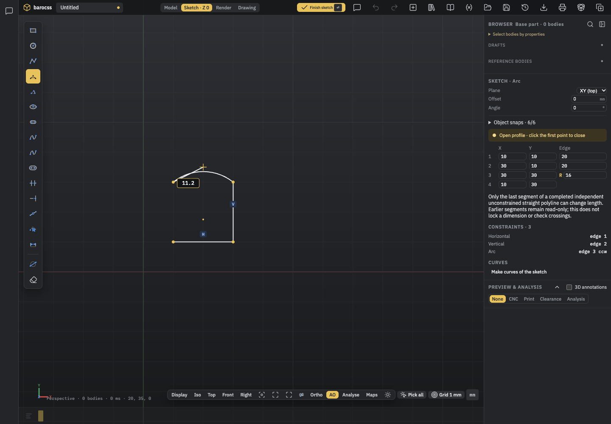
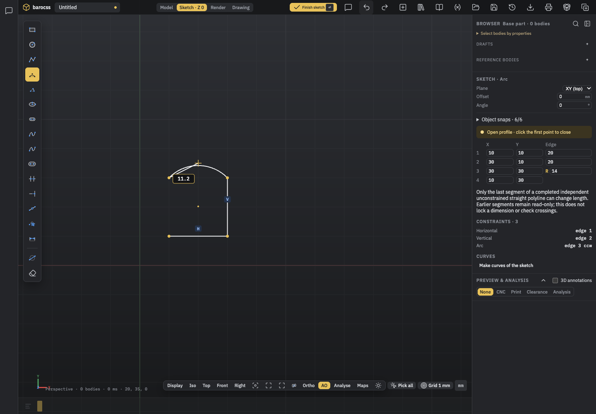
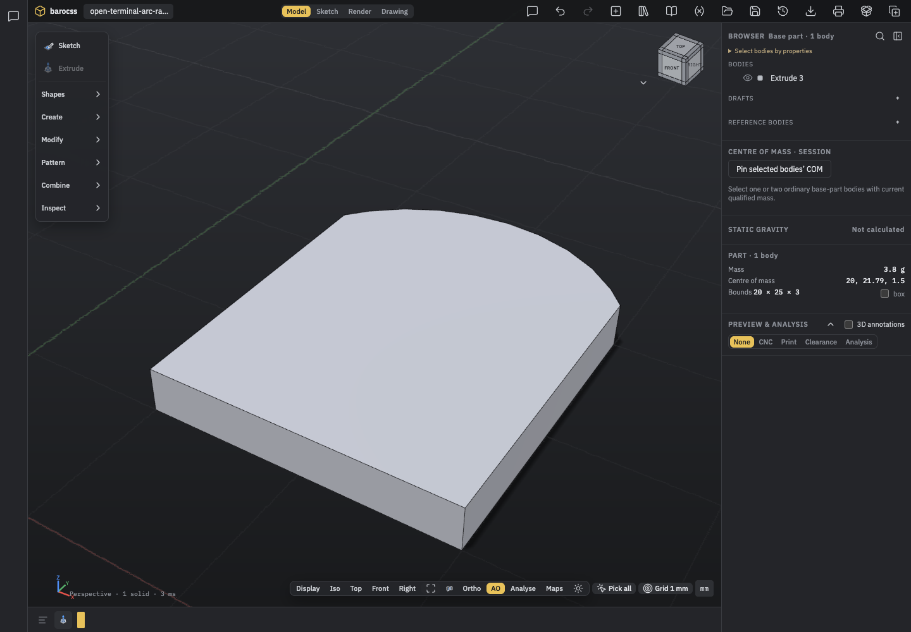

# Four-point terminal Arc radius draft Undo (#21)

Base: `c323ad22298a47f69ee8d7bf939e23932361459d`. This extends an explicitly excluded recipe, not a claim that previously qualified three-point history regressed. The umbrella issue remains OPEN.

## Baseline
Actual Line points (10,10) → (30,10) → (30,30), then Arc endpoint (10,30) and bend (20,35). The completed four-point draft exposes Arc 3 radius. R12.5→14→16 edits were accepted with original endpoints and empty saved document preserved, but Undo was disabled. This is an editing-history gap, not observed geometry or file loss. R12.5 restoration, explicit Line closure, Extrude3, feature Undo/Redo and Save/fresh Open all passed, with no continuation NOT_RUN.

## Limited implementation
Only the existing history-admission helper changes. It retains the original exact three-point recipe and adds exactly four points: two straight segments followed by a single terminal Arc. Sparse/nonfinite bulges, extra arcs, zero segments, near closure, constraints, extra contours, reopened/linked/associated owners and other unsupported data stay excluded. Before/after points and metadata identities must be unchanged, all nonterminal bulges must remain identical zeros, and arc sign plus major/minor branch must be preserved. No geometry calculation, solver, App generation guard, panel, schema or general matching changes.

## Verification
- Independent new6 + existing5 unit tests PASS; lint/syntax/diff and product/fixture/test cross-reviews PASS. Foreign-owner replay tests use explicitly recorded draftHistory entries, not a substitute for actual App callback evidence.
- Fixed actual PASS: R14→16 Undo restores14, Redo16; two radius Undos restore12.5, then a separate placement Undo removes only the Arc; three Redos restore the Arc and both radius edits. R9 is refused, fields/document remain unchanged and the existing Undo14/Redo16 still works.
- Explicit R12.5 restoration and straight closure preserve the four authored points, [line,line,arc,line] segments, CCW arc centre[20,22.5] and optional stored bulge0.5. Strict native solid, cylinderR12.5, endpoints and volume1409.6696334382564 match the independent oracle `3*(400+156.25*asin(.8)-75)` =1409.669633438256. Extrude Undo/Redo and Save/fresh Open repeat the native checks.
- Existing three-point Arc-radius and terminal-Line-length actual regressions PASS. All three browser runs report empty errors/source changes and complete context/browser/server cleanup. Model type-check and Studio TypeScript/Vite build PASS. No fixed actual/type/build failure occurred.
- Same-value no-op, cancellation, major/negative arcs and arbitrary longer/multiple-arc chains are not actual-browser qualified by this unit. Sign/major/context counterexamples have unit evidence only. Existing HOLDs and doc-sync pause remain unchanged.
- Baseline fixture SHA `a9d6e42b00757b6c775ecac63eba43e734edf6e5d0b2e0629faaebece0b2101d`; fixed fixture SHA `4af195a85340d369cd7b6157b2120e3caa31a08c0283d9d8f9258d599a3c9d5e`.

Synthetic models only. Exact commit CI and public-image rendering are recorded separately in #21.

