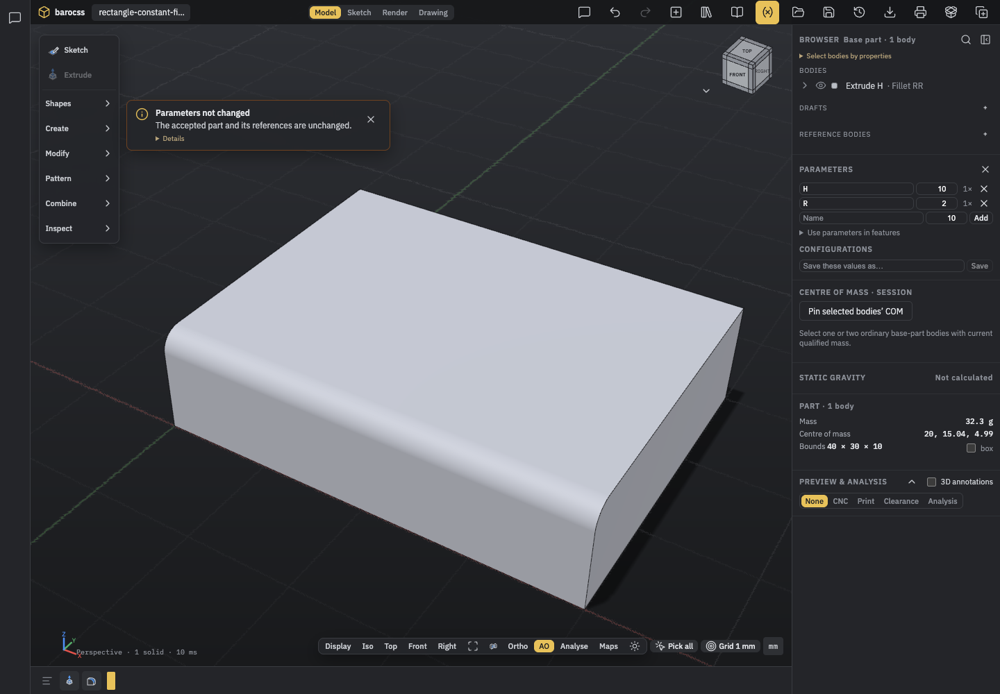
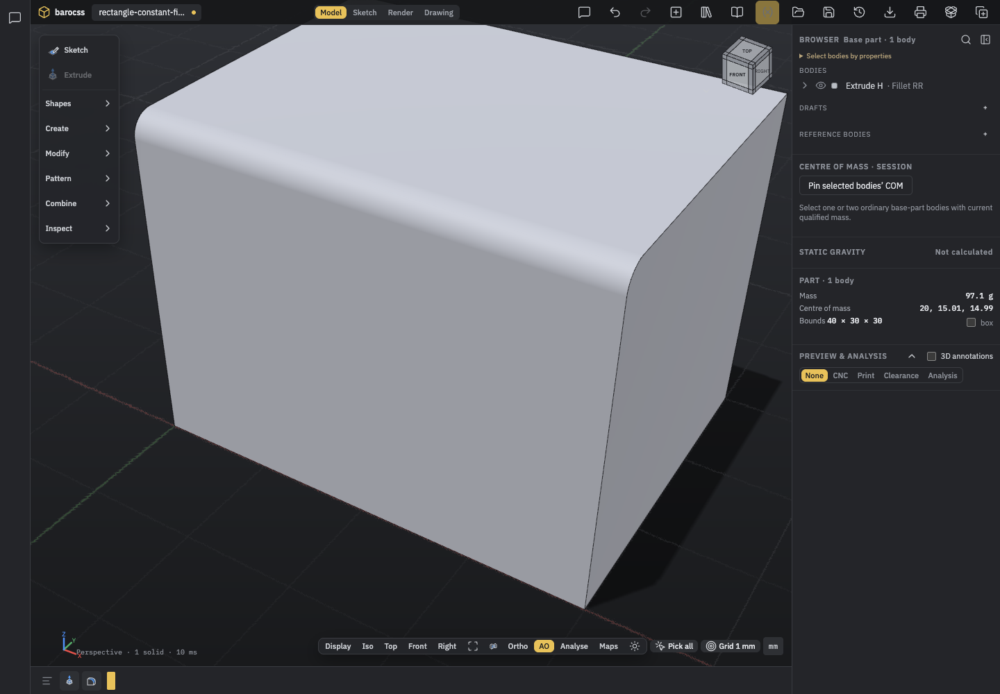
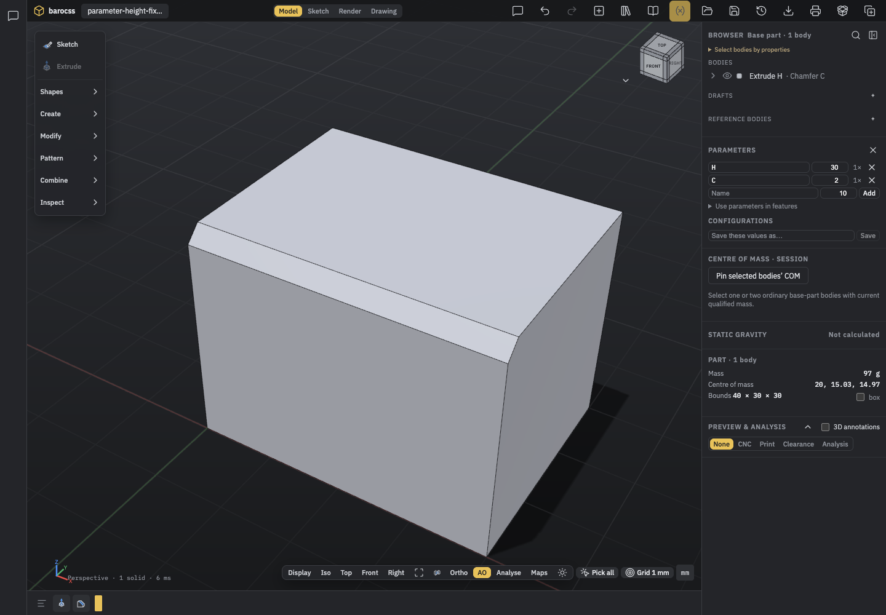

# Independent Height and finish parameter references (#20)

Baseline: `916dd48336d3120aaa009972eef64d3700193406`. Chrome 1440×1000, native engine.

## Observed gap and bounded change

A three-node rectangular prism with Height bound to H10 and terminal single-edge constant Fillet bound to R2 or equal Chamfer bound to C2 safely refused Parameters H10→30 with REFERENCE_MOVED. Both original documents, signatures, history, Undo and native geometry survived; Save/fresh Open also passed. This was an editability gap, not data loss.

The parameter Height adapter now admits a well-formed own single-key finish binding to an existing own finite-positive parameter **different from H**. The parameter keyset and every value except H must remain unchanged. The existing complete native parent topology/signature proof and final full evaluation are unchanged. Only verified signature evidence is updated; authored bindings remain bindings.

Shared H, simultaneous finish-value changes, varying/conic laws, downstream consumers, malformed/missing/inherited/nonpositive/nonfinite bindings and extra metadata remain outside this bounded path. General topology rematching and existing HOLDs are unchanged. #20 remains OPEN.

## Verification

- Original Fillet and Chamfer: safe refusal and preservation, 2/2 PASS.
- Fixed real Parameters H30→14→40: exact authored-document comparisons (H and proven signature only), native strict BRep, analytic volume, contact vertices and Fillet surface midpoint, per-step Undo/Redo PASS.
- H1 geometry failure: accepted H40 and history preserved; same-panel H30 recovery and Undo back to H40 (not rejected H1) PASS.
- Save/fresh Open: both bindings and R/C2, H30, native geometry and Parameters display PASS for both kinds.
- Existing numeric-finish Parameters browser regression PASS.
- Focused/adjacent tests: 107/107 PASS, including independent bound-law file/native consumers, shared/malformed binding refusal and both prefix stale/revision/native/topology failure boundaries.
- ESLint, Model TypeScript, Studio TypeScript and production build PASS. Build 5.23 seconds; existing bundler warnings remain.
- Browser receipts report contexts/browser/server closed, frozen source unchanged. Disk remained above 36 GiB throughout the final sequence.

Actual scripts: `parameter-height-bound-finish-browser.mjs` (`--baseline`, `--chamfer`) and existing `parameter-height-finish-reference-browser.mjs`.

A separate original investigation found Width W40→80 and Depth D30→60 already work for numeric Fillet/Chamfer (4/4 native, Undo/Redo, Save/Open PASS). No product change was made for that already-supported scope. Its observation driver is retained as `parameter-footprint-finish-reference-browser.mjs`.

