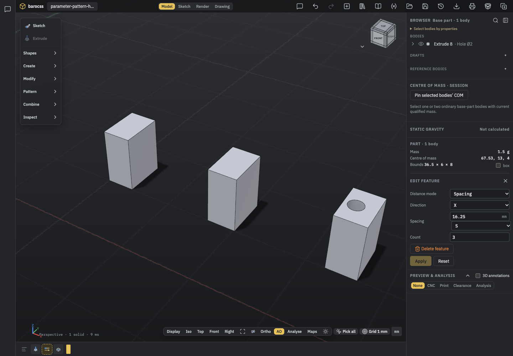
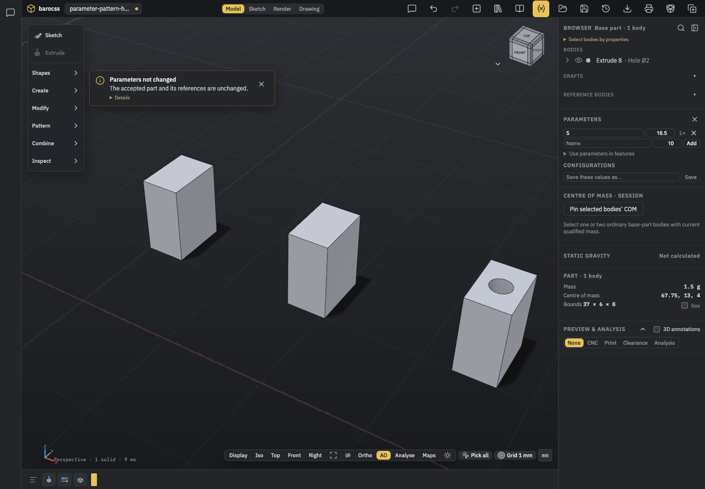
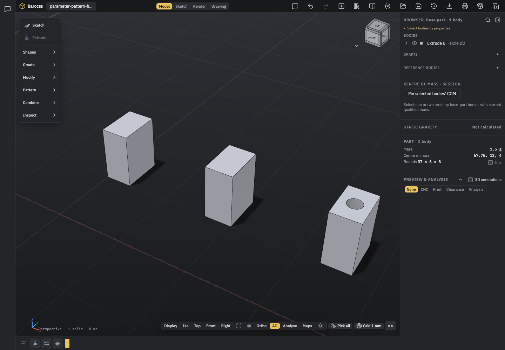

# Bound Linear spacing keeps a terminal Hole on its copy

Bounded implementation for existing #20 and #25. Both umbrella issues remain open. Synthetic desktop evidence only; no roadmap/doc-sync update or HOLD expansion.

## Actual baseline

On `461f892978e31060439e8e55486757ec77a03ba8`, open the four-node rectangle → Extrude → Linear pattern → terminal plain through Hole fixture. The rectangle is [50,10]–[54,16], height 8, X spacing bound to S=16, Count 3. The Hole is R1 at [84,13], face `n1.top@2`.

Parameters S=16.25 was accepted without warning. Copy 3 moved +0.5 mm but the authored and native Hole centre stayed X84 instead of X84.5. Strict B-rep remained valid and volume stayed 576−8π mm³, so volume alone cannot detect this defect. Independent cylinder centres, third-copy top loops and mass centroid confirmed the error. Undo restored the original; Redo and physical Save/fresh Open retained the eccentric result. Baseline fixture PASS means observation/lifecycle passed, not product correctness.

## Narrow correction

A Studio parameter adapter resolves only the spacing in temporary proof copies and reuses D1018's numeric History bore-containment, separation and coordinate guards. Only the authored terminal Hole centre changes; binding, IDs, prefix nodes and original face remain. It does not change loading or public/native semantics.

Admission requires exactly four plain numeric nodes, independent single-key spacing binding, one changed parameter, one terminal output, X/Y separated copies and one complete plain through bore. Unsupported active numbered-Hole spacing changes refuse atomically. Unrelated parameters and inactive dependencies remain unchanged. Additional consumers, downstream nodes, malformed/invalid values, touching copies, stale original bore containment and extra document metadata are not silently repaired. Existing final native evaluation, revision, document ownership and reference guards remain mandatory.

## Verification

- New independent unit tests 9/9; combined existing parameter Height tests and new tests 35/35 PASS. X/Y signed spacing, source/binding identity, shared consumers, extra metadata, invalid values, original bore boundaries and inactive/unsupported dependencies covered. Y/negative spacing are unit-level only.
- Actual fixed Chrome: S16→16.25 moves native centre 84→84.5; Undo/Redo and physical Save/fresh Open pass. Reopened S16.5 moves centre to85. S4 is refused with accepted document/history/native result unchanged. Subsequent Undo/Redo and second Save/fresh Open pass. All expected native volumes, cylinder radii/axes/centres, centroid and top loops independently checked.
- Existing numeric History dependent-Hole browser regression PASS. Existing parameter geometry retry at 1024/1440px PASS (delayed and immediate retry after refusal).
- Model type check, final Studio type check/Vite build (4.23s), scoped lint, syntax and diff checks PASS. No browser errors or source changes; contexts/browser/server closed.
- Earlier orchestration mistake used the wrong retry freeze environment variable: retry stopped before browser execution; following type/build stages were NOT_RUN until corrected. Earlier Studio type check failed on a test-only assert.throws overload; corrected to the message overload, focused9/9 rerun and final type/build passed. Product and browser fixture were unchanged by this correction.

Not a general pattern-face or public parameter remapping guarantee. No claim for arbitrary solids, shared parameters, downstream features, stale asynchronous navigation in this new actual fixture, or whole CAD readiness. Existing owner/revision behavior remains in place; full suites were not run.

