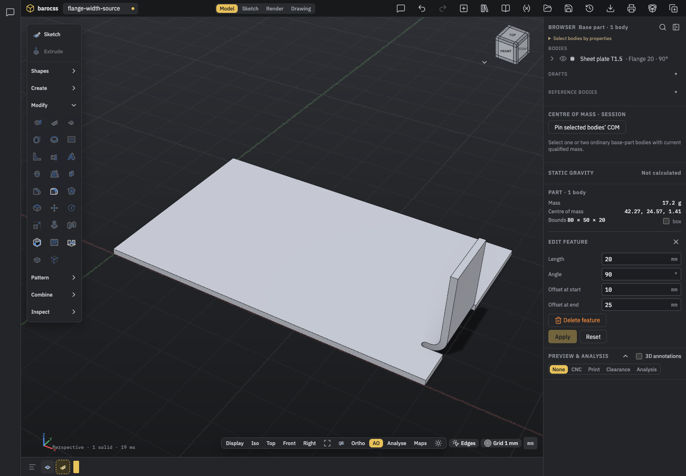
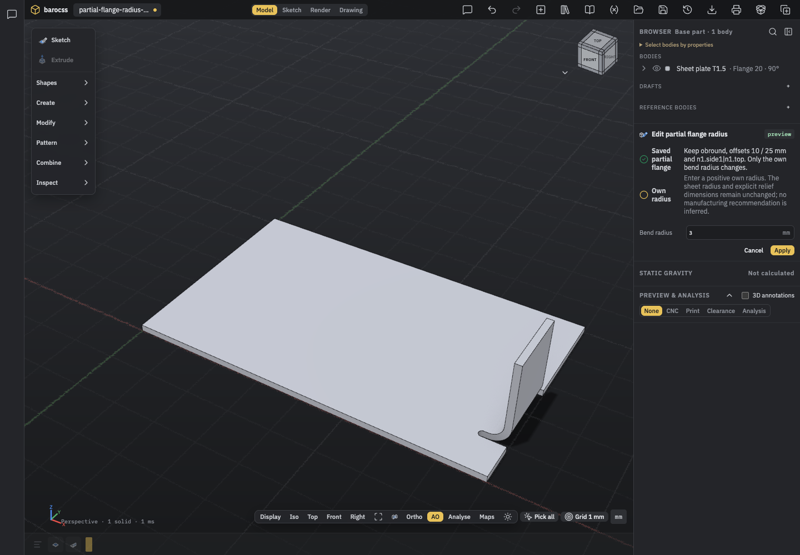
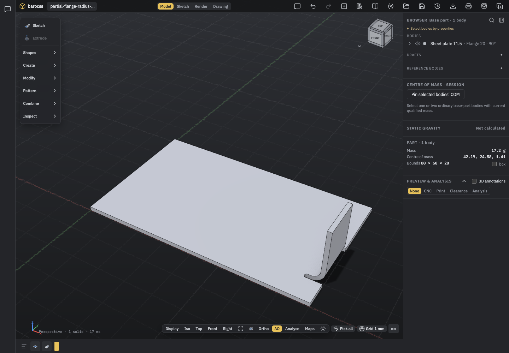

# Partial Flange own-radius History editing (#27)

Base: `9c7be1251894a24da78c3030f7ad773aee94c3f3`. This is a bounded partial implementation; #27 remains OPEN.

## Baseline

Actual creation of an 80×50 XY sheet, T1.5/R1.5/K0.44, followed by one x-max top-rim Flange with outer Length20, inside material, 90°, offsets10/25 and explicit obround relief1.5/1.5 passed at own radius2 and separately at radius3. Strict native geometry, folded volume, flat area, bend/cap locations, original parent signature, creation Undo/Redo and Save/fresh Open passed in both cases. The saved own radius remained intact; History offered no own-radius input, before or after reopening. Radius editing was NOT_RUN. This was a missing editing path, not data loss or a regression in the existing full-width editor. Opening/closing History was not a no-op Apply test.

## Restricted addition

`Edit partial flange radius` captures the current document and changes only its existing numeric `bendRadius`. Admission requires exactly three nodes: plain numeric XY rectangle, numeric sheet rules, one terminal partial Flange on the x-max top rim, own positive radius, two positive offsets, numeric rectangular or obround relief, 90° inside/Outer semantics. It verifies the complete original rectangular parent topology, exact original edge signature, actual original partial solid/flat result, and candidate native solid/flat result. Unknown/mixed values, inherited/bound radius, bound relief, downstream consumers and uncertain geometry remain excluded. Existing full-width helpers and History Apply guards are unchanged.

No-op returns the original document identity. Relief kind/dimensions, offsets, source, IDs and signature do not change. Existing Dim relief native evaluation and codec support are preserved and tested independently, even though this new numeric command excludes bindings. No schema/native kernel, manufacturing or other HOLD expansion.

## Verification

- New Model 7/7 and Studio owner 21/21 PASS; existing relief Model 7/7 PASS. Independent tests cover rectangular/obround native geometry, radius-only preservation, no-op, invalid/mixed requests, stale/cloned owner, canonical mutation, invalid original signature/native geometry, unsupported recipes and codec roundtrips.
- Fixed actual Obround PASS: no-op Apply, preview Cancel, R19 native refusal and unchanged accepted document, recovery to R3, Undo to R2/Redo to R3, Save/fresh Open and reopened command defaults.
- Existing full-width own-radius and partial relief-dimensions actual regressions PASS. All three receipts have empty error/source-change lists and completed context/browser/server cleanup.
- Final Model type-check and Studio TypeScript/Vite build PASS. Scoped lint, syntax and independent reviews PASS.
- Actual UI qualification is only x-max Obround. Rectangular, binding preservation and owner/session counterexamples have unit/native/component evidence, not additional browser qualification. Other directions, downstream geometry and general sheet editing are not claimed.

Independent oracle with active width15, trim `R+T`, straight leg `20-trim`, relief width/depth1.5/1.5 and cap radius0.75:

```text
Q = reliefWidth × (trim + reliefDepth − capRadius) + π × capRadius²/2
V = T × [4000 − trim×15 − 2Q + 15×(straight + π/2×(R+T/2))]
Aflat = 4000 − trim×15 − 2Q + 15×(straight + π/2×(R+K×T))
```

R2 native volume6367.917303918912 matches oracle6367.917303918968; R3 native6353.760221271831 matches6353.760221271854. Parent signature and relief dimensions stay fixed while bend and relief-cap X centres move with the setback. Sheet default radius1.5 stays distinct from the Flange's own radius.

## Failure history

The first independent Model run passed4/7 and rejected normal/no-op/codec cases: the new proof compared a reconstructed flat radius with strict equality. `sheet-flat.ts` derives this value from BRep cylinders, returning2.0000000000000004 for authored2 and3.0000000000000004 for authored3. Authored/default radius checks remain exact; only the derived flat value now allows finite arithmetic roundoff bounded by8×Number.EPSILON×max(1,abs(R)). A wrong-cwd edit attempt did not modify source and repeated the original failure; the corrected source then passed14/14. No geometry-tolerance or admission relaxation was made.

The first heavy run passed all three actual browsers but Model type-check failed because a test `satisfies Values[]` array retained optional-undefined union inference. Studio type/build was NOT_RUN in that run. Changing only the test array annotation to `Values[]` preserved all11 inputs and assertions; focused7/7 and lint passed, followed by final Model and Studio type/build PASS. Product and browser fixture hashes were unchanged by this type correction.

## Provenance

- Historical baseline fixture SHA: `05410460e21283238ac8642dd85f7ce6d490238e19b0a7484d331e994c2ee758`.
- Fixed fixture SHA: `e0f683adccb03d846ac6b73afc9ebb2dc9c997d08b436f30cc320b99d8391d17`.
- Fixed helper SHA: `ce48a80ef460099b7d21962f0d8b96fe22be75237d605f9d990bd0335a051c1d`.
- Runner: `apps/cad-studio/test/partial-flange-radius-history-browser.mjs`, with configured browser-runner prerequisites and a fresh output directory. The original baseline used `--baseline`, and the separate R3 creation added `--positive`; running observation mode on the changed product is not the historical missing-command baseline.

Exact final-commit CI and public-image verification are recorded separately in #27. Images contain synthetic models only.




