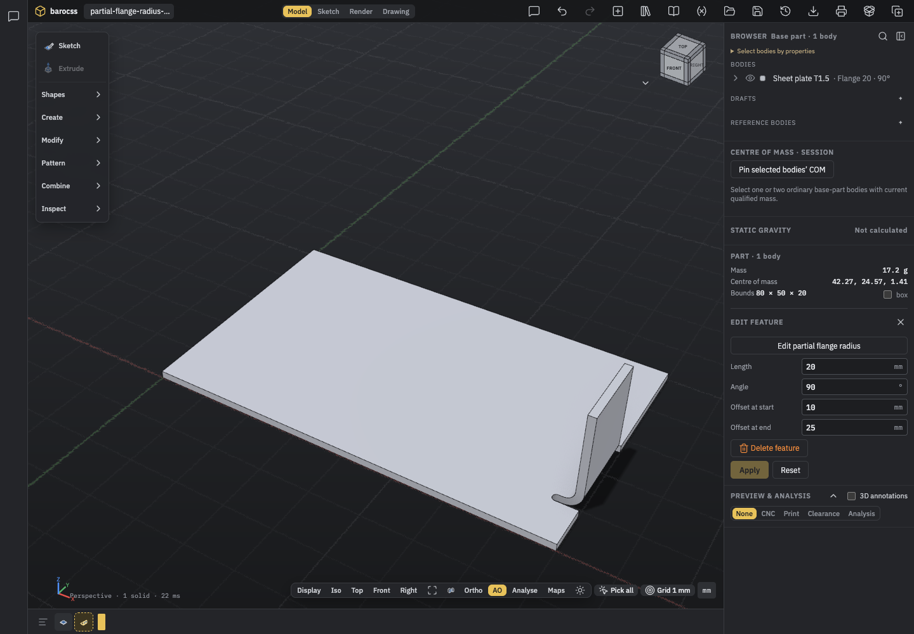
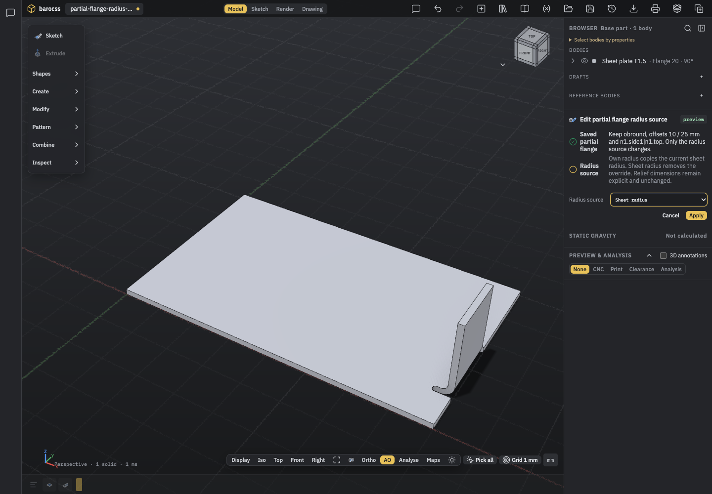
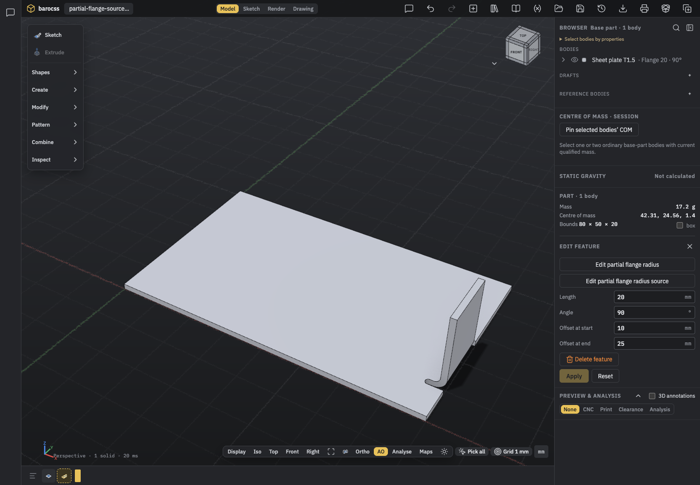

# Partial flange radius source (#27)

Limited source-only History editing: Sheet radius removes the override; Own radius copies the current parent sheet rule. Existing own numeric radius, relief/offset and full-width behavior is preserved.

See summary.json for exact validation and NOT_RUN boundaries. #27 remains open.

## Before
Source control absent (existing numeric edit remains).

## After
Explicit Sheet radius preview, keeping partial offsets and relief.

## Reopened
After roundtrip, existing numeric command and new source command coexist.

