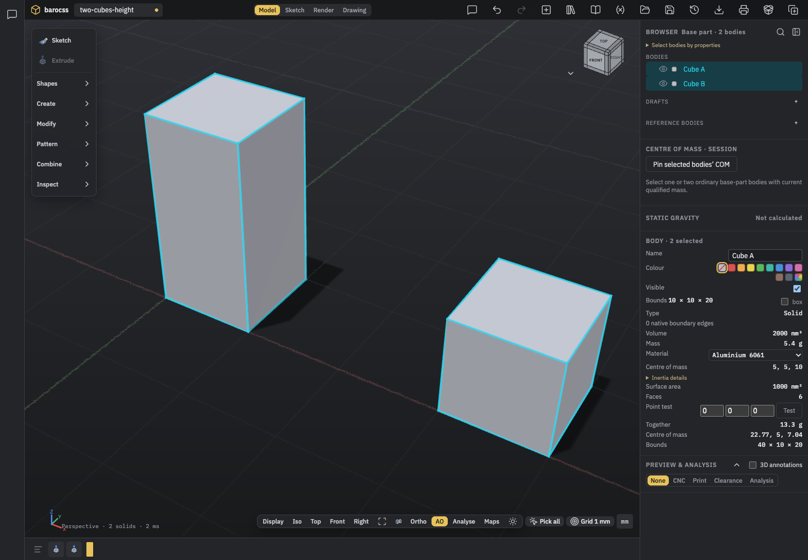
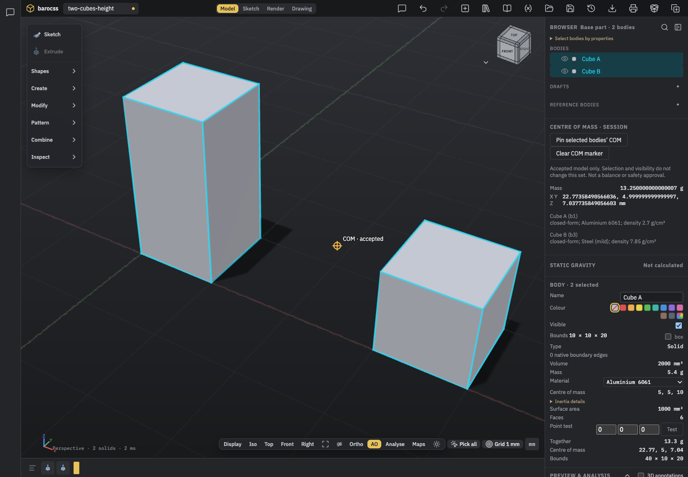

# Pinned centre of mass: a late mass reply after Clear

**Actual Studio Chrome/WebGPU PASS** for two separate fresh runs against
`da40a3087a73a345db73866bd5f873aa5b9b67f1`. This note records evidence only;
it does not change the product. See [issue #231](https://github.com/barocss/cad/issues/231).

The synthetic fixture derives from the existing two-cube project-close case.
It uses a 10 × 10 × 10 mm aluminium 6061 cube at X=0–10 and a steel cube of
the same size at X=30–40. The first cube's Extrude height is bound to a
parameter named Height. Select and pin both bodies (10.55 g), then use
Parameters to change Height from 10 to 20 mm.

- In both runs the accepted model showed the taller cube and a fresh body
  awaiting mass. Its existing pin reported that the current mass was pending,
  without a stale marker or partial aggregate.
- The test delayed only delivery of the original trusted standalone Worker
  mass event carrying the pending body's exact source and ref. It did not
  delay or replace any evaluation/mesh reply, fabricate a mass event, mutate
  the document, or change product code. It released that exact event once.
- **Recovery control:** when left pinned, the marker and readout returned at
  13.25 g and (22.77358490566, 5, 7.03773584906) mm.
- **Clear arm:** click **Clear COM marker** before releasing the same kind of
  current reply. Both body masses became ready, but the pin stayed cleared.
  The accepted document, dirty flag, selection, History, and Undo/Redo state
  stayed unchanged across Clear and delivery. An explicit re-pin restored the
  same centre of mass.

The model-volume check was 2000 mm³ and 1000 mm³. Independent material-density
arithmetic gives 5.4 g and 7.85 g, with an exact centre at (1207/53, 5, 373/53)
mm. Both runs completed with zero page/console errors or downloads; the 595
source fingerprints matched before and after cleanup. Each Chrome context,
browser, and dev server closed. The publication parent contains unrelated
Flange work; the browser source pin above is the tested commit.

## Actual Studio screenshots

After delivery with the pin cleared, the ordinary body inspector shows
the returned mass; the session pin and viewport marker remain absent.

Only explicit re-pin restores the session readout and its viewport marker.

Both images are unchanged 1440 × 1000 PNGs from the Clear arm. SHA-256:

- `04-late-mass-did-not-resurrect.png`: `4f9290344e0b887ef0927e4b99c7580e78dd0c09687079abc8b1a396b8769b71`
- `05-explicit-repin.png`: `44735f52e4832db5c81a03602c6ea7e41268cec259d8c566b4bc1c2bde4394af`

**Not run:** superseded-revision delivery, Worker replacement, and unrelated
mass-marker flows. This evidence does not assert that all of #231 is complete.
