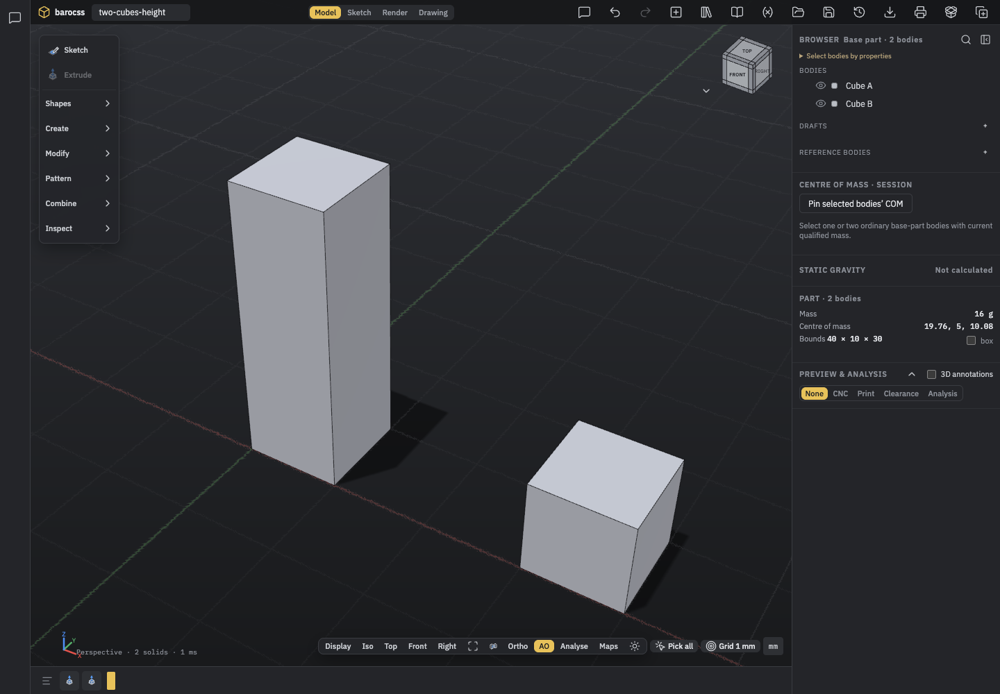
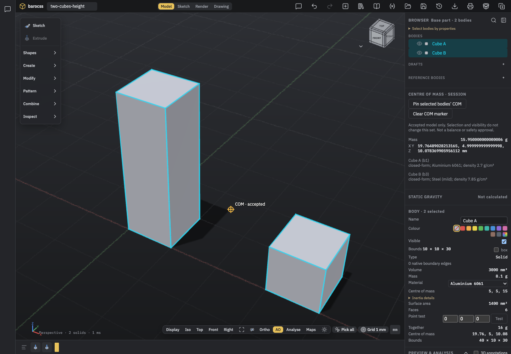

# Pinned centre of mass: same-key Model Open during an older reply

**Studio Chrome/WebGPU PASS** on `7d1c5c26602b6aaa36e98903f628661245d9def0`.
Evidence only; no product changes. See [#231](https://github.com/barocss/cad/issues/231).

Open a synthetic part with two rectangular solids, aluminium and steel.
Select and pin both; then change the aluminium Height parameter from 10 to
20 mm. The accepted model is fresh, but its original pinned centre is
unavailable while that body's separately delivered native mass is pending.

While holding only delivery of the original trusted standalone mass event,
use normal Model Open with a different version of the same-named file.
It reuses the exact same feature and body IDs, with Height and Base set to
30 mm. The same Worker delivers a newer source's standalone mass event and both
bodies are current. The prior session pin is cleared. No evaluation results
or mesh transfers were delayed, edited, or fabricated.

Deliver the exact original older event once to its original client handler.
The replacement document, selection, dirty flag, History, Undo/Redo, and
native body fields stay unchanged. The session pin and viewport marker remain
absent. Native body volumes are 3000 and 1000 mm³ and combined visible mesh
volume remains 4000 mm³. The full 1440 × 1000 screenshots immediately before
and after old delivery are byte-for-byte identical, so only the after image
is retained here. An explicit pin of the reopened part gives 15.95 g at
(6305/319, 5, 3215/319) mm, matching independent mass-weighted arithmetic.

One Worker throughout; no forced error or restart. The 597 source
fingerprints match before, after, and after cleanup. No page/console errors,
downloads, or source changes. Context, browser, and dev server closed. The
publication parent adds unrelated Flat Pattern SVG work; the tested browser
source is the exact pin above.

Original synthetic PNG SHA-256, respectively:
`2e923dbfdada58cb9c19ac3fd2c5f8bd94d21358624175dca39b8b60aabe7603`
and `4e80e00c41003b3e76e5ed840666748a57ddad65b3f75ced890882f67f8ab37f`.

**Not run:** browser Worker failure/Retry, closed/reopened projects in this
same run, and other reference flows. This does not close #231.
