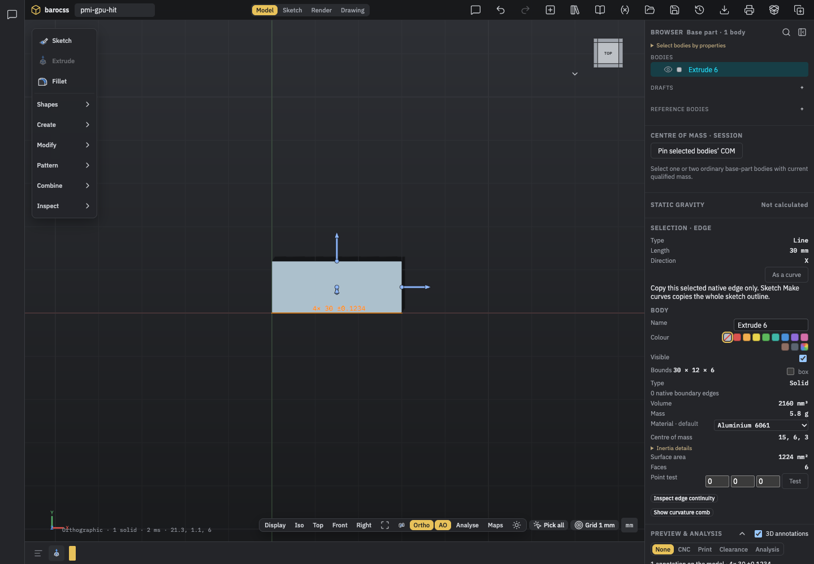
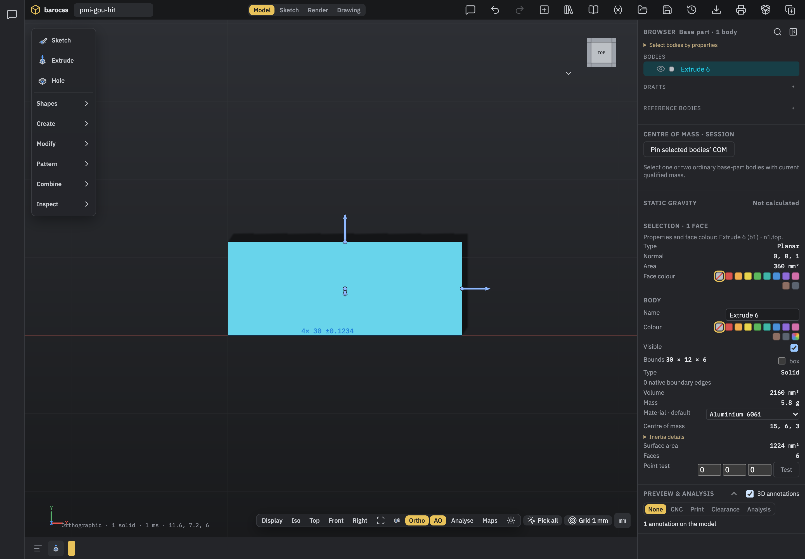

# #268: bounded WebGPU PMI glyph-quad picking

Verification date: **2026-11-18 UTC**. The evidence directory retains its preassigned date label.

This is a limited implementation and verification unit of existing issue **#268**. The issue remains **OPEN**. It does not change native drawing storage or claim complete PMI picking support.

## User-visible boundary

An authored front-view dimension on the synthetic bracket remains selectable at its visible label when viewed edge-on from Top. The prior world-span estimate could miss the rendered 12 CSS-pixel facing label. The new GPU path uses uploaded glyph-quad coordinates and current submitted ownership rather than a guessed text span. These are **padded glyph quads, not exact ink masks or depth/occlusion-exact hit regions**.

## Actual browser evidence

All browser runs required an actual WebGPU viewport. CPU fallback was not accepted. Candidate coordinates came from annotation-off/on screenshot differences in the manually reviewed `4× 30 ±0.1234` label region, not the product hit predicate or GPU bounds provider. Device-pixel coordinates were converted to CSS coordinates for clicks.

| Run | Observed result |
| --- | --- |
| baseline01 | Exploratory driver PASS; Top zoom 0: 4/5 hits, zoom 1: 5/5, zoom 2: 2/5. Driver PASS only means the observations completed. |
| actual01 | Front 3/3 hits; first Top glyph missed. Later cases NOT_RUN. |
| diagnostic01 | Observer setup did not complete; no API calls recorded. A final qualification assertion masked the setup exception. Diagnostic NOT_RUN. |
| diagnostic02 | Exact live Viewer observers recorded 58 requestRender calls and one null labelGlyphBounds result after pointer-hover state/material refresh. Descriptors restored. This is causal diagnostic evidence with logging overhead, **not** a timing-equivalent passing regression. |
| actual02 | Uninstrumented PASS: all **39/39** glyph probes. DPR 1 Front 3/3, Top 8/8 at each of three zoom positions; DPR 2 Front 3/3, Top 3/3 at each zoom position. |

The DPR 1 Top cases retain the five baseline column-quantile probes in addition to three glyph-component probes. Unclassifiable raster is a failed NOT_RUN qualification, never a silently skipped pass.

Actual02 also checked eight background/annotation-hidden boundaries, empty annotation lists, and fresh-context reopening of the original accepted document at both DPRs. Document, dirty state and camera remained unchanged across clicks. **Fresh Open was tested; native Save was not.** Errors, console errors, source changes and downloads were all zero. Four browser contexts, the browser and server were closed.

## Unit, type and command history

- Focused GPU tests: **8/8 PASS**. Focused Studio tests: **12/12 PASS**.
- Related existing GPU regressions: **107/107 PASS**; this is a scoped selection, not the whole repository suite.
- GPU and Studio type checks and GPU build: PASS.
- The new test was added to the explicit GPU package test runner after a final omission check. A targeted rerun through the regular `cad-dist` loader passed **8/8**. The full package suite was not rerun.
- Initial GPU type check found two optional-opacity TS18048 errors. They were corrected before the successful checks; these were not labeled pre-existing failures.
- The first scoped lint command had a `renderer.tsx` extension typo and did not execute. The corrected lint run passed with **0 errors**, retaining **1 existing no-console warning** in `gpuRenderer.ts` (base-commit line 212).

## Limits and handoff

Camera-relative raster, clipping and instance contexts outside the qualified provider are conservatively refused. This is not certification for every font, overlapping annotation, device, arbitrary camera, large-coordinate scene or multiline UI label. Existing SVG/CPU and line/head behavior are not redesigned. No persistent annotation identity, issued snapshot or native-schema work is included.

`summary.json` contains allowlisted counts derived from the receipts and image hashes. The PNGs are unchanged copies from the synthetic actual02 run and were visually reviewed. Raw receipts, stack traces, host paths, local URLs and authentication data are not included.

Base commit: `255e888fc189cd1cebe22167388ebbb62d06039a`. This is a **pre-push** evidence snapshot. Exact pushed SHA, CI and post-integration verification belong in the existing issue record and must not be inferred from this local validation.
