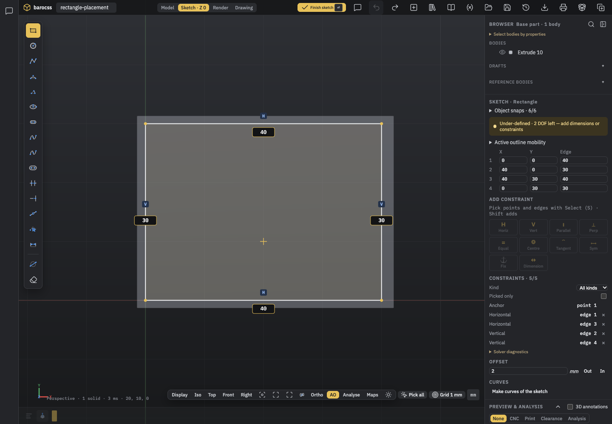
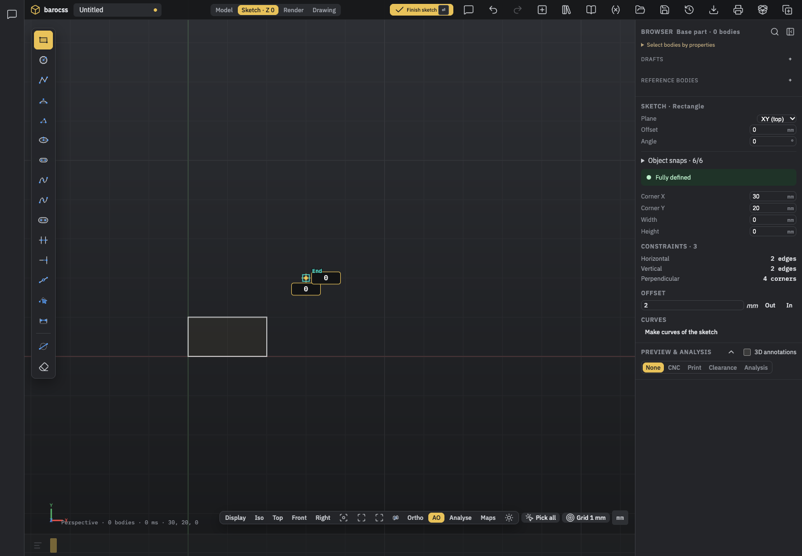
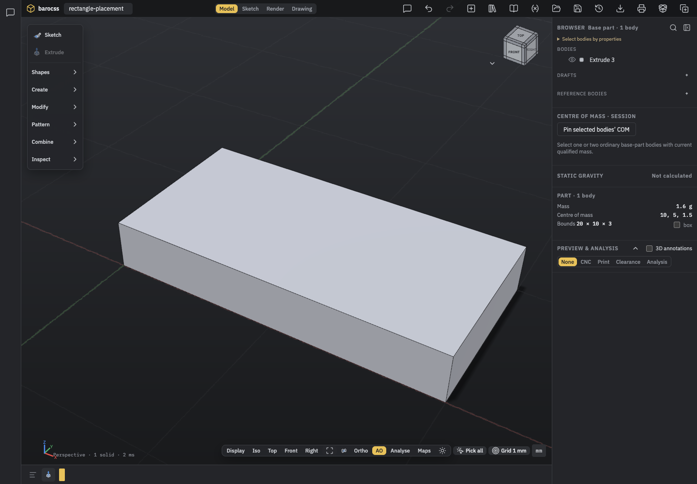

# Rectangle placement draft history (#658)

## Contract and implementation

A completed two-click Rectangle is one reversible **draft** operation. Its first corner captures the complete draft before parking the previous outline; pointer moves are previews, and the second corner records before → after even if it matches the last preview. Doc identity and sketch generation own the transaction. Changing tools invalidates an unfinished owner. Pending keyboard Undo/Redo is a no-op, matching the disabled buttons, and cannot clear earlier completed history. Escape still cancels the sketch.

Whole-draft snapshots preserve the Clear-profile retired-side reservation, original profile ownership and construction. Reselecting Rectangle parks the exact unchanged rectangle object. Repartition matching is limited to Rectangle on both sides and the same objects in the same order; equal-coordinate clones, different documents, reordered owners, and the existing Trim boundary are refused.

Draft validity is distinct from geometry acceptance: same-point, zero-width and zero-height **completed** rectangles are also reversible states. Omitting them would sever the Undo chain. Finish/geometry behavior is unchanged. This does not generalize history across a tool change that discards an invalid shape; that boundary remains unqualified. No schema or serialized model change. Other shape-placement histories are not newly qualified.

## Evidence and failures retained

- `cad-658-baseline-01`: PASS observation on original main `ac3adf7d6`, Clear → Rectangle completed with Undo disabled. Only the owner's App/viewport changes were temporarily replaced; EXIT restoration and both SHA-256 checks matched.
- `cad-658-fixed-01`: FAIL at second Undo following explicit Rectangle toolbar reselection. Earlier Clear → placement Undo → original Undo/Finish passed. Revealed existing `switchTool` copying/parking boundary; fixed with exact owner preservation, not coordinate equivalence. Later stages NOT_RUN.
- Initial expanded focused run: 28/29, FAIL on the existing Trim → Rectangle refusal. Broad partition allowance was narrowed to Rectangle on both sides and exact references. Final focused run: 31/31 PASS.
- `cad-658-fixed-02`, `cad-658-band-01`, `cad-658-final-01`, `cad-658-band-final`, `cad-658-clear-regression`: PASS on intermediate sources. Kept separate from final-source qualification.
- `cad-658-degenerate-baseline`: PASS observation on the pre-final WIP: valid A → same-point two-click rectangle left Undo disabled while the accepted document stayed unchanged. The `shapeNode` history filter was then removed; geometry admission is unchanged.

- `cad-658-final-02`: FAIL in the fixture after same-point Undo/Redo passed. A zero model width had a tiny nonzero projected SVG span; the screen showed Width 0. The fixture now asserts the actual Width/Height input is exactly zero and permits <0.001 px projection noise. Remaining stages were NOT_RUN.

## Final-source checks

- `cad-658-final-03`: PASS actual Rectangle placement, Clear/original recovery, Escape, first-corner tool invalidation, pending keyboard no-op, repeated placement and toolbar reselection, Construction, Select transition, all three degenerate draft chains, document Undo/Redo, physical Save/fresh Open. Frozen 1,075 source files unchanged; page/console errors 0; browser/server cleanup confirmed.
- `cad-658-band-final3`: PASS existing band replacement refusal, completed Rectangle Undo → empty → original band, Redo, Escape/reopen and normal width edit.
- `cad-658-clear-final3`: PASS existing Line/Clear draft keyboard/button Undo/Redo regression.
- Focused tests: 31/31 PASS. Scope includes existing Trim refusal, exact owner/order and foreign-document guards. These are not the entire repository test suite.
- Studio `build` (TypeScript noEmit + Vite): PASS; Vite 6.12 s. Existing nonfatal dynamic-import warnings remain.
- ESLint on changed product files and tests: PASS. `git diff --check`: PASS.
- Actual baseline, restored original, degenerate Undo and saved/reopened native screenshots viewed locally. Public rendering is checked after publication.

Native geometry oracle for the independent accepted rectangle is the literal 20 × 10 × 3 mm box: volume 600 mm³, all eight expected corners, strict native B-rep validity. Physical Save and fresh-context Open compare the exact accepted document and native result. Browser checks use real toolbar/canvas/keyboard actions, not draft-state injection; initial synthetic documents are opened through the Model file control.

Unqualified: invalid-shape tool reselection/discard history, arbitrary other shape placement, OS-level interrupted pointers. No claim that a degenerate draft becomes valid geometry. Manufacturing, Physics/Motion, existing HOLD/WIP and doc-sync remain untouched.
