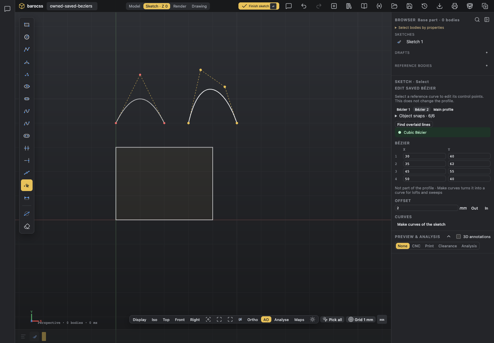
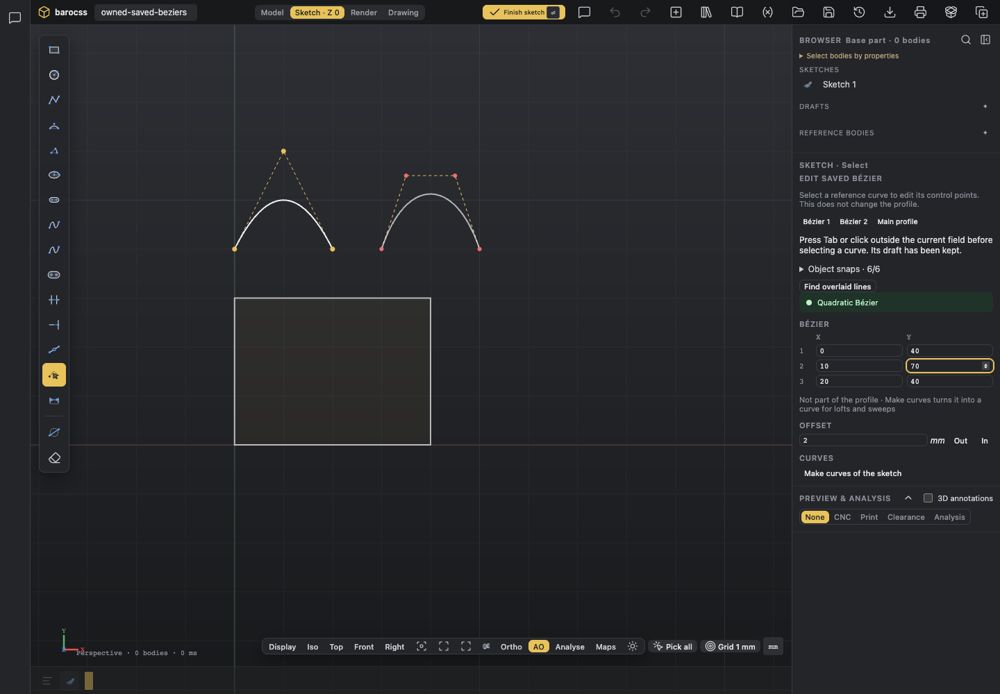

# Saved Bézier selection acceptance

Issue #253, base `5fadcffb89031d97d0c83e26f09294f19b977c8f`, FEATURE tier, 2026-11-17.

## Narrow change

An explicit saved-reference picker activates a unique exact Bézier object in a reopened Select/Dimension draft. It reuses existing control-point editing and offers return to the main profile. The closed-outline constraint and viewport picking policies are unchanged. Main IDs, shape order and original objects are preserved. Construction-flagged, malformed/degenerate, ambiguous duplicate and stale sources are refused. App retains document/draft/generation/live-shape admission. The component owns only the picker, not document commit.

Parked Bézier Undo/Redo matches one exact object, never equal coordinates or guessed IDs. Curve editor keys retire local text when the selected slot changes, not on pole edits. A focused field prevents pointer selection and explicitly tells the user to leave that field first; its text and selected source remain unchanged.

## Verification

- Helper/related regressions 13/13 and picker SSR 2/2 PASS; final Studio tsc and affected-file lint PASS; final Vite build 4.50s PASS. Independent read-only review: blocker 0.
- Actual desktop run 01: Q/C selection, pending Y=70 selection refusal, exact field retention, Q edit and Undo/Redo while another curve or profile is active PASS. It failed only because the driver expected a navigation discard dialog after direct Escape had already canceled correctly. Preserve this FAIL; do not call the entire run PASS.
- Actual run 02 retains run 01 prerequisite receipts and verifies direct Cancel again, then edits the saved cubic second control point Y=55→62, Finish, first committed Undo/Redo and native Save/fresh Open. The accepted document equals the original except those selected poles: profile, other curve, order, IDs and side tags are unchanged. Previous DXF bytes stay unchanged; export-only doc/history/dirty stay unchanged.
- Installed ezdxf 1.4.5 reads the edited and reopened DXF independently: exact degree/knots/poles/unit weights/layer/mm, five Bernstein points and endpoint tangents PASS. Both files are 5961 bytes, SHA-256 `72e620fca8175470d7aa460be68bb09d87972bca577cd5462f1ed31ff9ddc41d`. Native Save semantic equality PASS, SHA-256 `faa4ac541aba82696e26a221d7cbc17fceddf4f0db187a089203c10e5dc10def`.
- No browser errors, source writes or leaked owned processes. Screens were directly reviewed and contain only owned fixtures, no personal/authentication information.

Initial test-only failures were literal type widening/inference and an SSR import using Node rather than server.edge; the initially .tsx test was renamed .test.ts so the runner actually included it. Final checks above passed. No product failure was hidden by changing expected geometry or tolerances.

## Acceptance and limits

Together with `sketch-bezier-dxf-2026-11-17`, all seven proposed narrow adapter contracts and the previously open saved-curve edit/re-export consumer path are covered. The explicit picker resolves the acceptance need; endpoint clicking remains unchanged, not claimed fixed. Same-coordinate foreign objects and duplicate identity are refusal-tested. Actual UI fixture has distinct Q/C curves. Generic writer/kernel, all workplanes in UI, manufacturing, new R12 approximation UX and broad spline certification remain outside this change. Existing WIP/HOLD preserved.

