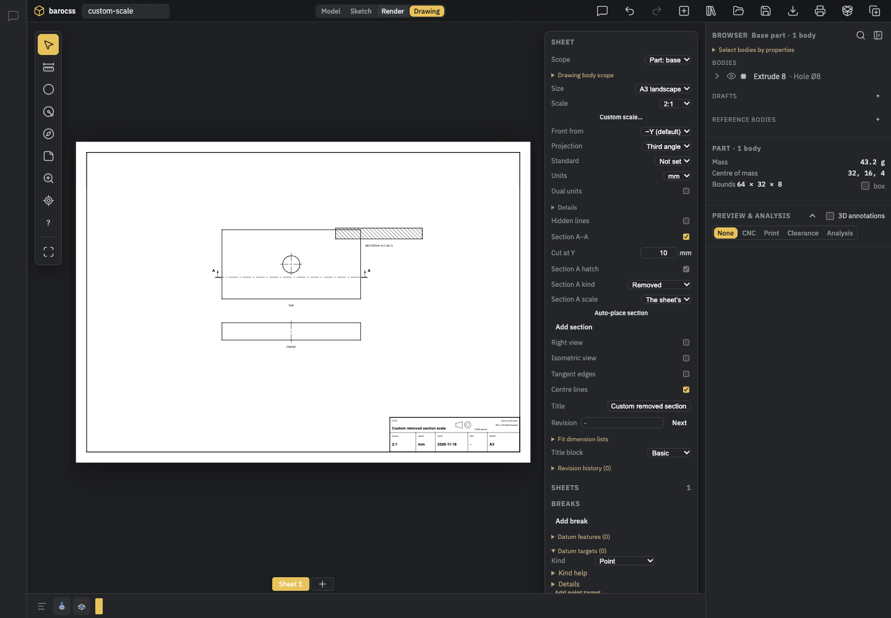
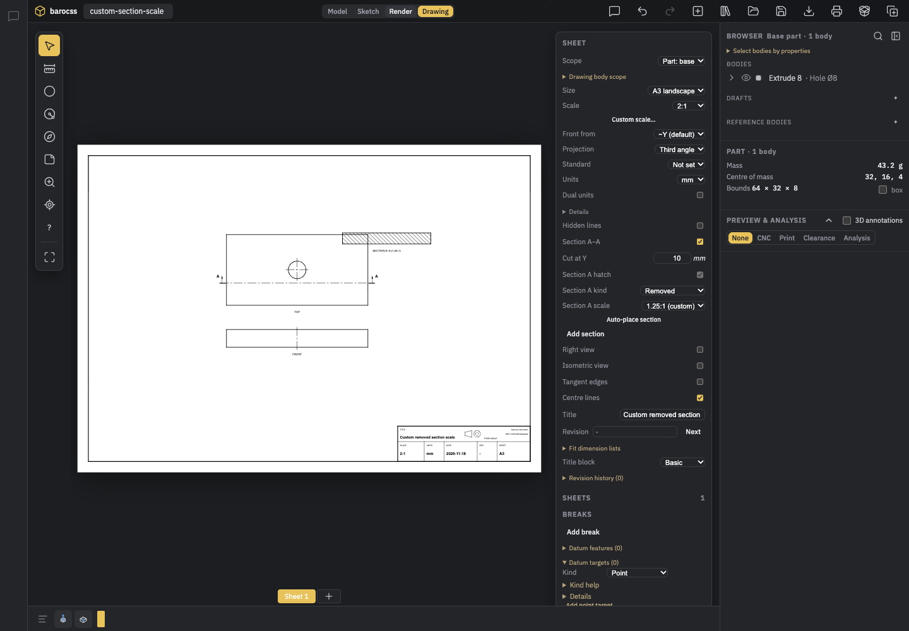

# Removed-section custom scale readback

Native removed sections already accept nonstandard numeric scale. The selector lacked the corresponding option and misleadingly displayed “The sheet’s” while the geometry used the explicit scale. Add one exact current custom option, matching detail-view readback. No new scale authoring, geometry or schema change.

## Verification

- Actual Chrome baseline FAIL: `sheet !== 1.25`. SSR baseline also failed for absent current custom option.
- Fixed Chrome PASS: native 1.25 section displays 1.25:1 (custom), actual paper bounds 80 × 10 mm for a 64 × 8 mm cut, distinct from 2:1 sheet scale. Standard 2 changes bounds to 128 × 16 mm. Undo/Redo, actual native Save download and fresh Open preserve the exact custom value. Explicit sheet inheritance removes only scale; source nodes remain unchanged.
- Focused 7/7: custom section SSR 2, adjacent detail SSR 2, section paper helper 3. SSR covers 0.0001, 0.75, 1.25, 1.23456789, 1000, all presets and inheritance, without document mutation. These extra values are not claimed browser-qualified.
- Before and reopened screenshots visually inspected; source-frozen browser cleanup passed.

Driver: `SECTION_CUSTOM_SCALE_FROZEN=1 node apps/cad-studio/test/section-custom-scale-browser.mjs <output>` with harness PW_DIR/Chrome environment.

## Limits

One front removed section at custom 1.25, standard 2 and inherited sheet scale. No export/PDF/DXF/physical print validation, arbitrary scale authoring or automatic collision/layout repair. Fixture's explicit paper position overlaps a neighboring view; unchanged placement is intentional for this readback-only check. Existing HOLD/schema contracts unchanged.

