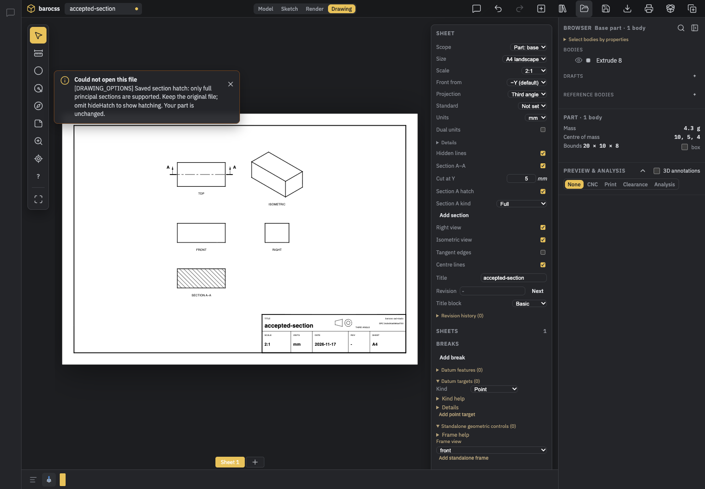
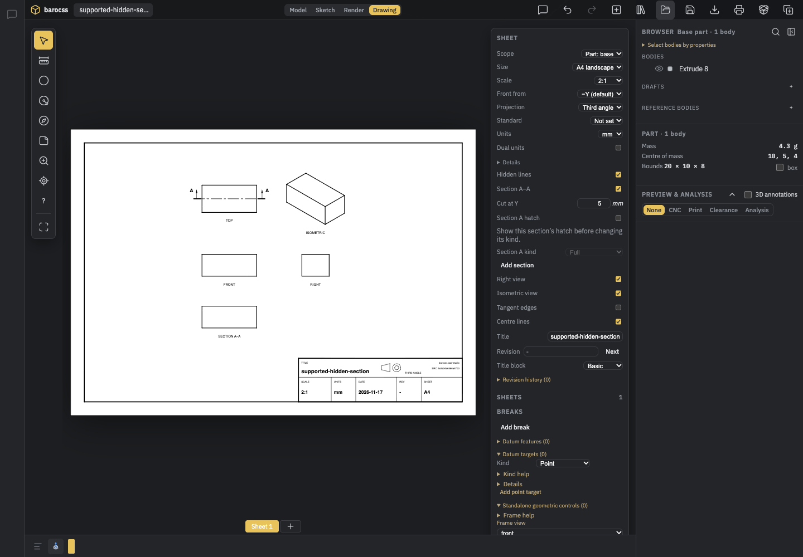

# #262 saved hatch field admission — 2026-11-17

## Boundary repaired

The new optional `hideHatch` field receives narrow saved-document admission in `drawing/savedSectionHatch.ts`, called by the existing `assertSavedDrawingDocument` boundary. The general `readDrawing` remains permissive; document entry points now reject an invalid/unsupported marked field before that reader can silently discard it. No schema5 promotion or historical migration.

Admission rejects invalid flag values, placement on the drawing/legacy section rather than an explicit section entry, unsupported section forms, duplicate/invalid flagged identity and explicit/implicit assembly scope. A supported full/principal part section survives. Existing recursive document admission also covers nested instance drawings. This does not redesign all drawing input validation or provide old-reader forward compatibility.

The earlier [late-reply note](../section-hatch-late-reply-2026-11-17/README.md) recorded this raw-file acceptance gap before this change. Its unresolved-gap statement is historical and is superseded for the marked-field admission covered here. Issue closure remains a parent audit/CI decision, not an automatic assertion by this note.

## Tests and actual result

- Model owner reports focused **10/10 PASS** (new admission4 + existing hatch6), shared frame/current-contract **16/16 PASS**, Model TypeScript and targeted lint **PASS**.
- Actual `/tmp/cad-section-hatch-admission-01`: first execution **PASS**, process exit0. All515 frozen sources unchanged, errors0/downloads0, context/browser/server cleanup complete.
- Driver syntax and `git diff --check` PASS. Parent final Studio TypeScript and production build **PASS**, exit0, build4.54s. Logs: `/tmp/cad-hatch-admission-studio-tsc.log`, `/tmp/cad-hatch-admission-build.log`.

Public Open starts from an own20×10×8 part with a shown full A section. Off/on first creates a nontrivial **dirty=true / Undo available** baseline. An attempted external file containing half section + `hideHatch:true` produces:

> Could not open this file … [DRAWING_OPTIONS] Saved section hatch: only full principal sections are supported. … Your part is unchanged.

The accepted Doc, filename, dirty=true, Undo/Redo controls, current selection snapshot, drawing hook and entire SVG remain exactly equal to the baseline. This is not a test with an injected fake rejection or a rewritten input. Current selection was preserved, but no extra nonempty selection was created for this run.

A subsequent public Open of a supported full section with `hideHatch:true` succeeds. The accepted document retains the flag, filename changes to the expected supported file, dirty is false, A checkbox is off and its diagonal hatch is absent.





Both original actual PNGs inspected at pixel level: explicit actionable refusal while prior named/dirty part remains; valid file then shows retained off state and A contour/name. Synthetic own data only, no private information. PNGs are unmodified copies.

## Limits

This browser run covers **external Open only**. OPFS/version/recovery paths have separate Model boundary tests; they were not replayed as actual UI here. Prior output, persistence and late-response suites are not re-executed or relabeled as new PASS. Old builds still do not understand the field and may discard it on re-save. Existing PDF golden/ASME limitations and all unrelated HOLDs remain unchanged.

From `apps/cad-studio`, established heavy gate/source freeze, Node22/PW_DIR/CHROME:

```sh
SECTION_HATCH_ADMISSION_FROZEN=1 node test/drawing-section-hatch-admission-browser.mjs /tmp/cad-section-hatch-admission-new
```

## Custody

- Receipt SHA256: `5ada86da0fde43433c4179f3a0362bc803896f25875a6b50b86d3923acdf7c68`
- Driver SHA256: `d8e528fab6de105b9c07fb972332cad24d159dccbd672c897e6be11314cdf4aa`
- `01-invalid-half-flag-refused.png` SHA256: `f8c2ab0e6e0e080c2e18629e2ad2e2cd38dce204e5e00ed567dbaaaaf52b4e60`
- `02-supported-hidden-full-section-opened.png` SHA256: `5ad0e1d04a90fc9683295ea4b871e6dd9387ebe35760b7a175b70a67ab65f2b5`
