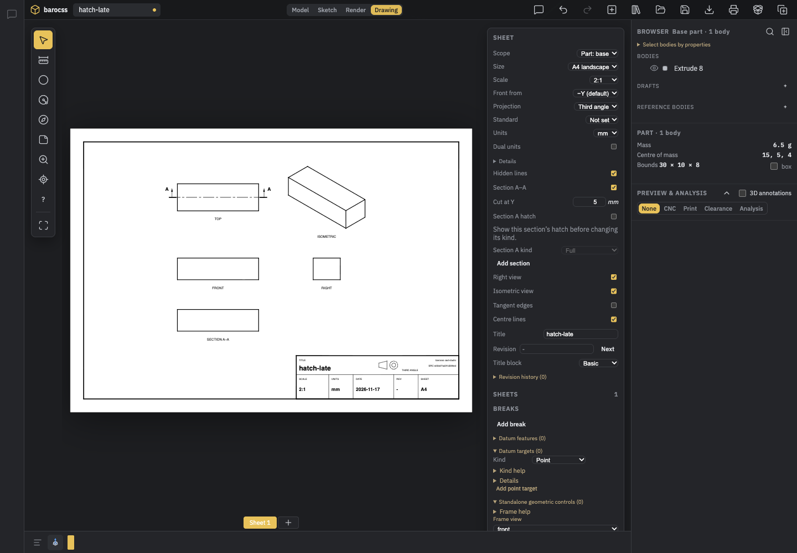
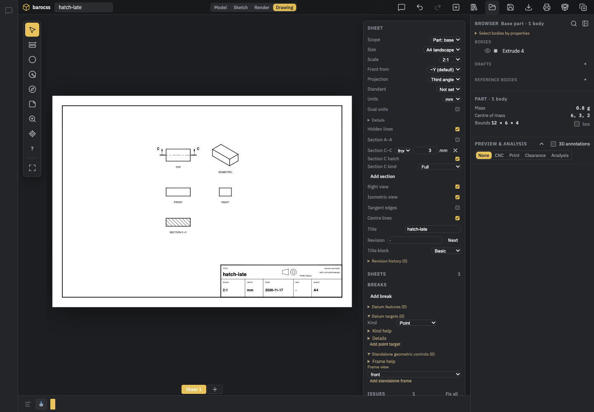
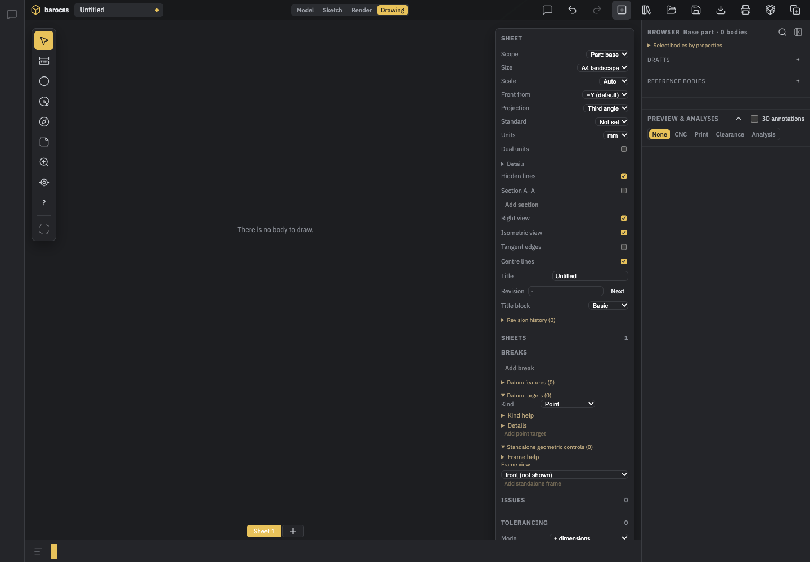

# #262 current hatch settings across source changes and late replies

2026-11-17, parent `3c41df857`. **Test/evidence only; no product changes.** Actual first run `/tmp/cad-section-hatch-late-01`: **PASS**, exit0, all515 frozen sources unchanged, errors0/downloads0, context/browser/server cleanup complete.

## Original response custody

The driver observes original outgoing per-worker `ids`/`added` wire tables to identify source nodes. It holds the actual `drawing` reply and subsequent original callbacks from that same worker, then invokes those callbacks with their original events in FIFO order. It does not rewrite request/response data, replace geometry, execute a fake response, or add a product debug hook. Full original held drawing payloads and callback/tick observations are retained in the receipt.

## Bounded actual results

| Case | Actual evidence |
|---|---|
| Accepted Width30, then current hatch off while drawing reply is held | Original drawing request id9 resolves rectangle max[30,10], extrusion8. A off is accepted before release. On release, A stays off and the current contour is60×16 paper mm at2:1; original body volume2400 mm³ agrees with30×10×8. No additional drawing request is caused by the toggle. Both callback/tick observations retain hideHatch true and checkbox false. |
| Open overtakes Width40 drawing | Original request id13 resolves max[40,10]. While held, public Open accepts a different12×6×4 document with section C. Open acceptance is observed before waiting for geometry, avoiding a FIFO deadlock. After release, C is shown/hatched, A is absent, volume288 mm³. All10 callback/tick samples preserve the new document and do not reinstall A. Selection and dirty state are preserved. |
| New overtakes C Width16 drawing | Original request id21 resolves max[16,6]. Public New accepts an empty document before release. All8 callback/tick samples retain that document with no old section groups or hatch checkboxes. Final UI remains empty, with no body to draw. |

The independent geometry expectations are explicit fixture arithmetic, not values inferred from the reply under test. The SVG contour check observes final drawn line coordinates; it does not use an unshifted layout rectangle. The body volume comes from the existing evaluated-body hook, not rounded mass-panel text.







All three original screenshots were inspected at pixel level: expanded30×10×8 with A off, new12×6×4 with C on and no A, then empty New document. Synthetic own fixtures only; no sensitive or private information. PNGs are unmodified copies.

## Completion boundary

These bounded actual **source-edit/current-settings, Open, and New late-response** checks close the corresponding evidence gaps in the [initial](../section-hatch-visibility-2026-11-17/README.md) and [lifecycle](../section-hatch-lifecycle-2026-11-17/README.md) notes. The earlier storage/output suites were not repeated, and their prior PASS results are not presented as new executions.

**#262 remains OPEN.** The original minimum contract asks that unsupported inputs not silently succeed, while the current permissive saved-file reader discards invalid/unsupported hideHatch. That raw-file reader contract remains a separate unresolved acceptance decision/implementation boundary. This late-reply run does not fix or approve silent discard. Older readers also lose the unknown field on re-save, as previously documented. No schema5/migration or other HOLD is lifted. ASME PDF mismatch and unrelated general concurrency scenarios remain outside these results.

## Reproduction and artifacts

From `apps/cad-studio`, Node22/PW_DIR/CHROME, established heavy gate and whole-checkout source freeze:

```sh
SECTION_HATCH_LATE_FROZEN=1 node test/drawing-section-hatch-late-browser.mjs /tmp/cad-section-hatch-late-new
```

Driver syntax and `git diff --check` PASS; product type/build are not repeated for test/evidence-only changes.

- Receipt SHA256: `4a26bbbe07e7cc805a63d055377a136f898e3f2891588fb9c1dde2585f14f6f6`
- Driver SHA256: `735d146dd30aa0b7aa279bfe95c8c790d3889bf4b60fae4b167ddea41649a10d`
- `02-released-current-width30-hatch-off.png` SHA256: `b8af24eeff39f2d5431a2017ad161b113b8df8c586ed1b72fc18a675dfdc7603`
- `04-Open-C-after-old-reply.png` SHA256: `0cd6c6bcba833c0fec3f0edd2da72e251b4f16bef0a1ef21a03796baf8f6a061`
- `05-New-empty-after-old-reply.png` SHA256: `fbba154e6af23e2c06912c29a5178c30de1709b14b130cfabebc3b637bf8a4b6`

## Subsequent admission evidence

The raw-field gap described above was subsequently addressed by the narrow saved-document admission change and [external Open acceptance](../section-hatch-admission-2026-11-17/README.md). The earlier OPEN reason is historical; issue closure is subject to the parent’s final audit and CI. The late-response results themselves are unchanged.
