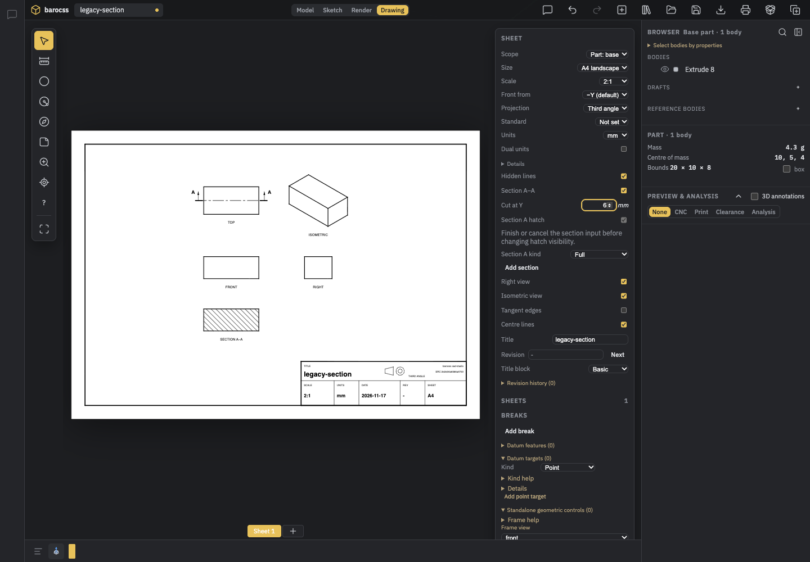
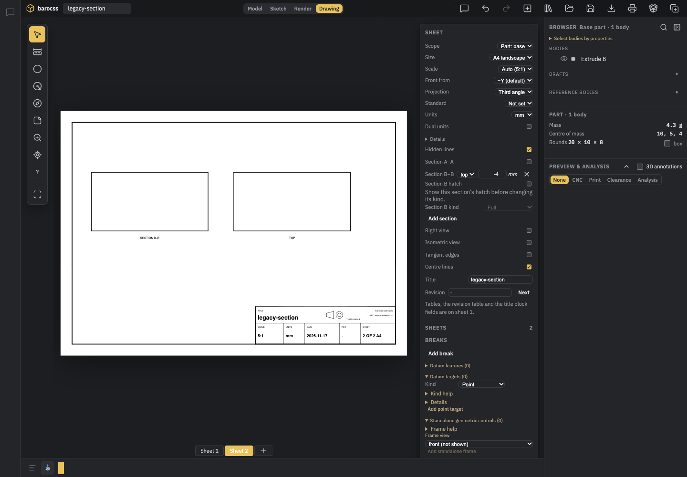

# #262 hatch lifecycle actual acceptance — 2026-11-17

Test/evidence only, parent `28e3edd34`. **Issue remains open:** source-edit/late-Worker and document-switch races are not covered here. This extends [initial hatch visibility acceptance](../section-hatch-visibility-2026-11-17/README.md), without repeating its output suite or changing product code.

## Final actual result

`/tmp/cad-section-hatch-lifecycle-04`: **PASS**, process exit0. 515 frozen sources unchanged; errors0, downloads0; context/browser/server cleanup complete.

1. **Legacy single A:** an own20×10×8 box begins with `section:{y:5}`. Public hatch off removes that shorthand and stores `sections:[{id:'A',view:'front',at:5,hideHatch:true}]`. OPFS Make version → Close project → reload → fresh Open preserves exact saved bytes and accepted document, checkbox off and no visible diagonal hatch. Show restores legacy shorthand; Undo/Redo restores the expected hidden/shown state.
2. **Uncommitted depth:** type6 in Section Y while accepted depth remains5. A real mouse pointer clicks the visible hatch label. Typed6 and input focus remain; accepted Doc, selection, dirty, Undo/Redo controls and drawing Worker count remain exactly unchanged. This verifies pointer protection, not a new Escape cancellation feature. Enter then explicitly commits6; Undo restores5.
3. **Parent-view sheet move:** public Add section creates B/top at−4. Public Add sheet and Move Top view to sheet2 move ordinary B with its parent. B appears only on sheet2; A remains only on sheet1. Set B off on sheet2, then A on on sheet1. Whole-document merge preserves IDs, cut definitions, original nodes and independent flags. Undo/Redo and a second OPFS save/reload/fresh Open retain A on/B off on their correct sheets.

Actual screenshots inspected at pixel level: pending input6 remains focused beside disabled hatch, and fresh sheet2 shows B contour/name without hatch plus Top, with no A. Own synthetic fixture only; no private information. PNGs are unmodified copies.





## Earlier attempts preserved, not product passes

| Run | Outcome and classification |
|---|---|
| lifecycle01 | **FAIL, harness actionability.** Legacy persistence/on/UndoRedo passed, but Playwright treated the checkbox-associated label as disabled and did not send the intended pointer click. Corrected to a real `page.mouse.click` at observed label bounds. |
| lifecycle02 | **CANCELLED/FAIL, setup error.** Relative-path edit failed before launch; unchanged harness was immediately stopped during navigation. Exit130; cleanup complete. No product acceptance counted. |
| lifecycle03 | **FAIL, harness precondition.** Actual pending-pointer and sheet-merge/UndoRedo assertions passed; second save tried to attach an already attached project and waited for an absent project-name field. Corrected attach helper to reuse the current project. |
| lifecycle04 | **Final PASS** after those test-only corrections; no product fix was needed. |

All four original receipts remain in their numbered `/tmp/cad-section-hatch-lifecycle-*` directories. Earlier partial progress is not substituted for the final complete run.

## Scope / reproduction

No SVG/DXF/PDF repetition, native-folder storage, shared GPU changes, schema migration, manufacturing approval or HOLD activation. Existing output and Model evidence remain separately qualified. **NOT_RUN:** source edit plus late responses, Open/New race matrix, and broader unsupported-form behavior. The initial note's actual legacy/sheet/pending gaps are addressed only by the final lifecycle04 evidence above.

From `apps/cad-studio`, Node22/PW_DIR/CHROME, established heavy gate and all writers frozen:

```sh
SECTION_HATCH_LIFECYCLE_FROZEN=1 node test/drawing-section-hatch-lifecycle-browser.mjs /tmp/cad-section-hatch-lifecycle-new
```

Driver syntax and `git diff --check` PASS. No type/build repetition for this test/evidence-only change.

## Custody

- lifecycle01 receipt SHA256: `a69937c9ada079207aaa12a0969b58d431115adfd2153f83b075e150adbaf5f3`
- lifecycle02 receipt SHA256: `0400042f2785a9cc481faca8a26fa9a3a243ade468fdefb2f9fb5a3525de0c47`
- lifecycle03 receipt SHA256: `355266523d864b5144e590704eb923fb6a16687745c0ad7b60f6b89f2e2d114f`
- lifecycle04 receipt SHA256: `11c18e34d64050343d98a5eaec6384b509ef0cf6ef66c13515a06b384805b3b1`
- `02-pending-depth-click-preserved.png` SHA256: `1035564809916f60b6e591febcfbbac7391348bcea99f1f9c9b5cda6d6b1e5f3`
- `04-fresh-split-sheet-flags.png` SHA256: `574dbc65134513fea7e7249b70d8dc84192ecdd30353735c4785b1fc0844d778`
- Driver SHA256: `fb0d0d5fe3c938615caf34b29249751f25c99e6f36304c30f007aeaf70479d6a`
