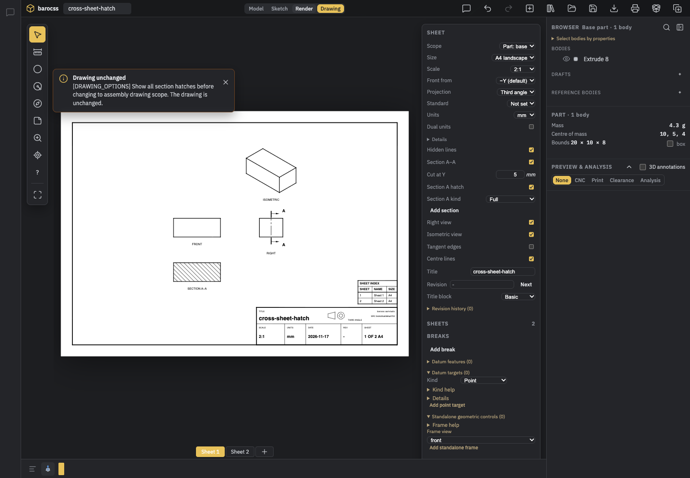
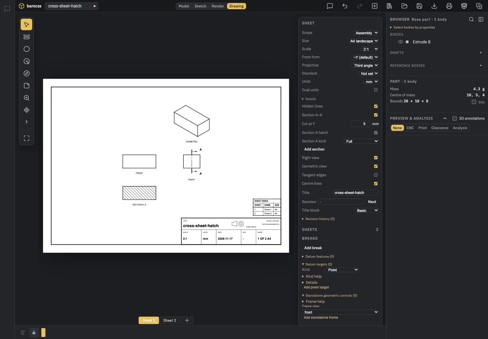

# #262 cross-sheet hatch scope protection — 2026-11-17

## Contract

A drawing with a hidden section remains part-scoped until the user explicitly shows every section hatch. Switching scope must not silently delete any `hideHatch` flag. The Studio commit boundary validates the merged whole drawing, not merely the current sheet; a hidden section on another sheet therefore cannot escape validation. Refusal occurs before the authored-state callback, and failed commits do not perform scope cleanup or change sheet selection.

Model `changeDrawingScope` and `withManufacturingDrawing` validate the final scope through `assertSectionHatchScope`. Studio performs this actionable scope check before saved-field validation and canonicalization. The existing drawing geometry and hatch geometry algorithms are unchanged.

## Actual public-UI acceptance

First run `/tmp/cad-hatch-scope-01` **PASS**, process exit0. Synthetic own 20×10×8 part; A/front is shown on sheet1 and B/top is hidden on sheet2. With sheet1 active, public Assembly scope selection is refused with:

> [DRAWING_OPTIONS] Show all section hatches before changing to assembly drawing scope. The drawing is unchanged.

The entire accepted Doc, filename, dirty state, Undo/Redo controls, selection snapshot, SVG and active sheet remain equal to the baseline. Scope stays Part. B is not present in the current sheet's controls, so this specifically exercises whole-drawing protection rather than only a local checkbox guard.

The user then switches to sheet2 and explicitly shows B, returns to sheet1 and selects Assembly. This succeeds. Nodes and section geometry remain unchanged; there are no hidden flags because the user explicitly showed the hatch, not because the scope transition removed them. The hatch control is disabled in assembly scope.

All515 frozen source files unchanged; errors0/downloads0; context, browser and server cleanup complete. This run does not repeat output, OPFS persistence or late-reply suites and does not claim additional nonempty selection coverage.





Both actual PNGs were inspected at pixel level: Part scope and actionable refusal in01, Assembly scope and disabled hatch control in02. Synthetic fixture only, no private information. These are unmodified original PNG copies. The receipt's ROOT_MUST_VIEW_SCREENSHOTS marker is a capture-time instruction, not a statement that review is still pending.

## Verification and limits

- Model owner: hatch/scope/manufacturing **24/24 PASS**, Model TypeScript and targeted lint **PASS**.
- Studio new scope commit tests plus existing drawing commit roundtrip: **7/7 PASS**; Studio TypeScript **PASS**.
- Small UI/helper/test/driver targeted lint **PASS**.
- **DrawingWorkspace lint remains FAIL with three existing unused-name errors**, not an overall lint PASS: `DrawingFix` at42:84, `_leader` at752:21, `_sheet` at752:37. Read-only `git show HEAD:apps/cad-studio/src/ui/DrawingWorkspace.tsx` confirmed the same declarations at those lines before this change. Log: `/tmp/cad-hatch-scope-workspace-lint-final.log`.
- Parent final production build **PASS**, exit0, **3.90s**: `/tmp/cad-hatch-final-build.log`.
- Studio logs: `/tmp/cad-hatch-scope-studio-tests-final.log`, `/tmp/cad-hatch-scope-studio-tsc-final.log`, `/tmp/cad-hatch-scope-studio-lint-final.log`.

This closes the supported UI scope-transition gap, not general assembly hatch support. Raw marked-file admission is documented in the [admission note](../section-hatch-admission-2026-11-17/README.md); permissive standalone readers and old-reader loss remain separately qualified there. Previous plain PDF golden failure and unrelated HOLDs are not reclassified. Overall issue closure is covered by the parent's final acceptance audit.

From `apps/cad-studio`, with the established heavy gate, full source freeze, Node22/PW_DIR/CHROME:

```sh
DRAWING_HATCH_SCOPE_FROZEN=1 node test/drawing-hatch-scope-browser.mjs /tmp/cad-hatch-scope-new
```

## Custody

- Receipt SHA256: `6aecca4740e2e6694e6e4bae3e487f2673b206ed694bdff5d17d2ca509c3c71f`
- Driver SHA256: `d62b52a251ede5ef3f0e52bbbfc650ecb8061ff10c966a6cd18d9f98fbb12d77`
- `01-other-sheet-hidden-scope-refused.png` SHA256: `42f18f5fc3c174574daea6c23c1089419a69abc2f7572ff5027c783a4b5575d3`
- `02-all-shown-assembly-scope-accepted.png` SHA256: `13bfb0f42290c9bdc0a8031da054611ee934bd461bdbd31d80d08276b07b9ded`
