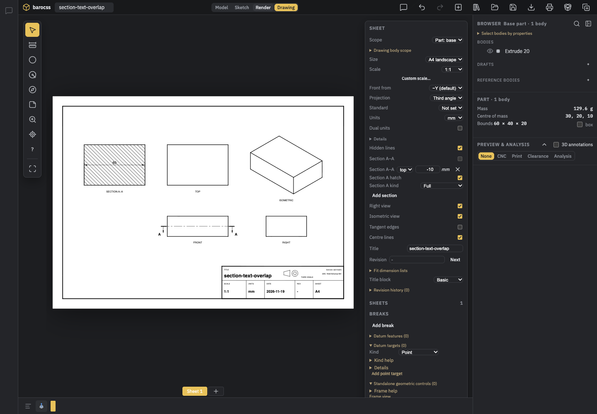

# #247: section text hatch clearance evidence

Prepared 2026-11-19. This is a bounded implementation evidence package, not completion of the broader issue. Commit, push and CI remain **NOT_RUN**. Regression and lint results, including existing failures, are separated below; this is not an all-green claim.

## Scope

Strict single made native base body; ordinary full section and resolved non-basic linear text. Derived Screen/SVG-only hatch subtraction, with no saved field or schema change. Original material rings, model/reference data and non-hatch marks remain unchanged. The caller refuses unknown native body count, purchased-only fallback, assembly/placed/selected-body scope and multiple outputs/bodies.

The public synthetic fixture is a 60 × 40 × 20 mm block, section A at top −10, with one 60 mm horizontal manual dimension. Endpoints were prepared through product projected references, not mouse-authored. Real public Open → Drawing → SVG download was exercised.

## Results and first failure

- **baseline01: fixture failure.** Open, Drawing and real SVG download succeeded; the independent parser found two section-A groups (body and cutting plane). It stopped rather than claiming a product failure. The parser was narrowed to the body group without `data-view`.
- **baseline02: PASS.** Actual downloaded SVG has 29 hatch segments; 2 intersect conservative final text bounds, totaling 5.552768131301716 mm inside the text quadrilateral.
- **actual01: PASS.** Protected, moved, Undo, Redo and reopened SVG downloads each have 32 hatch segments, zero intersecting segments and 0 mm inside text bounds. Independent Python checks the text/anchor/weight/size/position and 0.6 mm gap plus 0.125 mm round-cap radius (rounding tolerance accounted for). Material containment is checked too.
- Actual label drag changed only its authored `place`. One Undo restores the original document; Redo restores the moved document. Native Save bytes decode equal to the accepted document; fresh Open retains the moved reference and protection.
- All runs shown as PASS have empty source-change/error arrays and closed owned browser/context/server resources.
- **unit02: 14/14 PASS** remains the earlier result.
- **regression-model01: 242 PASS / 4 FAIL of 246.** One new dual/deviation test assumed a display contract incorrectly. The test fixture and an unused test variable were corrected without changing product files. The other three failures concern existing line/arrow output, original unit-output fixtures, and the plate DXF committed fixture.
- **Original-source head-compare01: 65 PASS / 3 FAIL of 68.** The same three existing failures recur; exact error-payload equality was confirmed by the coordinator. This is a focused baseline comparison, not a full original-source 246-case run.
- **unit04: 17/17 PASS** after the fixture corrections, including the three added dual/deviation, excluded-form/broken-view and deleted/unresolved-label cases. The full 246-case suite has **not been rerun after correction**.
- **Studio regression-studio01: 24/24 PASS. Model type02 and Studio type01: exit 0**, reported by the coordinator; type logs are empty.
- **lint02: FAIL with 3 existing unused-variable errors** in DrawingWorkspace (`DrawingFix`, `_leader`, `_sheet`). Original-source head-lint01 reports the same three errors. New test unused-variable lint was corrected. No lint-clean claim.
- Actual01 product files remained unchanged through these test-only corrections. No fresh heavy execution was performed while preparing this evidence update.

## Output identity

- Protected and Undo SVG SHA-256: `11be82e768e72feefa2fe22cc7a384bd02fab80698fe7064ccb26db441e6c08e`.
- Moved and Redo SVG: `4704c33f4c83f40cf4cec37280a468505e42cc74ab634a5e8f866e751304b08f`.
- Reopened SVG: `c8ab14bcc4e076c5dbf3c345e1d755d9200ac0e892aef137cbf66974d5b8b484` (fresh Open uses the saved artifact filename, so whole-file equality is not claimed).
- Native Save: `a3da44eb3fcce625fff7746dffba8033d3acc723074e6e070c3de3058430e5b6`.

Selected source/driver hashes, frozen-source counts, independent oracle results and artifact hashes are in [verification.json](verification.json). Raw receipts, HTML, source capsules and local absolute paths are deliberately excluded.

## Limitations

PDF and sheet DXF retain original hatching: unit byte-equality evidence only, **not actual download/reader verification**. Native 1:1 section DXF actual readback is NOT_RUN. No PDF golden/HOLD change. Original geometry preservation is supported by unit and document invariants, not independent volume measurement. Conservative product text bounds are not font/glyph certification. Screen screenshots and downloaded SVG checks are separate evidence; no independent pixel equivalence claim. Actual dual units/tolerances, source edits, late-worker replacement, multiple bodies, half/broken/detail/assembly sections are outside this execution.

## Unaltered synthetic screenshots

The three original PNGs were visually reviewed for private/authentication information and copied byte-for-byte. They contain only the synthetic CAD scene. This package does not claim public GitHub image rendering verification.
