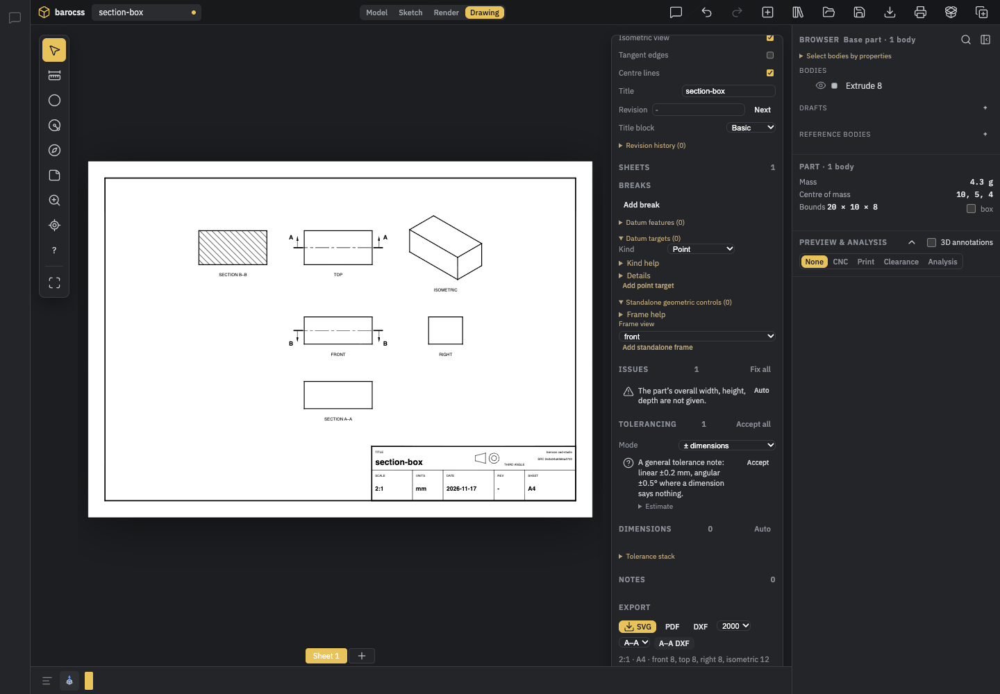
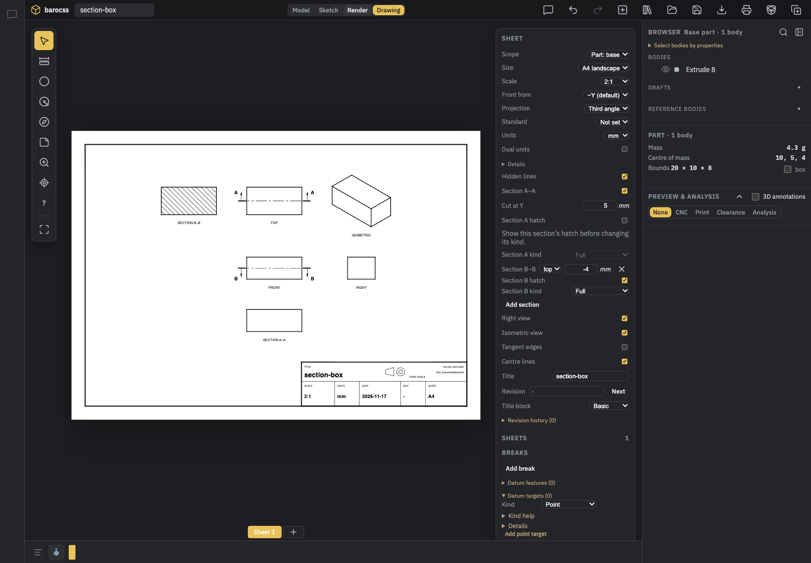

# #262 per-section hatch visibility — bounded implementation and acceptance

2026-11-17. **Issue remains OPEN.** This implements a saved drawing presentation choice for a full/principal section in a part drawing. It is not manufacturing approval, a kernel change, or a complete acceptance claim.

## Implemented contract

- `DrawingSection.hideHatch?: true`: omitted means the existing hatch is shown. A and B are independent. Hiding removes only the chosen section's hatch marks, not its projection/rings, boundaries, cut-line arrows, name, dimensions or references.
- Single legacy A switches to the existing `sections` list while hidden, preventing `section:{y}` shorthand from dropping the flag. Showing again restores the ordinary shorthand when eligible. No schema5 migration.
- The current accepted drawing settings, **not a cached SectionCut flag**, govern sheet marks. `sameSection` is unchanged. Studio strips the display-only flag from native projection input and its key, so changing it does not recut geometry.
- Sheet SVG/DXF/PDF consume the same marks. Section-derived details and datum-target hatches keep their existing behavior. Standalone 1:1 section DXF remains a geometry export with its original hatch.
- Studio enables the checkbox only for valid part scope and supported full/principal section forms. Assembly and half/offset/aligned/removed/revolved forms are not added. A hidden section's kind control asks for hatch restoration before changing kind. Pending section depth input prevents hatch-click blur commits.

## File and API boundaries

Current schema3/4 optional-field readers preserve this supported setting. **Older saved-file readers discard the unknown field; opening and re-saving with an older build can make hatch visible again.** This is not backward round-trip preservation. No migration HOLD is lifted.

The strict drawing command reader rejects invalid flag types and unsupported section combinations. The saved reader retains its existing permissive policy: unsupported/invalid hide flags are discarded, not treated as a newly supported form. Studio owns the effective part-scope restriction; the Model's drawing-settings-only API does not have a document scope to certify a single-part context. No generic assembly hatch feature is claimed.

## Validation

| Evidence | Result |
|---|---|
| New Model `drawing-section-hatch.test.ts` | **6/6 PASS**: legacy canonicalization, strict/permissive boundaries, sheet merge, cached cuts/current settings, referenced dimensions, through-hole/material rings and independent section export |
| New Studio `drawing-section-hatch-ui.test.ts` | **4/4 PASS**: visible defaults, supported scope/forms, pending input, native key/input omission |
| Model and Studio TypeScript + targeted lint | **PASS** |
| Studio production build | **PASS**, 5.53 s (`/tmp/cad-section-hatch-build.log`) |
| Existing six-file Model regression selection | **53/54**, one existing plain-PDF golden mismatch, not waived or called PASS |
| Actual Chrome `/tmp/cad-section-hatch-01` | **PASS**, 515 frozen sources unchanged; zero errors/downloads; context/browser/server cleanup complete |

The existing `drawing-sheets` plain PDF golden expected `d280596ee08f569553b20d08e72673421cb58fed919f1e0917128369a1dcd081`, actual `533e64765f48aeac1d244bc20b3aad7551feb08349b8d06ab1a69b619d5e4b66`. Parent verification identified the same existing hash failure. This feature does not fix it or the separately held ASME mismatch. Existing regression log: `/tmp/cad-section-hatch-existing-regressions.log`.

## Actual public-UI and output evidence

The own fixture is a 20×10×8 mm part (volume1600 mm³), front A at depth5 and top B at depth−4. The top depth sign follows the existing toward+Z/depth−Z contract. Independent expected native cut areas160/200 mm² are covered by the Model tests, **not measured by the browser's ring-count hook**.

- A off: A's 16 diagonal hatch lines disappear; B remains hatched. SVG non-hatch content, boundaries, names and other groups are unchanged. Model nodes, dimensions and selection remain unchanged.
- Off/on and Undo/Redo issue **zero drawing Worker requests**. Re-showing restores all four captured export byte sequences exactly.
- A+B OPFS Make version → close project → reload → fresh Open retains A off/B shown. This is the multi-section actual case, not a claim that the separate legacy-single-A actual scenario was exercised.
- Export clicks generate original SVG, sheet DXF, PDF and standalone section DXF Blobs. The driver intercepts the **download anchor after Blob creation**, captures original bytes, and suppresses browser downloads. It does not replace or synthesize exporter payloads.
- Independent browser XML parsing verifies A-only diagonal removal, B and all other SVG content identical, and physical297×210 mm size.
- A narrow independent DXF group-code/entity reader verifies HATCH count2→1, unchanged non-hatch entities after serialization-handle normalization, mm units and resolved handle references. It is not an ezdxf/general interoperability claim.
- A narrow PDF byte/content-stream reader checks xref location, declared stream length, A4 MediaBox and mm→point transform. Exactly16 line operators are removed; each is diagonal and lies within the final SVG A contour bounds. Other content operators are preserved. This is not a general PDF visual-renderer or standard-conformance certificate.
- Standalone 1:1 section DXF bytes are identical before/after hiding A.





Both original actual screenshots were inspected at pixel level: A contour/name visible without hatch, B still hatched; fresh control states match. Own synthetic data only, no personal information. PNGs are unmodified copies.

## Remaining acceptance / NOT_RUN

Issue #262 remains open. **Not run in actual Studio:** legacy single-A Save→fresh Open, source-edit plus delayed Worker response overtaking a toggle, section/sheet movement and later-sheet merge, full document-switch race matrix, and pending-depth pointer interaction (unit/UI wiring only). Hole/detail/datum and dimension-reference preservation are Model evidence, not an additional actual browser run. Native-folder storage remains HOLD; broad assembly/pattern editing, unsupported section forms, schema5 migration, shared GPU changes, manufacturing approval and ASME PDF repair remain outside scope.

Reproduce from `apps/cad-studio` under the established heavy gate and whole-checkout source freeze, with Node22/PW_DIR/CHROME:

```sh
SECTION_HATCH_FROZEN=1 node test/drawing-section-hatch-browser.mjs /tmp/cad-section-hatch-new
```

## Artifact custody

- Actual receipt SHA256: `54375525a544dd9c993334acce9844b948028c7187c690bc34a2c302f698332c`
- `02-A-hidden-B-shown.png` SHA256: `c4432eba7d441fe6b21586c56044693bf86cc33f996e5dfc5c646bb9cf38e67c`
- `04-fresh-OPFS-hatch-setting.png` SHA256: `d3d2fdc345da071244837e7dda0159d0c64df0a82c21a64844a32a024d9eae62`
- Raw capture bytes and receipt remain in `/tmp/cad-section-hatch-01`; the committed driver records capture hashes in its receipt. No product outputs were silently substituted.
