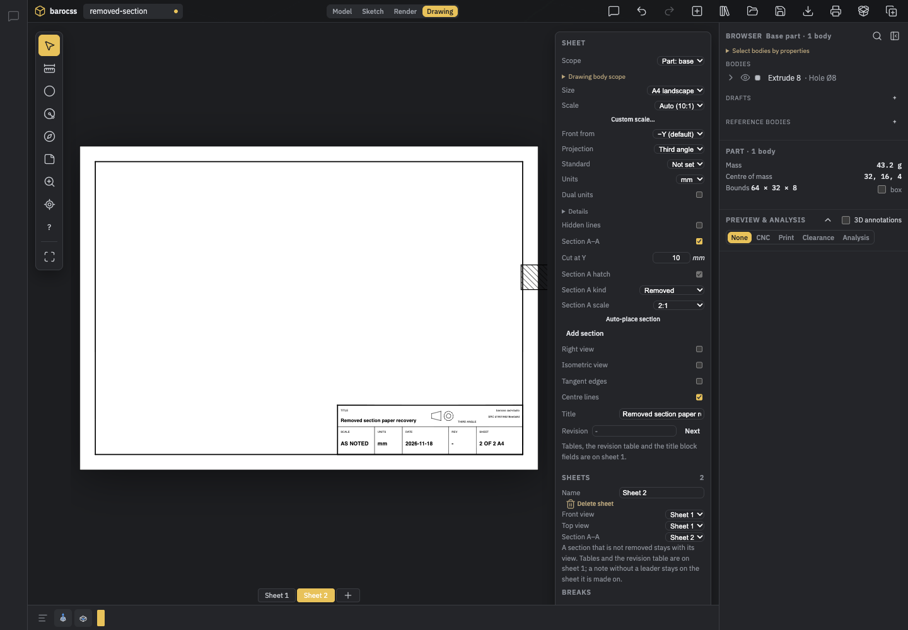
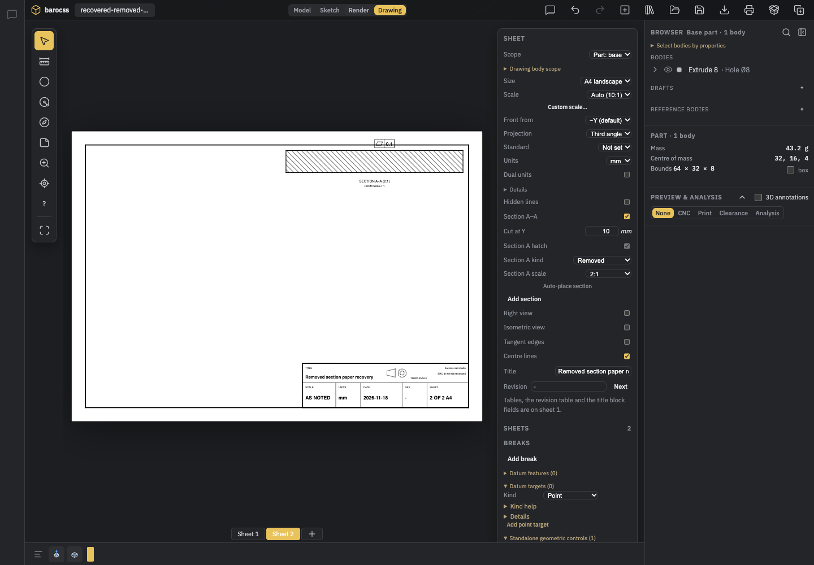

# Removed-section paper position recovery

A removed section with an explicit A3 paper location can remain outside an A4 continuation sheet after reassignment. The section controls now provide **Auto-place section**, which removes only `removed.at` and uses the existing layout on the assigned sheet. It preserves the cut, section identity, explicit scale and annotations. The control is disabled when already automatic or a section input draft is pending.

## Verification

- Focused helper and adjacent detail tests: 6/6 passed. Covers unchanged geometry identity, explicit scale preservation, no-op variants and continuation-sheet merge/annotation ownership.
- Actual local Google Chrome, frozen source: PASS. A3 section moved to A4 sheet 2 starts at `[286,77,414,93]` mm, outside the page. Auto-place restores `[155,14,283,30]` mm at 2:1 (128 × 16 mm), without modifying cut, source nodes, flatness frame or sheet ownership.
- Undo restores the off-sheet override; Redo restores automatic placement.
- Actual downloaded SVG independently checked for the section bounds, label and flatness value. Native Save and fresh Open preserve the recovered document and placement.
- Before/reopened screenshots visually inspected. Browser/server cleanup and source freeze checks passed.

Reproduction: `SECTION_PAPER_POSITION_FROZEN=1 node apps/cad-studio/test/section-paper-position-browser.mjs <output-dir>` with the repository browser harness Chrome/PW_DIR environment.

## Limits

One front removed section, A3 to A4, native Save/Open and SVG. No PDF/DXF, physical print or general annotation collision certification. Auto-place never silently shrinks an explicitly scaled section and does not guarantee that arbitrary oversized content fits. Existing HOLD and schema contracts remain unchanged.

