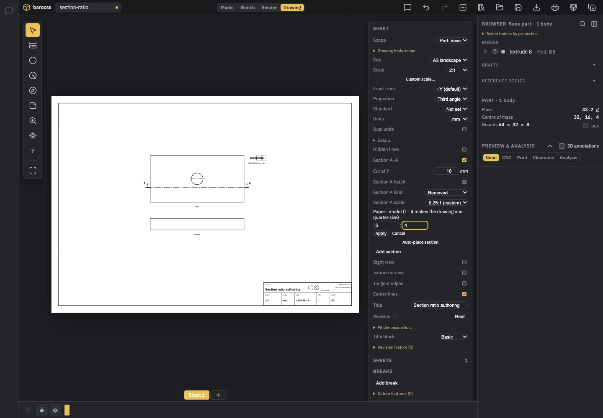

# Removed-section paper:model scale authoring

Removed sections now expose Custom scale using the shared explicit ratio editor. The existing `sheet` option value and “The sheet’s” label are preserved via optional automaticValue/automaticLabel props, while default sheet/detail Auto behavior remains unchanged. Drafts belong to the section object and do not survive document replacement. Apply/Enter commit; Cancel/Escape and invalid ratios preserve the document. No cut, schema, geometry or annotation-ownership changes.

## Verification

- Focused 10/10: section/detail custom readback and opener, ratio parser, sheet independence and section paper preservation. Studio type/lint PASS.
- Actual section Chrome PASS: 1:4 gives16×2mm;5:4 gives80×10mm from64×8mm cut. Sheet scale2, cut at10, paper position, source and flatness frame unchanged. Invalid blank/zero/negative/nonfinite/too-large ratios, Cancel/Escape, Undo/Redo, native Save/fresh Open, replacement-document draft isolation PASS.
- Explicit “The sheet’s” transition removes only removed.scale and renders at sheet scale2, retaining paper position and cut.
- Actual SVG download contains SECTION A–A (1.25:1) and flatness value. Export retained here; this does not qualify general annotation collisions.
- Actual detail-ratio and existing two-sheet ratio browser regressions each PASS, including their native/SVG flows.
- Draft/reopened screenshots inspected. Source freeze/cleanup passed.

Driver: `SECTION_RATIO_AUTHOR_FROZEN=1 node apps/cad-studio/test/section-ratio-author-browser.mjs <out>` using harness Chrome/PW_DIR. Regression drivers: detail-ratio-author and sheet-custom-scale with their normal frozen environment flags.

## Limits

One principal front removed section with flatness frame. No aligned-section authoring flow, PDF/DXF/physical-print or general collision/fit certification. Existing manual paper position can overlap neighboring views and is intentionally unchanged. Auto-place remains separate. Parent epic/HOLD unchanged.

