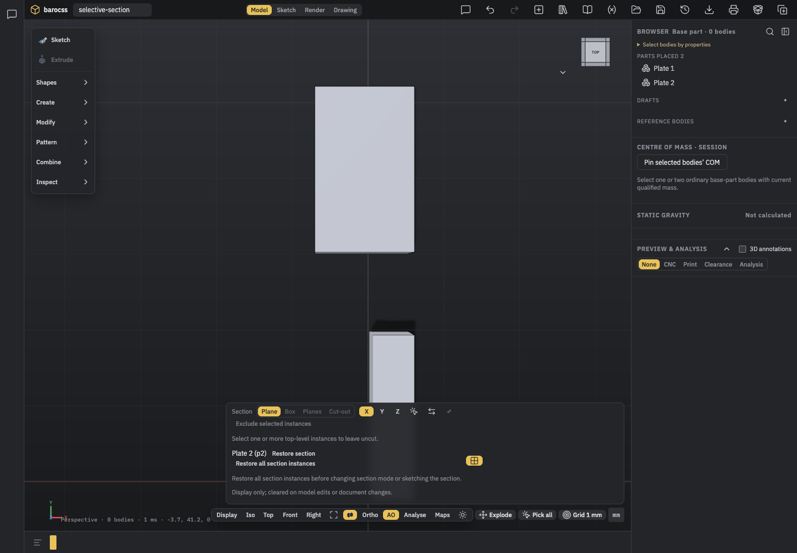

# #258: selective single-plane section, bounded implementation

Synthetic fixture only. No personal documents or credentials. Existing issue stays OPEN.

## Delivered
- Explicit top-level occurrence IDs may be excluded from a single plane and individually/all restored. Shared definitions are unchanged.
- CPU section applies each pose once and preserves native provenance without a new cap on excluded instances. GPU surface/edge/thread clipping and bounds honor the same mask.
- Session-only state clears on Close, accepted document identity changes (including edits/Undo), and fresh Open. Nested paths are rejected, not promoted. No persistent schema changes.
- Other section modes and Sketch section are explicitly blocked while exclusions exist. Visibility filtering remains upstream.

## Verified on the frozen working tree
- Related unit/regression selection: **21/21 PASS**, including 2 actual `GpuRenderer.bounds` method tests with a mocked world (not a device/shader test), session hook and CPU provenance, prior planes/cutout/instance-pose tests.
- Actual Chrome **PASS**, native WebGPU section and forced CPU section on the same WebGPU viewport. Two rotated shared 20×12×8 boxes: removed-side probe misses p1 but hits only excluded p2; public clicks agree. Restore and Close return expected hits. Live offset hook preserves the mask.
- Public F/Frame all executed in each path; camera and picking observed. Screenshots show full p2 and cut p1. The expanded section panel partially obscures p1: this is **not** a claim of complete unobstructed framing. Exact bounds are separately verified by the mocked-world tests, not inferred from camera target.
- Native document, displayed feature history, dirty flag and Undo enabled state unchanged. Initial Undo was enabled and remained enabled; this does **not** prove entire Undo-stack equality.
- Actual native Save equals the original synthetic document; fresh Open clears the section/exclusion session and retains both original occurrences.
- Studio `tsc --noEmit` PASS. `git diff --check` PASS. No source changes during browser run; console/page errors empty; both contexts/browser/server closed.

## Limits / remaining issue acceptance
Native WebGL2 backend qualification, full native-edge/cap picking matrix, actual hidden/isolation/source-refresh/delete-Undo interruption matrix, arbitrary geometry/threads/silhouettes, complete Undo-stack proof and unobstructed Fit layout remain unqualified. Forced CPU is not a native WebGL2 run. Plane setup/live drag/CPU selection use existing test hooks; exclusion/restore/selection/Save/Open/F use public controls. No new GPU CI, schema5, manufacturing, physics, PDF, release or deployment scope.

## Reproduce
From `apps/cad-studio`: `node scripts/test.mjs section-selective section-exclusion-session section-view section-planes section-cutout instance-pose`, then root TypeScript binary with `--noEmit`.
From repo root, with PW_DIR and CHROME configured: `SECTION_SELECTIVE_FROZEN=1 node apps/cad-studio/test/section-selective-instance-browser.mjs <fresh-output-directory>`.

