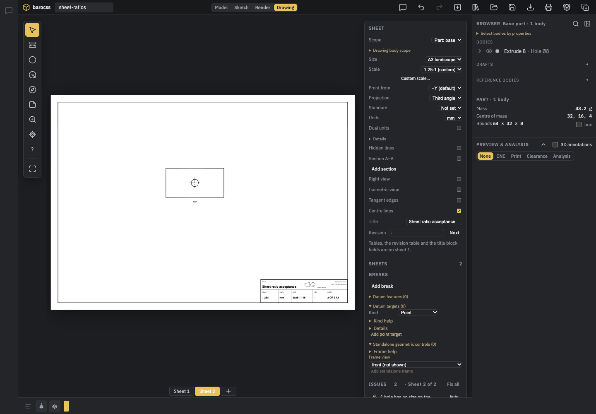

# Explicit drawing sheet ratios

Base `134a7c102` (latest SubD local-rotation included). Bounded #180 drawing improvement, not whole-epic acceptance.

## User workflow

Sheet Scale previously offered only the standard preset array. Ratios such as 1:4 or 5:4 could be represented in native settings but not authored directly in this control. **Custom scale…** now opens an explicit **Paper : model** ratio editor. Apply/Enter makes one existing drawing-settings commit; Cancel/Escape leaves the document untouched. Blank, zero, negative, nonfinite, overflow/underflow or resulting scale above 1000 is refused. The result is bounded to the existing continuation-sheet file contract `(0,1000]`; the file stores the existing numeric `scale`, not the original ratio spelling. A nonstandard current value has an exact selected option instead of falling back to Auto. Presets and Auto remain available.

Drafts are owned by the current settings object. Changing sheet/document/settings hides an old draft, even if the displayed scale happens to match. No geometry, schema, Model API or automatic-layout preset changes. The chat `drawing.set` standard-scale-only contract remains unchanged. This is Studio authoring, not expanded agent API support.

## Verification

Actual Chrome runs01 and02 PASS (`SHEET_CUSTOM_SCALE_FROZEN=1`, Node22.19).

- Synthetic existing starter plate: 64×32×8 mm, front on sheet1, top on sheet2. Sheet1 1:4 stores0.25; sheet2 5:4 stores1.25, independently.
- Blank, zero denominator, negative, scale1001 and Infinity show refusal without document changes. Cancel and Escape preserve the document.
- Unapplied draft on sheet1 does not enter sheet2. New native document removes the old draft. Undo/Redo retain exact accepted settings and geometry nodes.
- Actual SVG downloads, parsed without product geometry imports: front outer line-coordinate bounds **16×2 paper mm**, top **80×40 paper mm**, matching literal64×8×0.25 and64×32×1.25. Both exports retained here.
- Actual native Save download/fresh Open preserves both scales and renders the correct current selector. Auto removes only the selected continuation scale and keeps the first sheet's scale.
- Focused tests13/13: ratio validation/continuation persistence3 + adjacent drawing regressions10. Studio type check, targeted lint and diff check PASS.
- Reopened screenshot directly reviewed. No baseline browser needed for the new authoring feature; missing controls/preset restrictions were source-confirmed. Run01 passed. Final review changed editor initialization to exact saved scale:1, avoiding reciprocal roundoff/overflow when opening existing values. Run02 rechecked final sources and added initial ratio / Apply no-op checks; passed.

Limits: no PDF/DXF, physical print, dimensioned/section/assembly drawing acceptance, full arbitrary-range layout precision, chat API widening or new schema. Existing drawing fit warnings remain authoritative; custom scale does not auto-fit or promise that views fit.

```sh
node apps/cad-studio/scripts/test.mjs sheet-custom-scale detail-custom-scale detail-paper-position detail-crop-edit
node node_modules/typescript/bin/tsc --noEmit -p apps/cad-studio/tsconfig.json
node node_modules/eslint/bin/eslint.js apps/cad-studio/src/ui/drawing/SheetScaleControl.tsx apps/cad-studio/src/ui/drawing/SheetSettings.tsx apps/cad-studio/test/sheet-custom-scale.test.ts
SHEET_CUSTOM_SCALE_FROZEN=1 PW_DIR=<existing-playwright> CHROME=<Chrome> node apps/cad-studio/test/sheet-custom-scale-browser.mjs <output>
```


