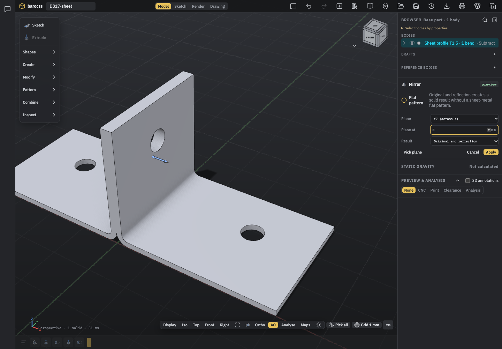
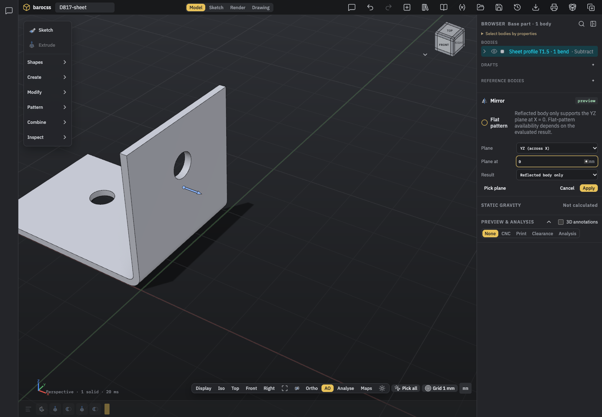

# #27: Explain sheet Mirror results before Apply

Limited existing-issue guidance; #27 remains OPEN. No geometry, topology, saved schema, manufacturing capability or document-sync change.

## Original baseline
Original main 0d9443ce92f7a70ae0014b75a565339398ba2918 passed the existing D817 asymmetric L-bracket reflection lifecycle, but neither result mode explained flat-pattern availability before Apply. Combined output is a valid solid with no sheet metadata and native flat-pattern CAPABILITY refusal. Reflected-only origin YZ preserves the qualified sheet and flat. This was an information gap, not geometry corruption.

## Change
Only a single selected sheet body gets an additional Mirror step. Combined mode says it creates a solid without a sheet-metal flat pattern. Reflected-only states the existing YZ / X = 0 restriction and explicitly leaves flat availability to the evaluated result. The step is not marked complete, so it does not certify a preview's flat geometry. Non-sheet, no selection and multi-selection do not gain this instruction. Existing picked/fixed-plane instructions are retained.

## Verification
- Actual Chrome D817: both mode instructions before Apply; offset X = 5 and XZ refused with Apply disabled and source unchanged; recovery to YZ / X = 0; Cancel preserves source; same-session body reselect and Mirror re-entry; Apply, Undo/Redo and OPFS Save / reload / Open: PASS.
- Existing independent native geometry and flat oracles remain unchanged: combined volume 5935.536489519336 mm³ and no sheet flat; single reflection volume 2967.7682447596635 mm³; flat area 1974.2710130907633 mm², asymmetric holes, bend orientation and fixed-face normal verified after reopen.
- Mirror-focused model tests 9/9 PASS, including non-sheet fixed-plane and saved edit regression.
- First Model type-check failed only on the new heterogeneous test-array inference. Explicit Values[] annotation corrected it without changing runtime values, product or actual driver. Focused test rerun 2/2 PASS; final Model tsc, Studio tsc and Vite build PASS. Existing bundler warnings remain.
- ESLint and diff check PASS. Browser receipt errors=[], changes=[]; contexts, browser and server closed. Both preview screenshots visually checked.

Actual native qualification is the existing one-bend, two-hole asymmetric L-bracket in origin YZ. No arbitrary reflection plane, general sheet flattening, downstream reference or manufacturing qualification is claimed. Save/Open uses reload in the same browser context, not a new browser context.

Run from repository root with frozen source:
`MIRROR_GUIDANCE_EXPECT=1 D817_SOURCE_FROZEN=1 node apps/cad-studio/test/sheet-move-browser.mjs OUTPUT --mirror-replacement`
Omit MIRROR_GUIDANCE_EXPECT for the original baseline; baseline observes the existing UI without asserting the new instruction.

