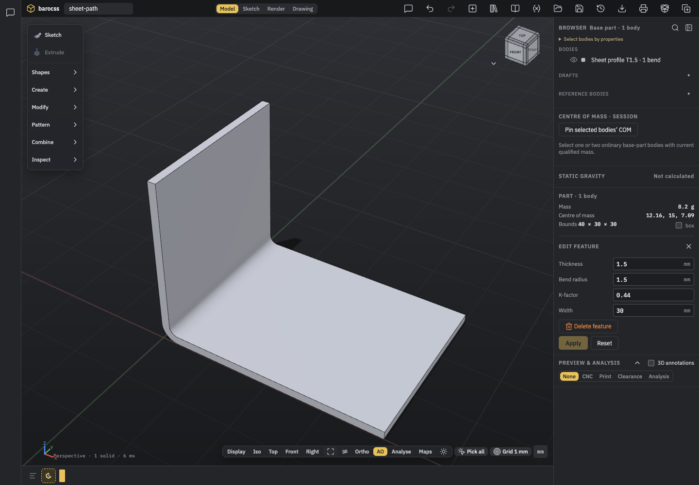
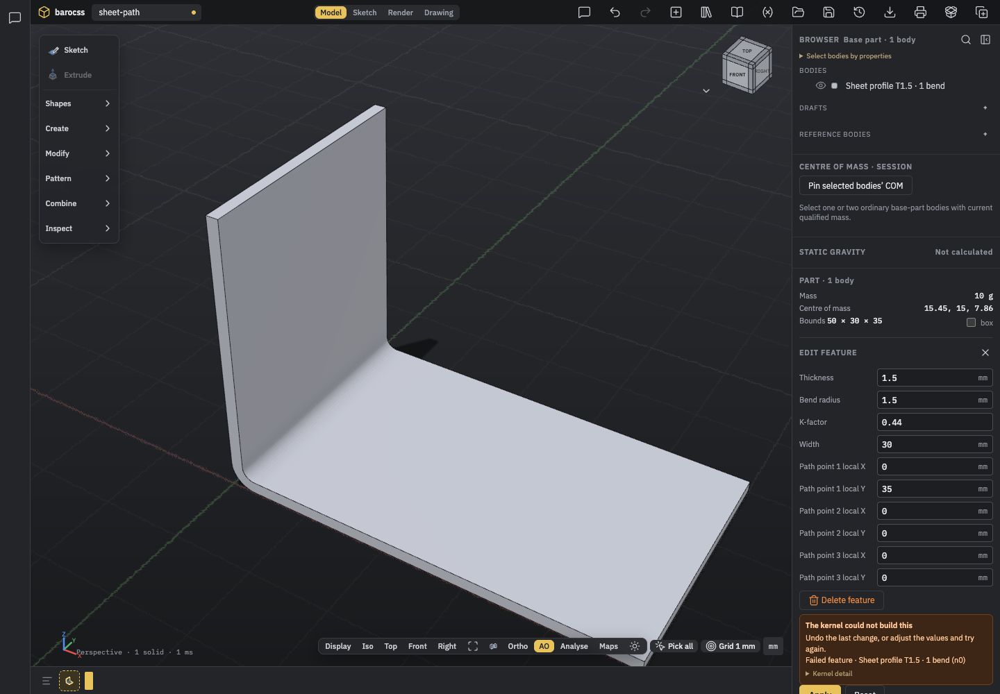
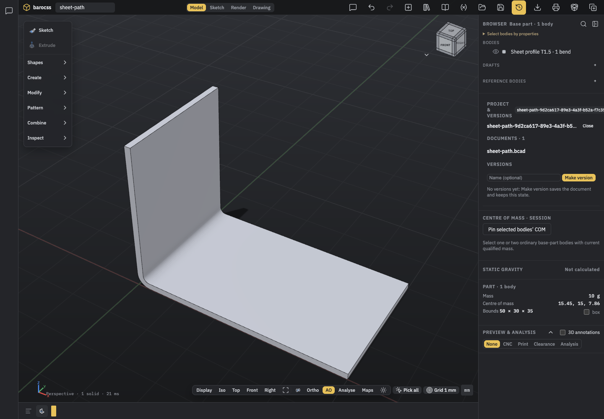

# Sheet profile local path History editing · #27 · 2026-11-18

A Sheet profile's authored section points can now be edited in History. Fields explicitly say `Path point N local X/Y`: local Y is world Z in the default XZ profile plane. This is coordinate editing, **not** inferred Base/Leg/Bend angle controls or automatic preservation of an L/U/Z/Hat family. Coordinates remain independent.

Only `app/editFields.ts` changes product behavior. Each setter immutably changes one existing coordinate leaf and preserves point count/order, ID, material side, plane, thickness/radius/K or bend table and all downstream nodes. The existing parameter binding wrapper binds the exact coordinate leaf. Existing native draft evaluation accepts or refuses geometry; there is no clamp, automatic repair, new kernel capability or schema change.

## Verification

- Focused new7 + existing9 = **16/16 PASS**: L/U/Z/Hat field mapping and immutable leaf updates; existing2/64-point field-count boundary; exact parameter bind/update/unbind and document roundtrip; independent folded volume and flat lengths; coincident/radius-unfit refusal; downstream literal circular hole identity and volume/flat hole preservation; unchanged bend table and unsupported-angle refusal.
- Model and Studio type checks PASS; Vite production build7.04s PASS. Scoped lint and diff check PASS.
- Static independent review found no product blocker. In-memory mutation on the existing first immutable-coordinate test: control1/1 PASS; wrong coordinate axis and direct mutation of the input tuple each produce1FAIL. No product/test files changed. This is one test, not a full mutated native suite.
- Actual baseline03 PASS records missing History path fields. The worker's own fixed file was preserved separately and restored byte-for-byte after temporary HEAD baseline evaluation.
- Actual fixed01 whole flow PASS: base40→50, leg30→35; coincident base0 evaluation refusal with accepted document/native/dirty/UndoRedo unchanged; valid51 draft recovery then Close cancels it, leaving50; two-step Undo/Redo; OPFS Save, Close, page reload, reattach and Open; fields and geometry preserved.
- Browser product/source capsule1073 files unchanged through cleanup, runtime/console errors0, context/browser/server closed. Actual screenshots viewed.

The synthetic profile is `[[0,B],[0,0],[A,0]]`, side left, plane origin[0,30,0], normal[0,-1,0], xAxis[1,0,0], width30, thickness1.5, radius1.5, K.44. Original live native `flatPatternOf` is used, not a deserialized B-rep claiming retained sheet metadata. Native/Worker volume is checked against `30*1.5*(A+B-6+(π/2)*2.25)`. Developed length is `A+B-6+(π/2)*2.16`; the four exact flat boundary segments and independent shoelace area are checked. Final A50/B35 gives volume3714.0431280879834mm³, length82.39292006587698mm and flat area2471.7876019763094mm². K.44 is a fixture value, not calibrated shop data.

## Failures and limits

The first focused run had3 failures because its flat box oracle assumed X was developed length. The declared fixed-face frame puts width along X and developed length along Y; correcting the fixture axes yielded13/13, then the three extra tests yielded16/16. No product change was made to fit that oracle.

Baseline01 used outputs{} and strict expected-document comparison timed out because Open correctly derives b0. The fixture now explicitly declares b0. Baseline02 accidentally omitted `--baseline`, so it tried fixed expectations against old code and failed on absent fields. Baseline03 with the correct flag passed. Both failed receipts remain. The first Studio type command used a nonexistent package filter and was **NOT_RUN**, not a pass; the corrected command uses `@barocss/cad-studio-app`.

Actual browser scope is one orthogonal L and scalar K. Arbitrary-path geometry, actual U/Z/Hat editing, new angle controls, individual bend radii, bend-table UI, flange/relief retargeting, external CAD/DXF/STEP, fresh browser-process recovery and physical fabrication validation are not certified here. The downstream hole and bend-table checks are focused tests, not browser coverage. OPFS reopening is in the same browser context after reload. #27 stays OPEN for its remaining requirements. Manufacturing/equipment and all other HOLDs remain unchanged; no roadmap/doc-sync or release action.

```sh
node packages/barocss-cad-model/scripts/test.mjs sheet-path-edit sheet.test
pnpm --filter @barocss/cad-model type-check
pnpm --filter @barocss/cad-studio-app type-check
cd apps/cad-studio
SHEET_PATH_SOURCE_FROZEN=1 PW_DIR="$HOME/.cache/barocss-playwright" CHROME='/Applications/Google Chrome.app/Contents/MacOS/Google Chrome' node test/sheet-path-edit-browser.mjs /tmp/sheet-path-fixed
```




