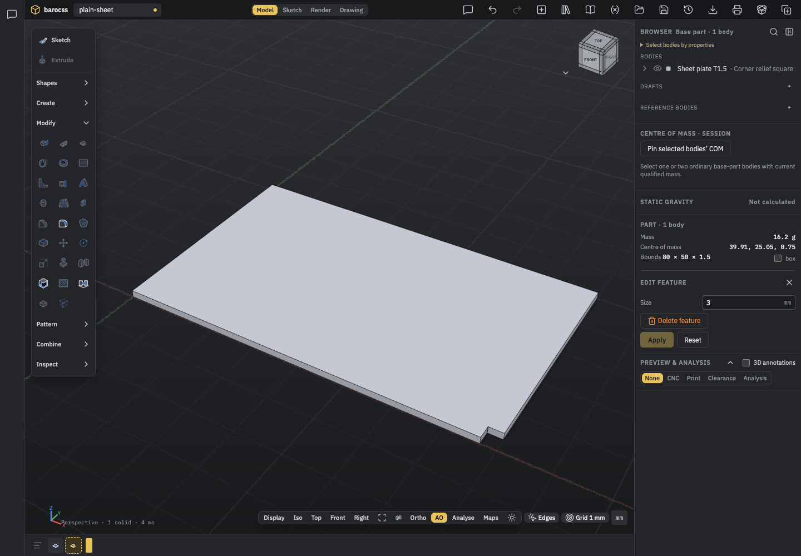
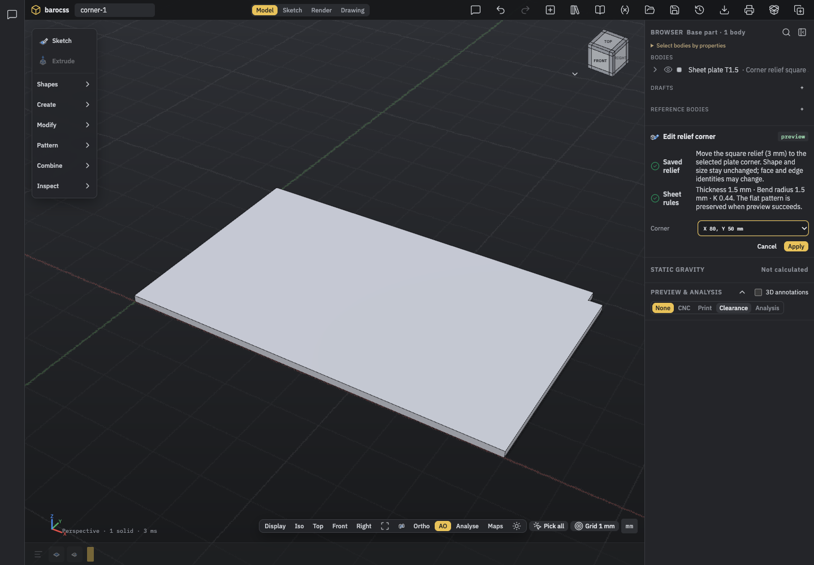
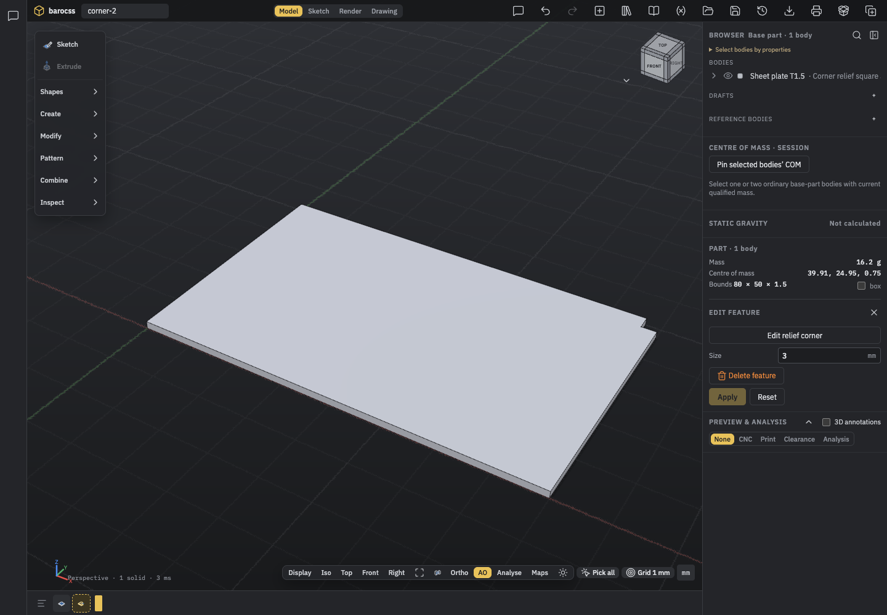

# Corner relief: explicit saved-corner reassignment (#27)

## Scope and baseline

On baseline `fddd9f82683a962c6b72e1d181032da5509edd2e`, an actual corner-edge pick and Corner relief command created a Square 3 mm relief on an 80 × 50 × 1.5 mm plate. History exposed Size but no corner reassignment. Native location, volume 5986.5 mm³, centroid, all 12 vertices, flat six-segment boundary, Undo/Redo and physical Save/fresh Open passed. This is an editing gap, not data loss.

History now offers **Edit relief corner** only for a plain numeric XY rectangle → numeric Sheet base → single terminal Corner relief. The four corners are explicit choices with coordinates. Shape, size, source sketches, sheet rules and feature IDs are preserved. Apply-time proof checks the original eight vertices, twelve straight edges, six axis planes, incidence, semantic names and original saved signature. The selected original corner receives its native signature; this is explicit reassignment, not automatic reference repair. Original and candidate strict solids, sheet reports and flat results must validate. Document identity/revision and existing saved-command owner guards remain mandatory.

Before Apply, the HUD shows shape/size, thickness, default bend radius, K-factor and that the flat pattern is preserved when preview succeeds. Face/edge identity changes are disclosed.

## Verification

- New focused tests 7/7; existing Flange radius tests 6/6; scoped lint/diff checks PASS.
- New native unit oracles cover Square and Round at all four corners, analytic volume/centroid, square vertices/flat boundaries, file roundtrip, return to original corner and exact prefix preservation.
- Rejection tests cover invalid choice, cloned/in-place changed owner, downstream feature, metadata/direct content, parameter dimensions, invalid signatures and invalid oversized original relief (including no-op). Runtime `direct: undefined` and shifted non-square rectangles are positive controls.
- Actual Chrome: real source edge pick and creation; three explicit moves across remaining corners; native cut coordinates, volume/centroid, all vertices and flat boundary; visible volume; repeated Undo/Redo; physical Save/fresh Open after each move; Cancel preserves the last accepted document. Apply-before sheet-rule guidance and History entry rendered and inspected.
- Existing actual Flange radius and Sheet path editing regressions PASS.
- Initial Model type check failed because the `never` arrow helper did not participate in narrowing and a downstream test used `move` instead of the schema's `translate`. Changed to an equivalent throwing function declaration and valid test type; focused 13/13 and final actual rerun PASS. Final Model type check, Studio type check and Vite production build PASS. Earlier Studio build was NOT_RUN, not counted as a pass. Existing bundler warnings remain non-fatal.
- Actual receipts report no page/console errors or frozen-source changes; contexts, Chrome and Vite closed. Final available disk approximately 46.7 GiB.

## Reproduction

From repository root, with Node 22, installed workspace dependencies, `PW_DIR` pointing to Playwright and `CHROME` to Chrome:

```sh
SHEET_RELIEF_CORNER_HISTORY_SOURCE_FROZEN=1 node apps/cad-studio/test/sheet-relief-corner-history-browser.mjs /tmp/relief-corner-proof
pnpm --filter @barocss/cad-model test sheet-relief-corner-history flange-radius
pnpm --filter @barocss/cad-model type-check
(cd apps/cad-studio && pnpm build)
```

The fixture's `--baseline` mode is for the baseline commit, before the new control exists.

## Limits

Actual browser coverage is a Square relief on the specified XY plate. Round, shifted dimensions and adversarial ownership/signature cases are unit/native tests, not browser claims. Downstream references, multiple reliefs, flanged sheets, inherited/bound sizes, arbitrary planes, bend tables, manufacturing qualification, generalized repair and other #27 work remain unsupported or out of scope. Existing HOLDs and file format are unchanged. #27 remains OPEN.

All images and model values are synthetic; no private data or credentials.




