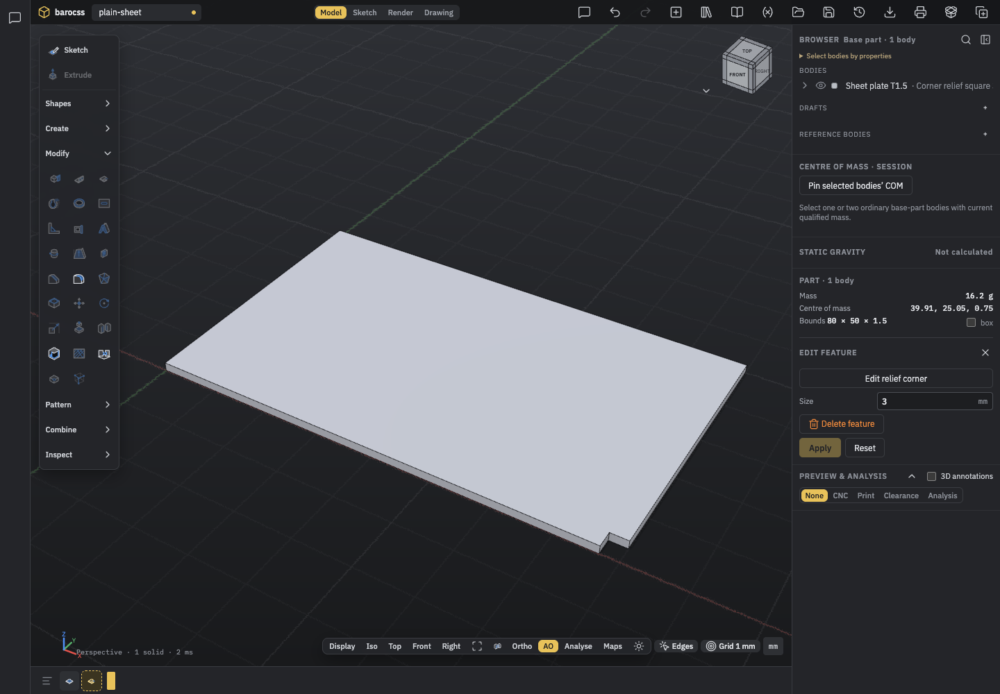
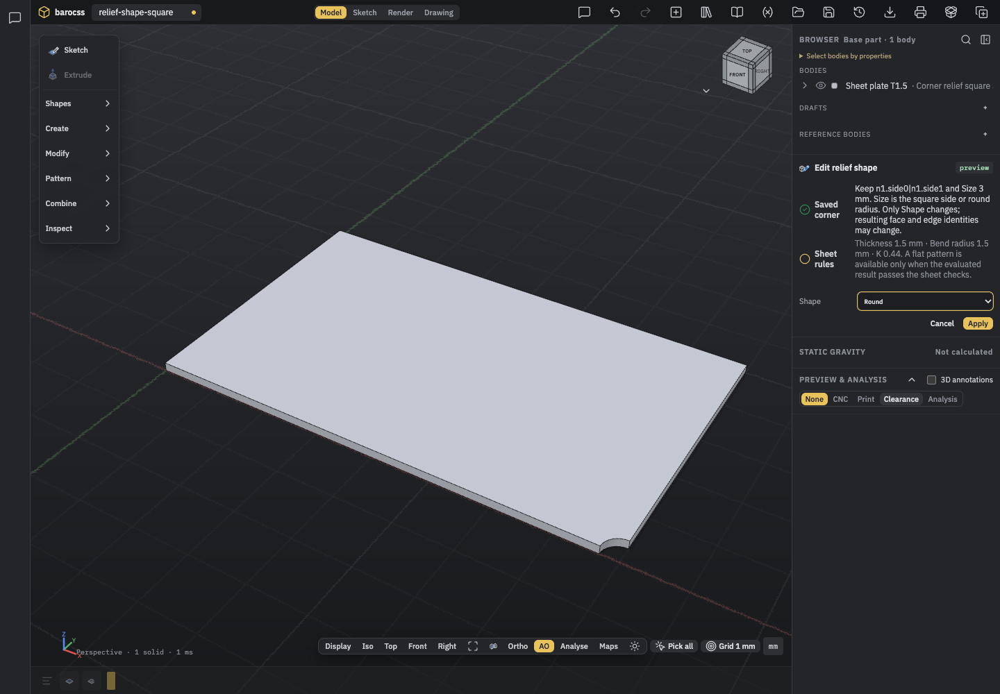
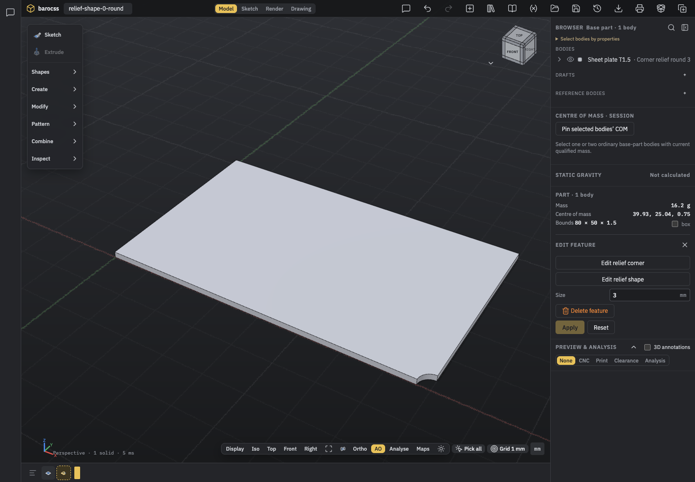

# Corner relief Shape history qualification — 2026-11-18

Existing issue #27 remains **OPEN**. This is a bounded editing improvement, not a new native relief capability or a manufacturing qualification.

## Scope

History exposes **Edit relief shape** separately from the existing **Edit relief corner**. The saved command changes only Square/Round on a terminal single Corner relief of a plain numeric XY rectangle → sheet-base → relief document. Size, corner, original signature, source nodes, outputs, IDs and sheet rules remain unchanged. A pending Size edit disables entry. Native source topology, original signature, original valid solid and flat pattern are proved before either a change or a no-op is accepted. Unsupported metadata, downstream consumers and bound dimensions remain excluded.

The synthetic actual fixture is an 80 × 50 × 1.5 mm plate, base bend radius 1.5 mm, K = 0.44, with a Size 3 relief at corner (80, 0). The plate is opened as a model file; the relief is created using actual edge picking and the command UI. No user model is included.

## Independent native oracles

- Square removes area 9 mm² at centroid (78.5, 1.5), giving volume 5986.5 mm³.
- Round removes a quarter disk of area 9π/4 mm², with inward centroid offset 4/π mm. Remaining volume is 1.5(4000 − 9π/4) mm³.
- Remaining centroid is computed by subtracting the removed area's first moments from the plate's; Z remains 0.75 mm.
- Strict BRep validity and exactly one solid are required. Square checks the complete 12-vertex set and six straight flat-boundary segments.
- Round checks native end-contact vertices, all additional boundary vertices, radius-3 Z-axis cylindrical wall geometry, one flat arc with signed sweep −π/2, four straight boundary segments, flat area and perimeter.
- Volume tolerance is 1e-7 mm³; coordinate/centroid/radius checks use 1e-8 mm. No relaxed tolerance was introduced for these actual runs.

## Actual evidence

| Run | Result | Verified scope |
| --- | --- | --- |
| Original Square baseline | PASS | Existing creation, Size field and corner button presence; Shape edit absent; native geometry, Undo/Redo, Save/fresh Open |
| Original Round baseline | PASS | Existing Round creation and independent quarter-disk geometry; Undo/Redo, Save/fresh Open |
| Fixed Shape history | PASS | Square→Round→Square→Round→Square, shape-only whole-document comparisons, each native/Undo/Redo/Save/fresh Open; Cancel, unchanged-selection Apply, pending Size entry disabled |
| Existing Corner history regression | PASS | Existing explicit corner reassignment remains available and passes its actual geometry/lifecycle checks |

All four inspected receipts report PASS and empty runtime errors. Baselines establish an editing gap, not a native creation failure. Fixed actual switching starts from Square; the independent Round baseline verifies the original Round creation path.

## Focused and outstanding verification

- Model focused tests: new Shape 5 + existing Corner 7 = **12 PASS** (reported by implementation owner).
- Studio owner tests: **18 PASS** (reported by coordinator), covering command coexistence and document/evaluated/worker/marker/variant/draft/context ownership boundaries.
- During development, a fresh helper reconstruction allowed a captured callback to miss an in-place mutation. The callback now reuses its captured command, and the independent owner test covers this boundary.
- **Model typecheck: initial FAIL, corrected final PASS.** Shared fail/never inference left a signature possibly undefined; a test values-array inferred optional undefined. An explicit return from the existing throwing branch and a Values[] annotation corrected those types without changing runtime or admission. Focused 12/12 rerun and final Model typecheck passed.
- **Studio typecheck and production Vite build: final PASS (4.65 s).** They were NOT_RUN after the first Model type failure; the final ordered rerun passed. Existing dynamic-import/directive warnings were nonfatal.
- **CI, commit and push: PENDING.** This note is not a release-completion claim.

All four corner variants and adversarial metadata/signature/mutation cases are unit coverage, not four-corner actual Shape browser coverage. Actual delayed worker delivery for this new command is not claimed. No downstream reference preservation is promised: resulting face and edge identities may change. Existing manufacturing, Physics, NURBS/schema and other HOLD boundaries remain unchanged. Issue #27 is not closed by this task.

## Synthetic screenshots

The three images were visually inspected and contain only the synthetic CAD fixture and application UI. No local filesystem locations, credentials or personal information are included.

## Reproduction entry point

`apps/cad-studio/test/sheet-relief-shape-history-browser.mjs` uses `SHEET_RELIEF_SHAPE_HISTORY_SOURCE_FROZEN=1`. Use `--baseline` for original observation, add `--round` for independent Round creation, and omit `--baseline` for fixed switching. The existing Corner driver remains a separate regression. Actual browser execution requires the coordinated heavy-test slot.
