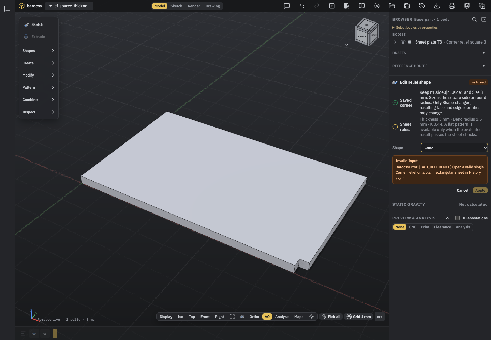
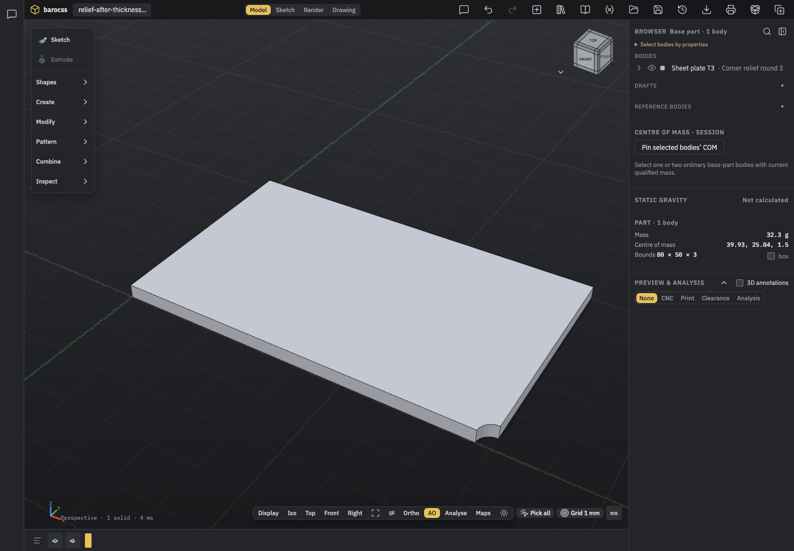

# Sheet source Thickness preserves subsequent relief editing

Existing issue #27 remains OPEN. No general reference repair, manufacturing, schema or other HOLD scope is expanded. Exact-commit CI and main push are pending at evidence preparation.

## Actual baseline: safe refusal, not geometry loss

The real UI creates a signed Square corner relief (Size 3, corner `[80,0]`) on an 80×50×1.5 mm plain sheet. Editing source Thickness to 3 is accepted: native volume 11973 mm³, flat area 3991 mm², Undo/Redo and Save/fresh Open all pass. However, the saved corner signature remains `p=[80,0,.75], s=1.5` although the parent vertical edge is now centred at Z1.5 with length3.

The subsequent **Edit relief shape → Round** preview safely refuses with BAD_REFERENCE. Original accepted geometry stays intact. Baseline receipt is observation **PASS**, not a claim that the complete editing workflow succeeded.



## Fixed actual workflow

fixed-01 is **PASS**:

- Thickness 1.5→3 updates only the proven corner signature to `p=[80,0,1.5], d=[0,0,1], s=3`, alongside the authored Thickness change.
- Square native volume 11973, flat area 3991, and independent vertex/centroid checks pass.
- After Undo/Redo and Save/fresh Open, Round preview and Apply succeed. Round volume is `3*(4000−9π/4)` =11978.794249588269 mm³.
- Round Undo restores Square; Redo and Save/fresh Open retain Round.
- The reverse Thickness 3→1.5 workflow also verifies the actual parent signatures, preserves Round through reopening, and permits Square restoration. Final Square volume 5986.5 mm³.
- The native parent signatures are collected independently in the fixed fixture, not inferred only from stored metadata.




For Square, removed planar area is 9 and removed centroid is `[78.5,1.5]`. For Round, Size is radius 3: removed area `9π/4`, centroid `[80−4/π,4/π]`. Remaining centroid follows subtraction from the 4000 mm² rectangle; Z is half Thickness. Flat checks include the full square-notch line boundary or a clockwise quarter-circle and its straight segments. Strict native BRep and the UI-visible volume are also checked.

## Narrow implementation

`state/sheetReliefThicknessHistory.ts` and the existing `state/historyFeatureApply.ts` are the only product paths changed.

Admission requires a terminal three-node plain numeric XY rectangle → sheet-base → single signed Corner relief, changing only numeric Thickness. Source, corner, shape, size, IDs, outputs and other rules remain unchanged. Unsupported or mixed dependent edits refuse atomically. An unrelated independent sheet is not blocked; dependency detection follows the existing single-parent chain, while non-three-node affected recipes remain unsupported.

The existing relief command factory is used only for metadata admission. Its synchronous native `prove()` is not invoked here. Two worker parent evaluations prove the old and new complete box topology, the same vertical corner role and the exact original stored signature. Only the newly measured signature is written to the candidate. Temporary extrude descriptions are proof descriptions, never evaluated or saved. Existing Shape/Corner proof strictness is unchanged.

Each await checks document/draft ownership and canonical revision, worker/open/scope, fresh evaluated source, marker/variant and permission. Both prefix responses and the final full evaluation must have the requested revision. Failure or stale ownership cannot commit. Final full native success precedes the single owned commit.

## Validation and review corrections

- New focused suite: **40/40 PASS**; scoped lint PASS.
- After nonconflicting #225 fast-forward integration at `255e888fc`, the focused suite was rerun: **40/40 PASS**. Browser and type/build results below belong to the earlier frozen product/fixture state; no post-integration browser rerun is claimed.
- Model and Studio type checks plus Vite build **PASS**, 4.26 s; coordinator session exited 0 and cleanup completed.
- Existing Shape and Corner actual regressions: shape-regression-01 and corner-regression-01 both **PASS**.
- All four inspected actual receipts have status PASS, no recorded errors, and context/browser/server cleanup. No baseline/fixed actual run failed in this task.
- Initial review caught an overbroad detector that would have included unrelated sheets. It was narrowed before actual execution; independent-sheet regression is included.
- A test `direct: []` type assertion was corrected before the passing type check. This did not relax runtime admission or native proof.
- Coverage is the bounded plain-sheet recipe, not arbitrary topology, bound dimensions, multiple reliefs, downstream consumers or manufacturing qualification.

Historical actual runner commands (working directory `apps/cad-studio`):

The baseline ran on pre-change main `610a11895` with the frozen baseline fixture SHA below. Running `--baseline` against the current fixed product is observation mode only and does **not** recreate the original defect. The fixed run used the frozen fixed fixture and repaired product.

```sh
SHEET_RELIEF_SOURCE_THICKNESS_SOURCE_FROZEN=1 node test/sheet-relief-source-thickness-browser.mjs "$OUTPUT" --baseline
SHEET_RELIEF_SOURCE_THICKNESS_SOURCE_FROZEN=1 node test/sheet-relief-source-thickness-browser.mjs "$OUTPUT"
```

Fixture SHA-256 from actual receipts:

- baseline-01: `6439ef15b6a875939daaae04e0d484266a2e3c16f0fea52545b89fb2ff723604`
- fixed-01: `90748dec47f286b54f1d47f3dfce664aa1fc651989172bb2f8e7d89c6f0a5e7b`
