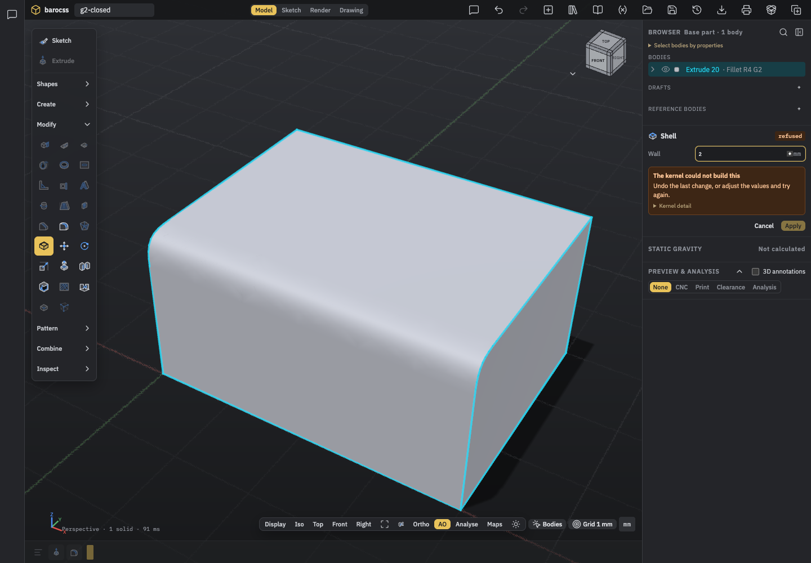
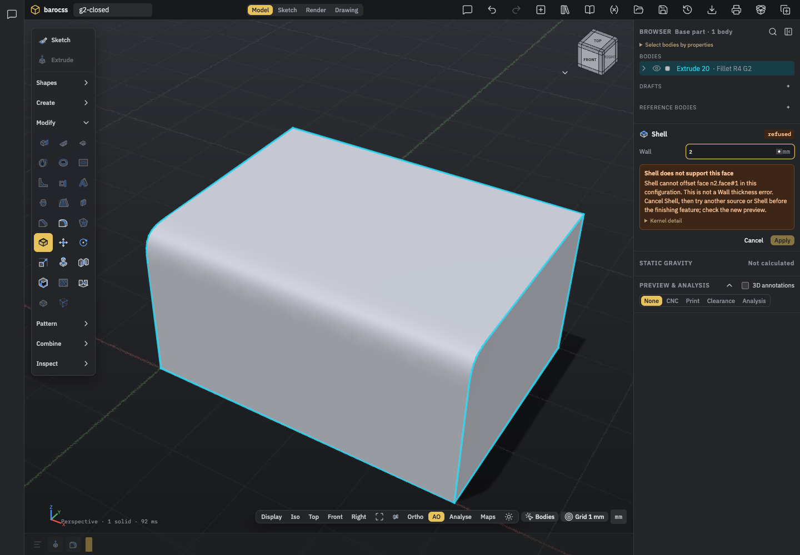

# Shell unsupported-face feedback · #126 · 2026-11-18

An exact native SHELL_FACE_KIND diagnostic now explains that Shell cannot offset the named source face in this configuration. It explicitly distinguishes this from a Wall thickness error and suggests Cancel before trying another source or Shell before the finishing feature, with a new preview check. This does not promise that reordering or another G2 shape will work.

Only the full native message, optionally wrapped with canonical `shell: `, maps to this guidance. Raw detail, code and failed-feature identity are unchanged; no owner is inferred from a face-name prefix. Existing Wall and sharp-region failures remain separate. No kernel admission, geometry, selection, schema, history or owner redesign change. The previous #78 temporary-failure-history fix is reused unchanged.

## Verification

- Focused Model tests11/11 PASS, including exact/native-wrapped message, malformed/unknown diagnostics, original detail/feature preservation, real G2 closed/top/bottom native refusal and source native/document equality, existing Wall and other guidance regressions.
- Model/Studio tsc, scoped lint/diff PASS; Vite build6.00s. Includes main5052b91 drawing changes.
- Actual Chrome baseline reproduced generic Undo/value advice for all three G2 modes. Final actual G2 closed/top/bottom Wall2 refuses with correct default face/configuration advice, preserves exact kernel detail, keeps Wall valid and Apply locked; Enter/Cancel preserve document and selected source. Strict native snapshots before/after Cancel and baseline/fixed are exactly equal.
- Conic rho.5 closed/bottom Wall2 controls both apply. Native/worker volume agrees with independent authored quadratic area/arclength and inward-offset section integral (relative1e-7). Strict closed shell counts are checked.
- Independent static review found no blocker. Read-only in-memory esbuild mutation checks ran the three pure mapping tests: original3/3 PASS, removing mapping and forcing the wrong face name each cause1FAIL/2PASS. Product/test files unchanged. Native tests are not counted in this mutation run.
- Images inspected. Receipt sources frozen and cleanup completed.

## Failures and correction

First actual baseline stopped before Shell because the command palette shortcut did not open with current focus. The fixture now invokes the existing model-rail Shell control, without changing product behavior. Baseline rerun passed.

First implementation matched the internal native text but missed the canonical `shell: ` wrapper. Focused native and actual browser checks both failed; no completion claim was made. The mapping now accepts exactly the wrapped or unwrapped native text, and both are explicitly tested. Final focused and complete browser reruns pass.

## Scope

One authored40×30×20 box, front-top Fillet R4 G2 tension.5, Wall2 and closed/top/bottom openings. Conic rho.5 controls closed/bottom only. Circular browser control, other shapes, G2 after Shell, history edits, Save/Open and general G2 Shell support are NOT_RUN. This is actionable refusal feedback, not expanded Shell geometry support. All HOLD boundaries remain.

```sh
cd packages/barocss-cad-model
node scripts/test.mjs shell-face-kind-feedback shell-wall-feedback frame-butt-guidance draft-angle-feedback
cd ../../apps/cad-studio
SHELL_FACE_KIND_SOURCE_FROZEN=1 PW_DIR="$HOME/.cache/barocss-playwright" CHROME='/Applications/Google Chrome.app/Contents/MacOS/Google Chrome' node test/shell-face-kind-browser.mjs /tmp/shell-face-kind
```



