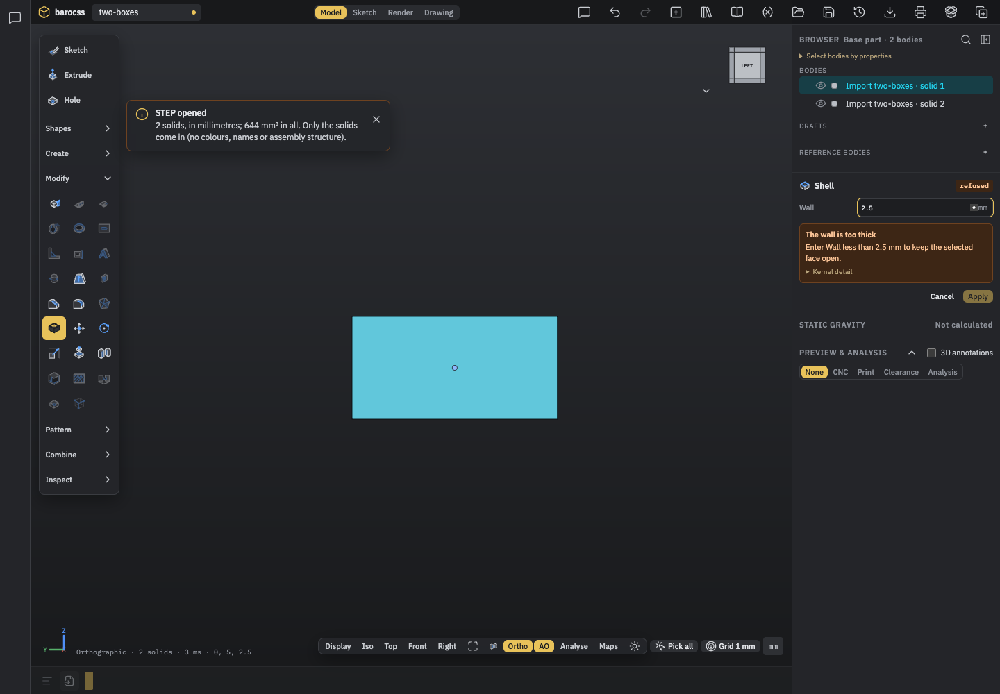
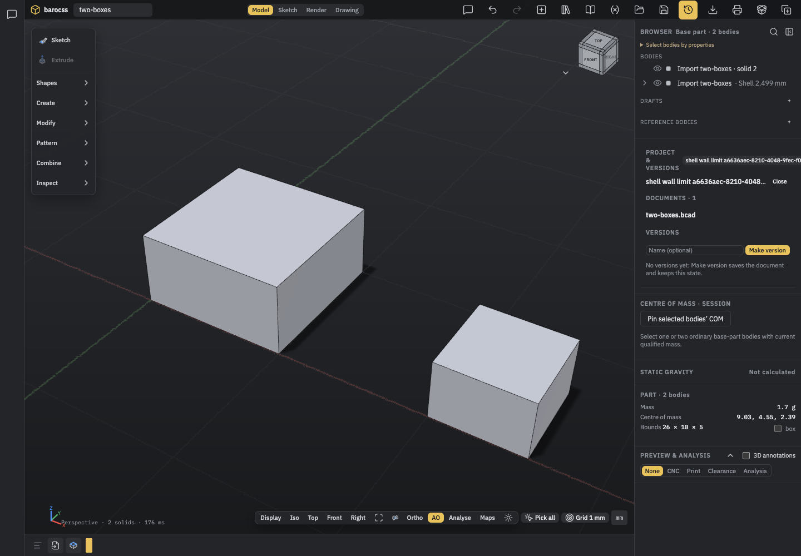

# Shell wall-limit feedback and exact labels · #78 · 2026-11-17

The imported 10×10×5mm box opened at X0 requires Wall strictly below 2.5mm. The native kernel already knows that boundary. Studio now places that exact measured limit in the default hint, keeps the raw detail, and does not invent a missing History step for the exact newly appended Shell preview. Accepted Shell and unknown/generated feature failures retain their attribution.

Numeric Shell automatic names preserve JavaScript's stored number string with mm instead of the shared rounded formatter: 2.499 reads Shell 2.499 mm, not the rejected Shell 2.5. Parameter labels retain their existing names. No kernel, native geometry, persisted value, recipe or schema changes. Shared numeric formatting is unchanged; #126 and all HOLD scopes remain untouched.

## Checks and failure record

Before product changes, two Model assertions failed (label and visible bound); Studio existing6 passed/new1 failed. Real baseline reproduced the generic hint and nonexistent History feature, with source freeze unchanged and clean shutdown. This baseline PASS means reproduction, not corrected behavior.

The new limit hint requires PARAMETER, the exact native full sentence, finite positive T and limit, and T≥limit. Raw limit token is not rounded. Generic, malformed, wrong-code and unmatched messages retain existing fallback advice. Shell preview attribution requires exactly one appended node, exact ID and unchanged accepted prefix identity; accepted/generated/unknown/mismatched candidates remain visible.

Focused Model48/48 and Studio16/16 passed, including existing engine and opening recovery tests. Independent static review found no blocker. Model and Studio tsc passed; Vite build 5.78s. The first fixed run was interrupted by a computer connection switch and left an incomplete receipt, so it is not a PASS. The second run passed the geometry/edit/Undo/Redo sequence, then the test expected an Open button for the currently active saved document. That row is a span until reload. The test now checks the actual saved filename before reload and uses Open afterward. Product code was unchanged for either retry. The History error-row assertion was also strengthened after independent driver review.

## Independent native oracle

X0 opening, wall t: cavity X=[0,10−t], Y=[t,10−t], Z=[t,5−t]. Expected volume is 500−(10−t)(10−2t)(5−2t). Every cavity corner and X0 inner/outer loops must exist; strict native BRep remains one solid. The second imported body stays volume144. Wall2.499 yields a 5.002×0.002mm opening. This validates the existing exact geometry, not new Shell capability.

Actual flow covers rejected creation2.5, accepted2, rejected History2.5, accepted2.499, Undo/Redo and OPFS Save/reload/Open. This is not a new browser process or external STEP export/interoperability test. No generalized shell limit computation or G2/kernel expansion is claimed.

## Reproduce

```sh
cd packages/barocss-cad-model && node scripts/test.mjs shell-wall-feedback engine
cd ../../apps/cad-studio && node scripts/test.mjs failed-feature opening-shell-failure
SHELL_WALL_LIMIT_SOURCE_FROZEN=1 PW_DIR="$HOME/.cache/barocss-playwright" CHROME='/Applications/Google Chrome.app/Contents/MacOS/Google Chrome' node test/shell-wall-limit-browser.mjs /tmp/shell-wall
```

Verified screenshot interpretation: the 2.499mm opening is only 0.002mm tall and appears as a narrow line at this scale. Its size and continued opening are established by native vertices and loops, not visual pixel thickness.

Final actual run PASS: exact default limit, no new missing-history row, accepted Shell failure attribution, Wall2→2.499, Undo/Redo, OPFS byte equality/reload/Open, reopened label and Wall input. Native reopening volume499.9249599959999mm³ matches analytic499.924959996mm³. No console/runtime errors, frozen sources unchanged, browser/context/server cleanup complete.



