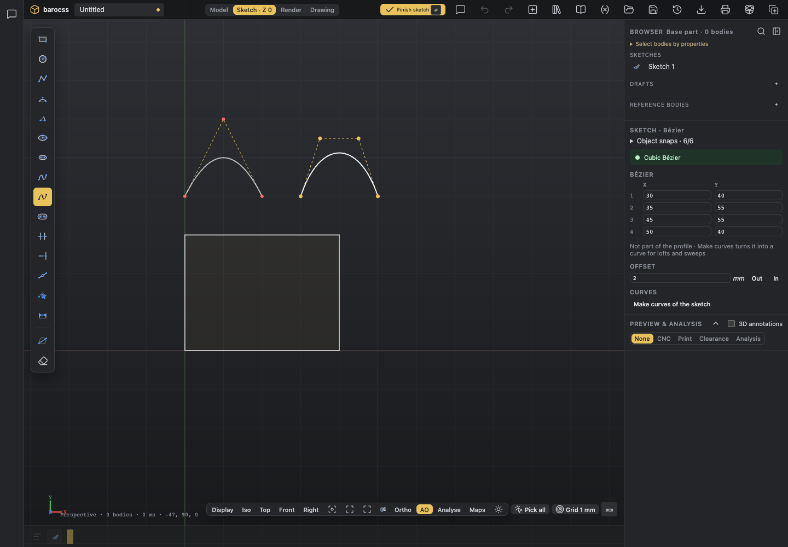
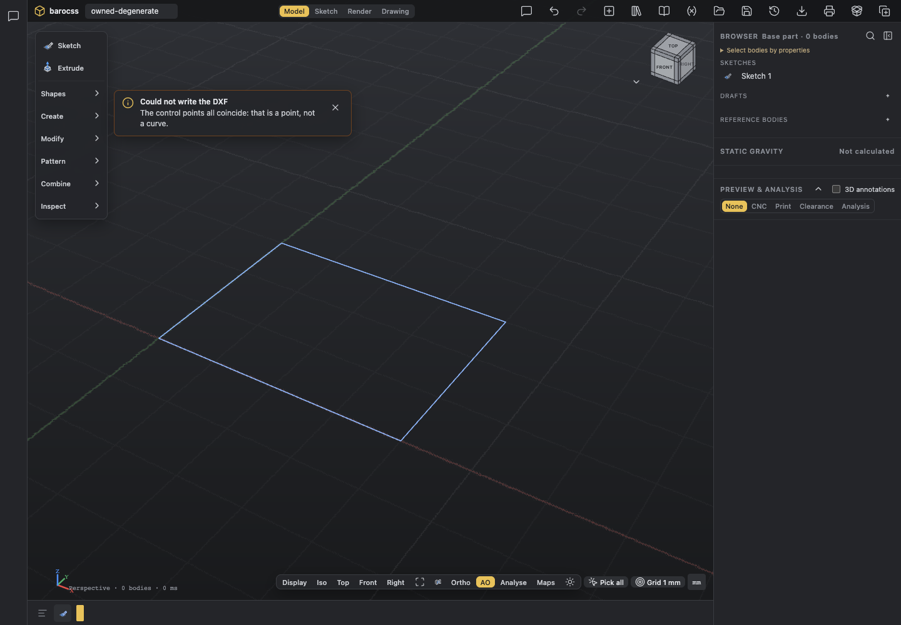

# Sketch Bézier DXF — bounded adapter acceptance

Issue #253; base `f00394b73deeae646aa4285b84a0bde8fc54b5a6`; FEATURE tier, 2026-11-17. No kernel/writer, public signature, schema or HOLD changes.

## Change

Stored quadratic/cubic Béziers now reach the existing AC1015 writer as degree 2/3 SPLINEs with local XY control points, clamped single-span knots and unit weights. `CONSTRUCTION` is the non-cutting reference export layer, not a change to native shape flags or profile semantics. No fitting, sampled polyline, world transform or automatic closure is introduced. Existing `bezierError` rejects malformed/degenerate curves before any bytes are returned. R12 without a tolerance throws the existing `R12_NEEDS_TOLERANCE` instead of silently omitting the curve. No new error-code union was added.

## Evidence

- Original skip-policy tests: 15/15 PASS before the deliberate policy change.
- Final Model `sketch-bezier` tests: 18/18 PASS. Independent group-code parsing and de Boor versus literal Bernstein checks cover Q/C, fractional/reversed/duplicate controls, local coordinates on tilted/offset planes, report counts, unit weights, valid loops/collinear cases, mixed valid/invalid whole-export refusal and R12 refusal. Source objects remain unchanged. Model type-check and affected-file lint PASS.
- Final Studio sketch-bezier regression 5/5, Studio type-check and Vite build (5.46 s) PASS. [Compact receipt and commands](qualification.json).
- Independent read-only review: no blockers. The adapter changes no other shape branch and keeps profile/offset semantics.
- Actual desktop run 02: authored rectangle plus Q/C through UI, Finish, History DXF download, native Save and fresh Open, then identical DXF bytes. Installed ezdxf **1.4.5** independently reads each file's degrees, knots, poles, weights, mm units, layer, five Bernstein sample points and endpoint tangents. Two reads PASS; DXF SHA-256 `3f82a88a0266246abd78b89ac52737e1785e37aaebd2b6634cd6dd57ecfbda4e`.
- Actual desktop run 03 resumes retained successful prerequisites rather than repeating them. A newly authored cubic's second pole is explicitly edited from Y=55 to Y=60 before Finish. The resulting DXF passes the same external reader, SHA-256 `e4c1ffbb9674850aab59478d4bfe0c1d4f45b121e3b52d0c138c6c33ca366dfb`. Previous native/DXF bytes remain unchanged.
- Run 03 opens an owned finite all-coincident curve and verifies an explicit DXF refusal, no download, unchanged document/history/dirty. Both actual runs report no browser errors or source writes and clean shutdown.

## First failures and remaining acceptance

Run 01 used the obsolete shared `.history .hs[data-node-index]` selector and timed out after authoring/Finish. The driver was corrected to the observed accessible History label. Run 02's **tested reopen → Select → curve-endpoint path did not expose the existing Bézier controls**. `activateDraftOutline` currently admits closed outlines, not this Bézier path. Other reselection routes are unqualified, not proven impossible. No product selection policy was widened here. Therefore #253 remains OPEN for the saved-curve reselect/edit/re-export acceptance path; a new-curve authoring edit is not reported as that path's PASS.

The successful steps of run 02 and resumed run 03 are separate evidence; run 02 as a whole remains FAIL. Original receipts remain unchanged. After run 03 only the driver's explanatory limitation wording was narrowed; syntax check passed, behavior was not changed.

No whole kernel suite, new generic writer feature, native geometry subprocess, manufacturing validation, external download, release, deployment or GPU/shared-code change. Existing WIP/HOLD and unrelated accuracy/golden failures are preserved.

## Actual screens

These are owned desktop fixtures, not mockups or competitor images. Pixels were reviewed for personal/authentication information before publication. Images illustrate the UI; independent file checks above establish output contents.

The two visible reference curves were exported as two SPLINE entities and retained through Save/fresh Open.

The invalid curve causes the shown refusal and no file download; document/history/dirty remain unchanged.
