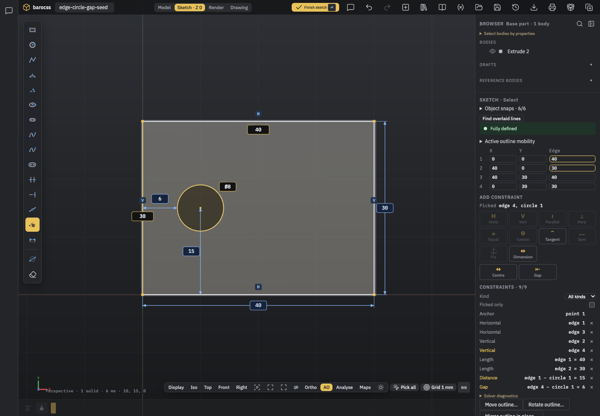
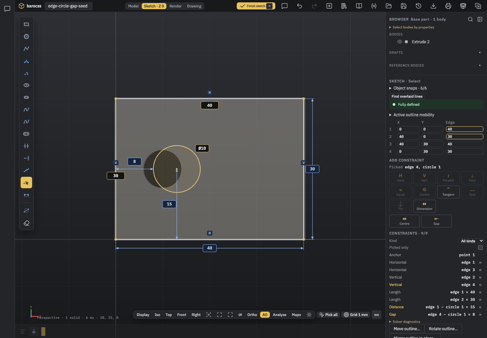
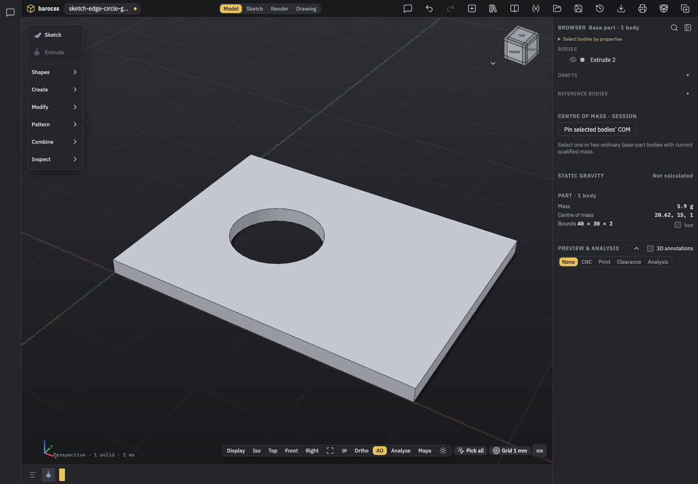

# D2014 — Sketch Edge-to-Circle Circumference Gap Driving Dimension (`#261`)

Date: 2026-11-25 · Track: P1 Sketch & Constraints · Issue: [#261](https://github.com/barocss/cad/issues/261)

## Decision

Add an explicit driving positive circumference-gap sketch rule (`EdgeCircleGapRule`, `kind: 'cgap'`) on closed outlines (`SketchOutline.rules`) that maintains the perpendicular clearance gap `G = |C[axis] - edgeCoord| - r > 0` from a horizontal or vertical straight outline edge to an attached circle's nearest circumference on a recorded side (`side: -1 | 1`), keeping `G` invariant across both gap edits and circle diameter/radius edits while leaving the existing center-distance rule (`cedge`) intact and distinct.

## Implementation summary

- **Model (`packages/barocss-cad-model`):**
  - Added [`src/sketch/edgeCircleGap.ts`](../../../../packages/barocss-cad-model/src/sketch/edgeCircleGap.ts) (`EdgeCircleGapGeometry`, `EdgeCircleGapEndpoints`, `edgeCircleGapGeometry`, `edgeCircleGapEndpoints`, `edgeCircleGapProblem`), enforcing H/V straight edge alignment, foot strictly inside the finite edge segment (`1e-6 mm` interior margin), strict positive clearance (`G >= 0.001 mm`), side preservation (`side: -1 | 1`), and post-solve residual verification (`<= 1e-5 mm`).
  - Extended [`src/sketch/terms.ts`](../../../../packages/barocss-cad-model/src/sketch/terms.ts) with `EdgeCircleGapRule` (`{ kind: 'cgap'; edge; circle; axis: 0 | 1; side: -1 | 1; value }`) and `ruleTerms` emission of `distance(..., r.value + radii[r.circle])` so editing either `G` or `r` re-solves the circle center to exact `G + r`.
  - Extended [`src/sketch/rules.ts`](../../../../packages/barocss-cad-model/src/sketch/rules.ts) with `edgeCircleGapKey` (`cgap<edge>_<j>`), `dimensionValue`, `drivingDimensionValue`, `dimensionLabel` (`Gap edge <n> – circle <j>`), `commitDimension` (refusing non-positive/non-finite values without converting to `ctan`, refusing co-existing `cedge` + `cgap` on the same edge/circle, refusing out-of-segment/non-HV/arc/crossing edits), `checkedEdit` post-solve `edgeCircleGapProblem` guard, `constraintEntries` (`Gap`), and `CIRCLE_FIELDS` cleanup.
  - Wired [`src/sketch/outlineFields.ts`](../../../../packages/barocss-cad-model/src/sketch/outlineFields.ts) (Feature Editor driving fields for `cgap` and diameter edits preserving `G`), [`src/sketch/driven.ts`](../../../../packages/barocss-cad-model/src/sketch/driven.ts), [`src/sketch/entityIds.ts`](../../../../packages/barocss-cad-model/src/sketch/entityIds.ts), [`src/sketch/corner.ts`](../../../../packages/barocss-cad-model/src/sketch/corner.ts), and [`src/sketch/mobility.ts`](../../../../packages/barocss-cad-model/src/sketch/mobility.ts).
- **Studio (`apps/cad-studio`):**
  - Extended [`src/ui/ConstraintTools.tsx`](../../src/ui/ConstraintTools.tsx) so picking a horizontal/vertical straight edge and an attached circle offers explicit **Centre** (`cedge`) and **Gap** (`cgap`) dimension actions side by side.
  - Extended [`src/ui/SketchMarks.tsx`](../../src/ui/SketchMarks.tsx) to draw `cgap` driving dimension lines strictly from the perpendicular foot on the edge to the circle's nearest circumference (`data-dim="cgap..."`, `data-dim-kind="cgap"`), visually distinct from `cedge` center lines, and anchor the inline dimension editor midway between foot and circumference.

## Verification

- **Model tests (`82/82` pass):** `sketch-edge-circle-gap` (4 comprehensive suites covering the `#261` analytic fixture, `G: 6 → 8` and `Ø: 8 → 10` edits, exact `2 mm` Extrude volume `2400 - 50π` and native cylindrical face `(13, 15), r = 5`, right/bottom/top edges, CW winding, transformed workplane, sub-display `6.125 mm` precision, Feature Editor `outlineFields`, reopen & `.bcad` JSON roundtrip, local mobility, and strict refusal suite) plus `sketch-outline-field-identity`, `sketch-reopen`, `sketch-profile-precision`, `sketch-rectangle-driving-retention`.
- **Studio unit tests (`43/43` pass):** `constraints` (including new `cgap` test), `constraint-list`.
- **Static checks & build:** `tsc --noEmit` (Model & Studio), scoped `eslint` (`ConstraintTools.tsx`, `SketchMarks.tsx`), and `pnpm build` clean.
- **Real Chrome E2E (`D2014_SOURCE_FROZEN=1`, [`test/sketch-edge-circle-gap-browser.mjs`](../../test/sketch-edge-circle-gap-browser.mjs)):**
  - Verified `Edge to circle gap` action on locked `40 × 30` sketch with attached `Ø8` hole (`C = (10, 15)`, `cedge0_0 = 15`).
  - Refused `G = 0` cleanly with alert banner and zero `cgap`/`ctan` mutation.
  - Added `cgap3_0 = 6` (`01-gap-6-added.png`), edited `G: 6 → 8` (`C = (12, 15)`, `02-gap-8-edited.png`), edited `Ø: 8 → 10` (`r: 4 → 5`, `C = (13, 15)` with `G = 8` held, `03-dia-10-gap-held.png`).
  - Verified sketch Undo/Redo, Finish sketch (`40 × 30 × 2` B-rep exact volume `2400 - 50π` & cylinder `(13, 15), r = 5`), document Undo/Redo, `.bcad` Save → fresh Open, and post-Open Feature Editor `Diameter: 10 → 12` (`C = (14, 15), r = 6`, `G = 8` preserved, exact volume `2400 - 72π`, `06-reopened-feature-edit-dia-12.png`).
- **Prior edge–circle regression (`SKETCH_EDGE_CIRCLE_MOBILITY_SOURCE_FROZEN=1`):** passed cleanly with zero regressions to `cedge` or circle mobility.

## Captured screenshots

| Added `cgap = 6` (`Ø8`) | Edited `cgap: 6 → 8` | Edited `Ø8 → Ø10` (`G = 8` held) | Post-Open Feature Editor `Ø12` |
| --- | --- | --- | --- |
|  |  |  |  |

## Boundaries

- Scoped to attached circles and horizontal/vertical straight outline edges whose perpendicular foot lies strictly inside the finite edge segment with positive clearance (`G >= 0.001 mm`).
- Non-positive values (`<= 0`), slanted edges, arcs, out-of-segment projections, outline crossings, and redundant/conflicting combinations (including co-existing `cedge` + `cgap` on the same edge/circle) are refused without mutating the sketch or converting to tangency (`ctan`).
- Stored in existing schema 3 `SketchOutline.rules`; no schema 5/migration change.
