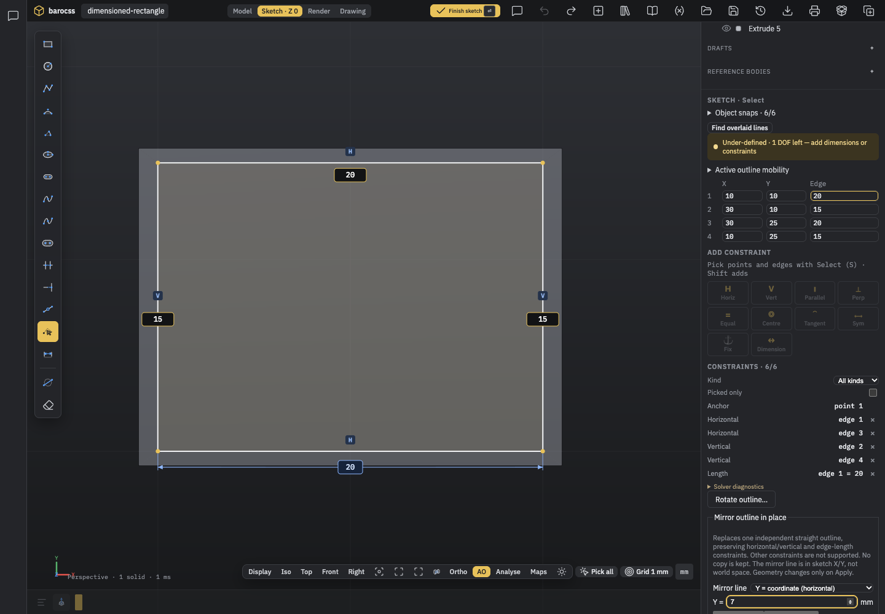
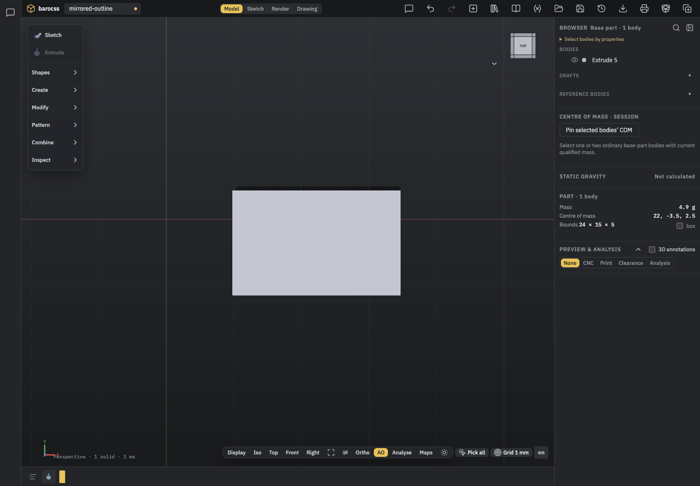

# Mirror preserving H/V and edge lengths · #634 · 2026-11-17

## Delivered boundary

Mirror in place now accepts independent straight outlines whose only explicit constraints are horizontal/vertical and numeric edge lengths. This allows ordinary Rectangle-tool H/V and a driving width without deleting constraints. Reflection remains about sketch X=coordinate or Y=coordinate; it replaces the outline, not a copy. Rotation admission is unchanged.

Metadata validation rejects invalid/nonintegral/out-of-range, duplicate or overlapping H/V indices, H/V not exactly satisfied by source coordinates, noncanonical length keys and nonpositive/nonfinite lengths. Source length residual must be within existing linear tolerance. Fix, angle and other rules, curved/derived/linked/band and multiple material outlines remain refused.

A temporary geometry-validation copy removes only these two mirror-invariant metadata fields. The returned candidate always spreads the ORIGINAL shape, preserving H/V, lengths and side IDs. For constrained inputs the existing settle must return exactly the reflected coordinates; otherwise Mirror refuses rather than silently repair or round. An off-grid 1e-8 fixture establishes this intentional conservative refusal. Solver/kernel/schema policies are not changed. Existing HOLD and parallel WIP remain intact.

## Verification and first failure

- Initial integration TypeScript failed before any browser run: heterogeneous invalid-length test fixtures inferred optional undefined properties. Fixed by explicitly typing the deliberately malformed fixture records; no product change was needed.
- Final Studio tsc PASS; focused `mirror-outline rotate-outline outline-rotation-commit sketch-edit-identity constraints` **77/77 PASS**; changed-file ESLint/diff check PASS; production build PASS (10.73 s).
- Actual Chrome: existing free-outline regression PASS and new H/V/length workflow PASS, first browser executions. Both source-frozen, no runtime/console errors, proper cleanup.
- Independent source/solver and UI/ownership reviews PASS. H/V-only rectangle and H/V+length preserve exact coordinates and metadata; non-axis-aligned 3-4-5 length-only triangle covered in units.
- Mutations: **3 killed, 1 survived**. Metadata validation bypass, dropping lengths, and skipping settle guard were killed. Removing only source length-residual checking survived because the later exact-settle guard rejected the same stale fixture. This redundant-defense survivor is explicitly retained, not counted as killed. Before/after baselines 15/15; source hash unchanged.

This is focused validation, not full Model/kernel/repository certification. Only Studio feature/helper/tests changed. Historical evidence notes are not retroactively rewritten.

## Actual consumer and numeric checks

The new driver opens a Rectangle-tool-equivalent H/V-only rectangle, mirrors it, Finishes and checks retained rectangle bounds. Then it opens the same rectangle with edge 1 length=20, exercises input/Enter/Cancel/Escape, X=0 and Y=7 reflection, draft Undo/Redo and pending Rotate draft retirement. Finish preserves H/V and the driving length. Native validity, independent shoelace area×5 volume, eight expected vertices and each side ID's reflected wall endpoints pass.

Physical native Save and fresh-context Open preserve the full reflected document and editable snapshot. Re-editing the same edge dimension 20→24 updates the expected coordinates, retains H/V, produces volume 24×15×5 and passes document Undo/Redo. Saving AGAIN after this width change and named-wall identity after resizing are NOT_RUN, not claimed. Explicit fixed-point input still refuses without altering the accepted document.

The reflection can move the outline outside the current sketch camera; automatic refit is not added. The browser continues through native geometry and reopened views. Screenshots are visual evidence, not the numerical oracle. The form's bottom can continue below the scrollable panel; input and button actions were exercised by the driver.

## Reproduce

After the Studio build, Node 22, installed Playwright and Chrome:

```sh
cd apps/cad-studio
OUTLINE_MIRROR_SOURCE_FROZEN=1 PW_DIR="$HOME/.cache/barocss-playwright" CHROME='/Applications/Google Chrome.app/Contents/MacOS/Google Chrome' node test/sketch-outline-mirror-browser.mjs /tmp/mirror-free
MIRROR_CONSTRAINTS_SOURCE_FROZEN=1 PW_DIR="$HOME/.cache/barocss-playwright" CHROME='/Applications/Google Chrome.app/Contents/MacOS/Google Chrome' node test/sketch-mirror-constraints-browser.mjs /tmp/mirror-constraints
```



