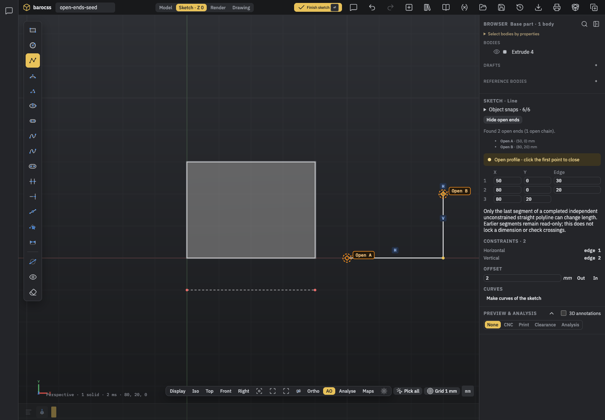
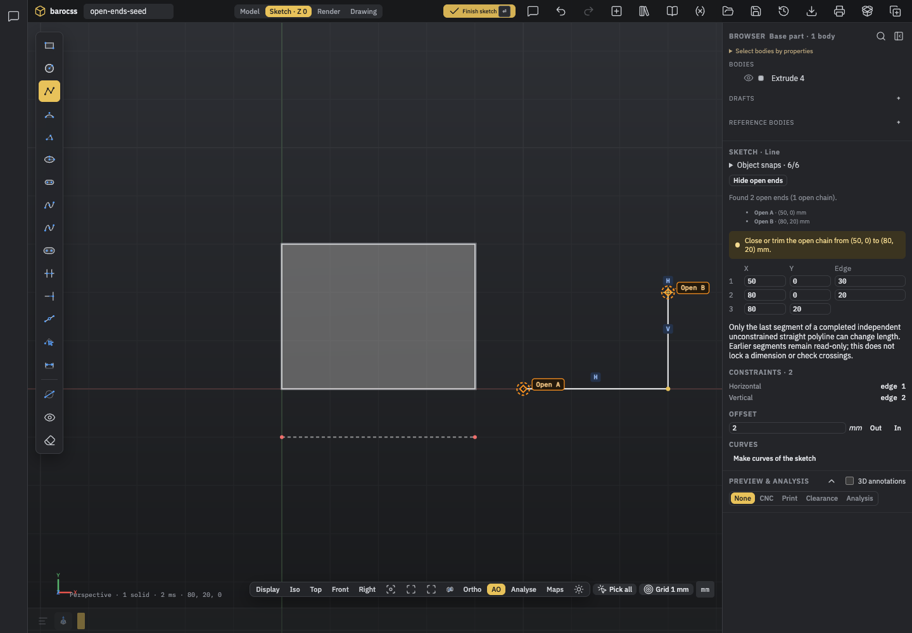
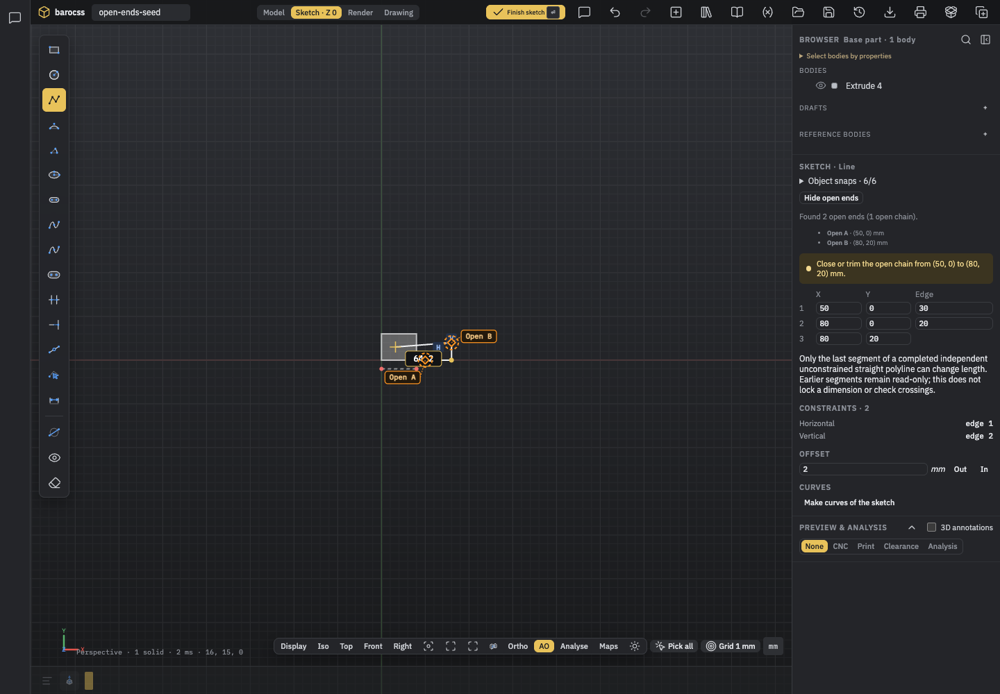
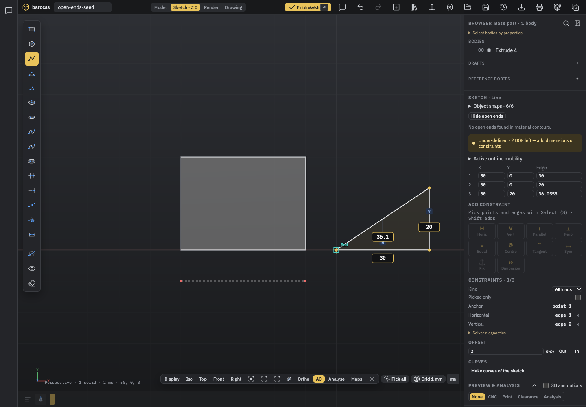

# D2015 — Sketch Find Open Ends Canvas Diagnostic (`#748`)

Date: 2026-11-25 · Track: P1 Sketch & Constraints · Issue: [#748](https://github.com/barocss/cad/issues/748)

## Decision

Add a session-only **Find open ends** diagnostic in Sketch mode that marks the open endpoints of unclosed material Line/Arc chains directly on the sketch canvas using the exact same `sketchFinishInputs` (`joinOpen`) and `unfinishedMaterialChains` eligibility as Finish, without auto-closing, forced snapping, adding constraints, changing schemas, or mutating document/undo state.

## Implementation summary

- **Shared eligibility (`apps/cad-studio/src/app/sketchOpenGuidance.ts`):**
  - Exported `unfinishedMaterialChains(shapes)` and shared it between Finish (`useSketchActions.ts`), `openChainFinishGuidance`, and `findSketchOpenEnds` so Finish and Find Open Ends always agree on the exact open chains.
- **Detection & label separation (`apps/cad-studio/src/sketch/openEnds.ts`):**
  - Added `findSketchOpenEnds(sketch)` (`OpenEndRole`, `SketchOpenEnd`, `SketchOpenEndChain`, `SketchOpenEndsReport`), ignoring closed outlines (including self-intersecting polygons), open construction geometry, band sketches, and endpoints already joined by `joinOpen`.
  - Added `openEndLabelOffsets(screenPoints)` to push close screen-space badges to opposite sides when zoomed out.
- **Session lifecycle (`apps/cad-studio/src/sketch/useSketchOpenEnds.ts` & `useSketchActions.ts`):**
  - Added `useSketchOpenEnds` keyed by `(doc, editNode, plane)` so markers update live as open ends are closed or undone/redone within the same sketch session, auto-activate only on Finish open-chain refusals (`finishOpenChainToken`), hide cleanly on toggle or `Esc` (`cancelAction`), and clear automatically on sketch exit, sketch switch, or document change with zero doc/constraint/undo mutations.
- **UI & canvas overlay (`OpenEndsControls.tsx`, `StudioSketchInspector.tsx`, `sketchOverlay.tsx`, `Viewport.tsx`, `SceneViewport.tsx`, `styles.css`, `App.tsx`):**
  - Added `Find open ends` / `Hide open ends` toggle and live status + coordinate list in the Sketch panel.
  - Rendered zoom-invariant dashed ring + hollow diamond + text pill markers (`data-open-end`, `pointer-events: none`) so markers remain distinct by symbol and text at any zoom level without intercepting clicks or object snaps.

## Verification

- **Studio unit tests (`7/7` pass):** `sketch-open-ends` (4 suites covering mixed closed rect + open arc chain + open construction line, `joinOpen` closed & partial chain parity with Finish, closed self-intersecting polygon & band sketch non-misdiagnosis, multi-chain labels, close screen-space badge separation, and zero state mutation) + `overlaid-lines`.
- **Static checks & build:** `tsc --noEmit`, scoped `eslint`, and `pnpm build` clean.
- **Real Chrome E2E (`D2015_SOURCE_FROZEN=1`, [`test/sketch-open-ends-browser.mjs`](../../test/sketch-open-ends-browser.mjs)):**
  - Verified closed `40 × 30` rectangle + open construction line reports `0` open ends.
  - Drew open material chain `(50, 0) → (80, 0) → (80, 20)`: `Find open ends` marked ONLY `Open A (50, 0)` and `Open B (80, 20)` with ring + diamond + text + `pointer-events: none` and zero mutation to doc or Undo (`01-open-ends-found.png`).
  - Clicked Finish while open: Finish refused with guidance and markers auto-appeared (`02-finish-refusal-auto-marks.png`).
  - Zoomed out strongly: verified both markers retained symbol + text with non-overlapping pill badges (`03-zoomed-out-markers.png`).
  - Clicked directly on `Open A (50, 0)` (proving markers do not intercept clicks/snaps): chain closed cleanly and markers vanished live (`04-closed-no-open-ends.png`).
  - Verified Undo (`Meta+z`) restored 2 markers live, `Esc` hid markers without exiting sketch, Redo + Finish persisted the closed second region, and opening a new sketch had `0` stale markers.
- **Prior D2014 regression (`D2014_SOURCE_FROZEN=1`):** passed cleanly (with deterministic `window.__studioDoc` wait for Feature Editor diameter commit).

## Captured screenshots

| User-requested `Find open ends` | Finish refusal auto-display | Zoomed-out separated badges | Closed by clicking `Open A` (`0` open ends) |
| --- | --- | --- | --- |
|  |  |  |  |

## Boundaries

- Scoped to unclosed material Line/Arc chains in the active sketch matching Finish's `joinOpen` + `unfinishedMaterialChains` contract.
- No auto-close, forced snap, constraint addition, post-import repair, or schema change.
